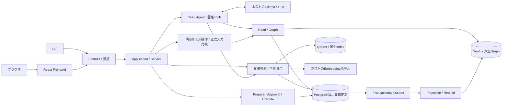

# LineScope

[](https://github.com/philippos2/line-scope/actions/workflows/ci.yml)

**設備・工程・製品の関係から影響範囲を調べ、根拠付きで対応判断を支援するライトウェイト・オントロジーシステムのデモ。**

「加工設備が停止した。どの工程や製品へ影響するか。代替設備を使えるか。修理・交換の費用や制約はどう違うか」という問いを、業務データ・依存Graph・文書・決定論的計算から調べます。最終判断はエンドユーザー、承認は承認者、実行は元の依頼者が行います。

- [画面から試す・起動ガイド](docs/getting-started.md)
- [設計FAQ：構成と設計判断の理由](docs/design-faq.md)
- [文書入口：要件・設計・実装設計の正本](docs/deliverables.md)

> 実PostgreSQL・Neo4j・Embedding／Qdrant・ローカルLLMに接続します。2台のトラブルから影響Graph・時間当たり損失・対応案比較・承認付き変更・再調査まで、代表経路を実ブラウザで確認しています。利用者の受入確認と一般的な品質保証は区別します。[到達点と残項目](docs/roadmap.md)

## 主な機能と検証対象

- **業務情報の参照**：設備・状態・工程・生産作業・製品・インフラ・保全情報を、認可付きで取得します。
- **関係と影響の調査**：下流影響・上流依存・共通依存・一段代替・単一障害点（SPOF）候補を、代表経路とともに表示します。
- **正式入力による比較**：経済・能力・安全・対応計画／故障履歴を選び、共通期間の費用・条件・不足情報を比較します。
- **文書検索と引用**：実Embedding／Qdrantで検索し、正本の有効な文書版と本文を照合して引用します。
- **承認付き更新**：変更準備、保存内容の確認、承認、実行、更新後の再取得を分けて操作します。
- **監査と同期**：version・Snapshot・業務監査・履歴・Outboxを使い、更新の整合性とGraphへの反映を管理します。

Graphの到達や構造上の代替成立だけで、実際の停止・十分な能力・安全性を認定しません。未登録値は不明として扱い、不明と0、探索不完全と影響なしを区別します。

## システム構成とデータの正本



| 構成要素 | 役割 |
|---|---|
| PostgreSQL | 業務データ、正式入力、更新要求、承認、監査、履歴、Outbox、文書metadataの正本 |
| Neo4j | PostgreSQLから再構築できる依存関係の派生Graph |
| Qdrant | 管理対象の文書本文とmetadataから再構築できる検索Index |
| LLM | 自然言語の調査でToolを選択し、取得結果を説明 |
| Embeddingモデル | 文書と検索文をベクトルへ変換 |
| React / React Flow | 関係・経路・比較・根拠・変更操作の表示 |

BackendはPython / FastAPI / Uvicorn、SQLAlchemy Core / Psycopg 3を使用します。FrontendはReact / TypeScript / Vite、起動と検証はDocker Composeを使用します。

構成の詳細は[アーキテクチャ](docs/design/architecture.md)、業務テーブルの関係は[DBスキーマ・ER図](docs/design/data-model.md#13-適用済み業務スキーマのer図)を参照してください。

## Agentと確定処理の分担

自然言語の調査では、LLMが登録済みのRead / Graph Toolを選びます。任意SQL / Cypher、Approval / ExecuteをLLMへ公開しません。

画面で明示選択したGraph対象や正式入力は、LLMにIDを再生成させずサーバへ渡します。探索、数値計算、引数検証、認可はサーバ側の決定論的処理です。

```text
調査・比較・根拠の確認
  → 明示的Prepare（変更前後を保存。業務値はまだ変更しない）
  → 承認者のApproval（保存Snapshotのhashを確認）
  → 元requesterのExecute（version等を再検証して確定）
  → 関係・入力・比較の再取得
```

承認は成立後30分で期限切れになります。同一要求の複数Targetは一つのTransactionで扱い、確定した変更結果と、その後の現在値を分けて確認できます。

- [Agent設計](docs/design/agent-design.md)
- [API / Tool契約](docs/implementation-design/api-tools.md)
- [Transaction・承認・同期の設計](docs/implementation-design/transaction-design.md)

## 画面から試す

[起動ガイド](docs/getting-started.md)に従ってサービスとFrontendを起動し、ブラウザで `http://127.0.0.1:5173` を開きます。初回は私有設定のtokenで接続します。

1. 「設備を探す」に設備名の一部、または設備コード全体を入力して検索し、設備を選びます。
2. 関係図で停止による影響先と上流の依存先を確認します。登録状態は別に表示します。
3. 図の直下で推定損害額と代替候補の提案を確認します。
4. 必要能力・空き能力、評価した製品、未確認の安全・品質条件を確認します。
5. 補助タブから比較・出典・入力の訂正・承認付き変更へ進みます。

[デモデータ](docs/demo/scenario1.md)はM-204が主軸異常で停止し、稼働中のM-208を代替候補として示す構成です。能力の評価はP-100について行い、P-200は今回選択した能力入力では評価しません。

## APIを直接呼ぶ

画面と同じBackendをcurlからも利用できます。[起動ガイド](docs/getting-started.md)で環境とBearer tokenを準備してから実行します。

```sh
curl -sS http://127.0.0.1:8000/agent \
  -H "Authorization: Bearer $LINESCOPE_TOKEN" \
  -H 'Content-Type: application/json' \
  -d '{"message":"M-204の異常について影響・修理・交換・代替を比較して"}'
```

この設備コード付き比較経路はLLM未設定でも動作します。入力が未選択なら登録候補と不明を返し、固定費用・能力・安全で補完しません。一般的な自然言語調査にはLLM設定が必要です。

共通応答は`answer`、`data`、`evidence`、`warnings`、`errors`、`request_id`、`context_id`、`status`を持ちます。比較の`data.decision_package`に判断材料と不足情報を返します。

- [API操作・承認・実行の例](docs/getting-started.md#apiを直接呼ぶ)
- [応答・再送・エラーの契約](docs/implementation-design/api-tools.md)

## デモシナリオ

| シナリオ | 確認する振る舞い |
|---|---|
| 関係と影響 | 設備停止から到達する工程・生産作業・製品と、上流インフラを区別 |
| 共通依存・代替・SPOF | 複数の重要対象と除外条件から、構造判定・経路・不明事項を確認 |
| Graphからの対象引継ぎ | 起点のGraphを保持して別設備を比較・入力の対象にし、旧対象の条件を消去 |
| 正式入力の比較 | 費用・能力・安全・計画／履歴を共通期間で比較し、未知・未評価を保持 |
| 承認付き変更 | Prepare→承認前拒否→Approval→Execute→再送→再取得・再比較 |
| 文書と根拠 | 実Embedding／Qdrant検索、有効版の照合、引用、版更新・Index再構築 |

全体の業務受入は[Business Scenario](docs/implementation-design/business-scenarios.md)に定義しています。代表デモの成功を、全シナリオや任意の自然言語質問への品質保証とは扱いません。

## セットアップ・データ準備・起動

Docker Engine・Compose v2、ホストのPython 3、自然言語調査と文書検索を試すためのOllamaを使用します。モデルは自動取得しません。

- [通常環境の起動・データ投入・Graph構築](docs/getting-started.md#通常環境の起動)
- [ブラウザでの接続・操作](docs/getting-started.md#ブラウザで操作する)
- [LLMの接続設定](docs/getting-started.md#ローカルllm)
- [実Embedding／Qdrantを含む常設環境](docs/getting-started.md#全部品を含む常設環境)
- [ログ・停止・再起動](docs/getting-started.md#ログ停止再起動)

通常構成は`compose.yaml`、Frontendの追加構成は`compose.frontend.yaml`、実Vector経路の追加構成は`compose.rag.yaml`です。API / migration / Projectionはコンテナで実行し、LLM / EmbeddingはホストのOllamaへ接続します。

## テストと実接続検証

Backendの自動テストは、独立した使い捨てPostgreSQL / Neo4j等を使用します。通常環境の資格情報・volumeは共有しません。

```sh
docker compose -f compose.test.yaml build tests
docker compose -f compose.test.yaml run --rm --no-deps tests ruff check backend scripts
docker compose -f compose.test.yaml run --rm --no-deps tests ruff format --check backend scripts
docker compose -f compose.test.yaml run --rm tests
docker compose -f compose.test.yaml down --volumes --remove-orphans
```

LLMを使わず、実DB・HTTPの最小経路を専用環境で確認する場合は、次を実行します。終了時にその専用環境を削除します。

```sh
python3 scripts/verify_minimal_flow.py
```

- [決定論的テストの範囲](docs/implementation-design/test-plan.md)
- [実モデルの評価方法](docs/implementation-design/evals.md)
- [実モデルを含むデモ受入](docs/getting-started.md#実モデルを含む一括デモ受入)
- [Frontendの検証・実ブラウザ手順](frontend/README.md)
- [検証結果と既知の失敗の履歴](docs/history/README.md)

## CI

[GitHub Actions](.github/workflows/ci.yml)は、変更範囲に応じてBackend・runtime・Frontendを検証し、`Tests and migrations`へ集約します。PRタイトルも検証します。

BackendはDocker内のRuff・実DBテスト・migration、runtimeは配布imageの起動、Frontendはlint・型・format・buildを確認します。Backendテストは独立環境の2 shardで実行します。

文書だけの変更ではBackend・runtimeの検証jobを省略します。Frontendの検証、対象判定、集約checkは実行します。実LLM・Embeddingの品質検証は通常CIへ必須化していません。[開発・CI運用](CONTRIBUTING.md)

## 制限とスコープ外

- **デモ・習作の範囲**：単一工場の架空データを対象とします。実設備の制御、本番MES / ERP接続、複数工場・マルチテナントは対象外です。
- **判断の範囲**：構造成立・登録条件による計算結果を提示します。実設備の安全や運転許可、未確認の品質は認定しません。
- **LLMの制限**：Read Agentの上限は既定120秒です。モデル応答の形式不正・Tool選択ミス・時間切れが残ります。
- **品質の範囲**：任意質問への成功、一般検索品質の数値閾値、商用SLA・高負荷運用は保証しません。
- **過去分析の範囲**：現在登録された情報を指定時点で評価します。当時の状態を完全復元するものではありません。
- **データの範囲**：在庫・受注・BOMの完全管理や、材料・在庫・調達を含むSupply Chain Operational Intelligenceはv1の対象外です。

範囲の正本は[要件定義](docs/requirements/requirements.md)、実装と受入確認の状況は[ロードマップ](docs/roadmap.md)を参照してください。

## リポジトリ構成

```text
line-scope/
├── backend/           # API・業務処理・Graph・Agent・外部接続とテスト
├── frontend/          # React / React Flowの操作画面
├── docs/
│   ├── design-faq.md  # 設計判断の説明と正本への案内
│   ├── requirements/  # 要件・業務概念・権限・受入基準
│   ├── design/        # アーキテクチャ・データ・Agent・画面設計
│   ├── implementation-design/  # API・Transaction・RAG・検証・運用
│   └── history/       # 個別の作業・判断・検証記録
├── scripts/           # 資格情報生成・デモ疎通・受入検証
├── .agents/skills/    # Coding Agentの開発・レビュー・検証手順
├── compose.yaml
├── compose.frontend.yaml
├── compose.rag.yaml
└── compose.test.yaml
```

## 設計・検証資料

### 最初に読む

- [起動・操作ガイド](docs/getting-started.md)
- [設計FAQ](docs/design-faq.md)
- [M-204停止とM-208代替候補のデモデータ・調査API](docs/demo/scenario1.md)
- [文書入口・正本の責務](docs/deliverables.md)
- [実装・受入確認のロードマップ](docs/roadmap.md)

### 要件と設計

- [機能要件・業務要件](docs/requirements/requirements.md)
- [業務概念・Graph関係の意味](docs/requirements/domain-model.md)
- [Use Case](docs/requirements/use-cases.md)
- [権限・承認要件](docs/requirements/access-control.md)
- [受入基準](docs/requirements/acceptance-criteria.md)
- [非機能要件](docs/requirements/non-functional-requirements.md)
- [アーキテクチャ](docs/design/architecture.md)
- [DBスキーマ・ER図](docs/design/data-model.md)
- [Agent設計](docs/design/agent-design.md)
- [Frontend画面設計](docs/design/frontend-console.md)

### 実装設計と検証

- [API / Tool契約](docs/implementation-design/api-tools.md)
- [Transaction・承認・Outbox・同期](docs/implementation-design/transaction-design.md)
- [処理シーケンス](docs/implementation-design/interaction-flow.md)
- [LLMへの指示設計](docs/implementation-design/prompt-design.md)
- [RAG・文書の正本照合](docs/implementation-design/rag-design.md)
- [決定論的テスト計画](docs/implementation-design/test-plan.md)
- [Business Scenario](docs/implementation-design/business-scenarios.md)
- [実モデルの品質評価](docs/implementation-design/evals.md)
- [運用・ログ・復旧](docs/implementation-design/operations.md)
- [変更・検証履歴](docs/history/README.md)

### 開発

- [開発ガイダンス](AGENTS.md)
- [開発・PR・CI運用](CONTRIBUTING.md)
- [Frontendの起動・検証](frontend/README.md)

開発用SkillはCoding Agentの作業手順であり、LineScope実行時のAgent機能とは別です。
