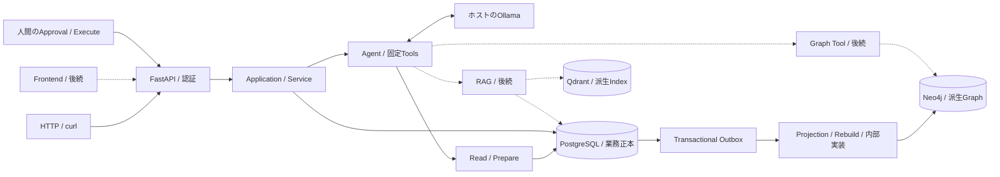

# LineScope

[](https://github.com/philippos2/line-scope/actions/workflows/ci.yml)

**設備・工程の依存関係と根拠をつなぎ、製造現場の意思決定を支援するプロダクト。**

設備異常時に「どこまで影響するか」「どの対応が可能か」を調べ、Evidenceを確認して、人間の判断と承認付き変更へ進むことを目指しています。PostgreSQLの業務Object、Neo4jの依存Graph、文書検索、AI Agentを組み合わせる、単一工場のデモです。

> **バックエンドを開発中です。** 認証付きAgent API、業務データの参照、一部の更新Prepare、人間によるApproval / Executeを実装しています。GraphのProjection・Rebuild・分析用読取基盤も実装していますが、Graph ToolのAgent接続、RAG、能力・経済・対応案比較、Frontendは未完了です。紹介動画は今後作成します。

## 主な機能と実装状況

| 領域 | 現在の実装 |
|---|---|
| 業務データ参照 | 設備・状態・保全・工程・生産作業・製品・インフラ・依存関係のRead Tools |
| 自然言語調査 | `POST /agent`からOllamaを使うRead Agent。回答・Evidence・公開Tool Trace・追加情報要求を返す |
| 更新Prepare | 明示的な設備状態変更、保全予定変更、生産作業予定変更をAgent APIへ接続。その他のPrepareには内部実装もある |
| 人間の変更操作 | 保存済みSnapshotの閲覧、承認／拒否、requesterによる実行。version検証・監査・Outboxを含む更新Transaction |
| Graph基盤 | Outbox、Neo4j Projection、generation管理、Rebuild / Restore、CURRENT確認・shared lock下の分析用読取と上限付き隣接関係取得。内部部品であり公開Graph分析は未完了 |
| ログ・監査 | request_id付きJSON運用ログ、Tool・更新・workerの操作イベント、DB業務監査・確定結果 |
| デモデータ | `seed-demo`でM-204・M-208と現在状態を投入。工程・製品・依存関係の業務デモ一式は未整備 |
| 今後の実装 | Graph Tool、Qdrant / embedding、業務判断支援の計算・比較、React等によるFrontend、業務シナリオの通し検証 |

影響・能力・リスク・損失・修理／交換／継続／代替の比較はプロダクト要件に含みますが、必要な業務規則にはPO判断待ちが残ります。未実装とスコープ外を区別します。[要件定義](docs/requirements/requirements.md)・[Use Case](docs/requirements/use-cases.md)

## システム構成とデータの正本

以下は設計上の構成です。破線のRAG・公開Graph Tool・Frontendは後続です。Projection / Rebuildは内部実装があり、標準Composeへの常駐worker接続は後続です。



| 層 | 技術・責務 |
|---|---|
| Backend | Python / FastAPI / Uvicorn |
| DBアクセス | SQLAlchemy Core / Psycopg 3。通常queryはCoreを標準とし、合理的なPostgreSQL固有処理等にはbind付きRaw SQLを使用 |
| 正本 | PostgreSQL。業務データ・更新要求・承認・監査・履歴・Outbox |
| 派生Graph | Neo4j。PostgreSQLから再構築可能な依存関係のRead Model |
| 派生文書索引 | Qdrant。RAG用Vector Index。pgvectorは採用しない |
| LLM | Ollamaアダプター。具体モデルの採用・品質評価は別途実施 |
| 検証・実行 | Docker Compose / pytest / Ruff / GitHub Actions |

Graphは同期状態CURRENTの場合だけ正常利用します。現在状態の正本はPostgreSQLです。LLMには任意SQL / Cypher、Approval / Executeの実行権限を与えません。[アーキテクチャ](docs/design/architecture.md)・[トランザクション設計](docs/implementation-design/transaction-design.md)

## DBスキーマ・ER図

設備と現在状態、保全予定・実績、工程・生産作業・複数設備割当、製品、インフラ、型付きDependencyRelationを管理します。更新要求・承認・監査・実行履歴・Outboxは別の管理テーブルです。

**[業務10テーブルのER図](docs/design/data-model.md#13-適用済み業務スキーマのer図)**

図はSQLのFKを示し、全管理テーブルを含みません。DependencyRelationの多態的参照と探索方向は[ドメインモデル](docs/requirements/domain-model.md)を参照してください。

## 実装済みのRead Tools

| Tool | 動作 |
|---|---|
| `get_equipment` / `get_equipment_state` | 設備と現在状態のID参照 |
| `get_maintenance_plan` | 保全予定のID参照 |
| `get_process` / `get_production_operation` | 工程・生産作業のID参照 |
| `get_product` / `get_infrastructure_resource` / `get_dependency_relation` | 製品・インフラ・依存関係のID参照 |
| `get_operation_equipment_assignments` | 生産作業の設備割当と親versionの参照 |
| `search_equipment` / `search_maintenance_plans` / `search_maintenance_records` / `search_dependency_relations` | 条件検索・署名cursorによるページング |

Toolは個別のHTTP endpointとして公開せず、固定dispatcherから呼び出します。入力検証・認可を実行側で行い、構造化Evidenceを返します。過去時刻の参照は現在登録情報の期間評価であり、当時の状態を完全復元するものではありません。[API / Tool契約](docs/implementation-design/api-tools.md)

## Agentと承認付き変更

通常の調査ではLLMが登録済みRead Toolを選び、結果を観測して回答します。更新Prepareは元の入力に対する保守的な明示コマンド判定と認可を通して処理します。任意の日本語表現をすべて変更命令として受理する仕様ではありません。

```text
調査・Evidence確認
    → Prepare（before / afterを固定、業務値は未変更）
    → 人間のApproval（Snapshot hashを確認）
    → requesterのExecute（versionを再検証して更新）
```

承認は成立後30分で期限切れになります。確定済みafter Snapshotと、その後に観測した現在値は別です。複数Targetは一つの業務Transactionとして扱います。

## APIを直接呼ぶ

以下は後述のセットアップ後、ホストから実行します。`.env`の`LINESCOPE_USERS`にあるtokenを設定してください。tokenをGitや共有ログへ保存しないでください。

```sh
BASE_URL='http://127.0.0.1:8000'
LINESCOPE_TOKEN='<.envにあるBearer token>'

curl -sS "$BASE_URL/health" \
  -H "Authorization: Bearer $LINESCOPE_TOKEN"

curl -sS "$BASE_URL/health/ready" \
  -H "Authorization: Bearer $LINESCOPE_TOKEN"

# 自然言語調査には後述のOllama設定が必要
curl -sS "$BASE_URL/agent" \
  -H "Authorization: Bearer $LINESCOPE_TOKEN" \
  -H 'Content-Type: application/json' \
  -d '{"message":"M-204の現在状態を調べて"}'

# floor / maintenance / managerのいずれかで設備状態の変更準備を作成
# この呼出しだけでは業務値は変わらず、LLM設定も不要
curl -sS "$BASE_URL/agent" \
  -H "Authorization: Bearer $LINESCOPE_TOKEN" \
  -H 'Content-Type: application/json' \
  -d '{"message":"設備M-204の状態をRUNNINGに変更して"}'
```

共通応答は`request_id`、`context_id`、`status`、`answer`、`data`、`evidence`、`warnings`、`errors`を持ちます。調査の`data`には`tool_results`・`tool_trace`・`needs_input`、Prepare結果には`update_request_id`・`approval_id`・canonical Snapshot・hash等を含みます。正常healthは200、認証なしは401、PostgreSQL利用不可のreadinessは503です。readinessはGraph / RAGの準備完了を保証しません。

保存した変更準備を確認する例です。`UPDATE_REQUEST_ID`にPrepare応答のIDを設定します。

```sh
UPDATE_REQUEST_ID='<Prepare応答のupdate_request_id>'
curl -sS "$BASE_URL/update-requests/$UPDATE_REQUEST_ID" \
  -H "Authorization: Bearer $LINESCOPE_TOKEN"
```

承認／拒否は`POST /approvals/{approval_id}/approve`・`/reject`、実行は`POST /update-requests/{update_request_id}/execute`です。approveは`{"snapshot_hash":"<保存済みhash>"}`をJSONで送り、reject / executeはBodyなしです。承認者とrequesterのtokenは権限要件に従って使い分けます。Agentから承認・実行はできません。再送・状態遷移・error codeは[API契約](docs/implementation-design/api-tools.md)を参照してください。

## 業務シナリオと受入仕様

最重要シナリオは、設備異常について影響・リスク・損失・修理／交換／継続／代替を比較し、根拠と不足情報を提示することです。現在の設備2台のseedだけで、このシナリオ全体が動くわけではありません。

- [Use Case一覧](docs/requirements/use-cases.md)
- [Given / When / Then形式のBusiness Scenarioと固定期待値](docs/implementation-design/business-scenarios.md)
- [受入基準](docs/requirements/acceptance-criteria.md)

数値計算は決定論的な規則で検証し、LLMの文章の完全一致を主な判定にしません。下位Integration / Unit Testの成功と、業務シナリオ全体の受入完了は区別します。

## セットアップ・データ準備・起動

Docker Engine・Docker Compose v2と、資格情報生成用のPython 3を用意します。API / migrationはPython 3.14.4の非rootコンテナ、PostgreSQLは18.6です。通常Composeのファイル名は`compose.yaml`です。

```sh
git clone https://github.com/philippos2/line-scope.git
cd line-scope
python3 scripts/create_demo_env.py
docker compose up --build -d --wait api
docker compose run --rm migrate linescope seed-demo
```

既存`.env`は上書きしません。既存環境では生成を省略し、`python3 scripts/upgrade_demo_env.py`で不足するrole用credentialを追加してから起動してください。資格情報ファイルはGit管理外・mode 0600です。管理者用と検索・runtime・Projection用のDB資格情報を分離します。

PostgreSQL → migration / role付与 → APIの順に起動します。APIは`127.0.0.1:8000`に公開し、DB portはホストへ公開しません。API portは`LINESCOPE_API_PORT`で変更できます。seedはM-204（STOPPED）とM-208（RUNNING）を初期投入し、再実行で既存の状態やversionをリセットしません。依存Graphの生成は行いません。

### ローカルLLM

ホストのOllamaにTool calling可能なモデルを用意し、`.env`へ`LINESCOPE_LLM_MODEL=<用意したmodel名>`を設定してAPIを再作成します。

```sh
docker compose up -d --no-deps api
```

コンテナの既定接続先は`http://host.docker.internal:11434`です。Ollamaはコンテナから接続できる待ち受け設定が必要です。必要に応じて`LINESCOPE_LLM_BASE_URL`を指定してください。モデルの自動取得は行わず、具体モデルの採用・日本語回答品質は別途評価します。embedding / Qdrantはまだ標準起動へ接続していません。

### ログ・停止・再起動

```sh
docker compose logs --no-log-prefix --since 10m api
docker compose run --rm migrate
docker compose down
```

APIの運用ログはstdoutのJSONで、request_id・結果code等を使って追跡できます。本文・token・Snapshot・SQL・例外messageは記録しません。DB業務監査とは別です。通常Composeのログ容量はlocal driverの10m / 3 files、ログレベルは既定INFOです。[ログ設計](docs/implementation-design/operations.md#13-ログ設計)

通常の`down`は正本DB volumeを保持します。通常停止に`--volumes`を付けないでください。`.env`のDB passwordを変えても既存DBのpasswordは自動更新されません。migrationは適用済みchecksumの変更を拒否します。[role・volume運用](docs/implementation-design/operations.md#14-postgresql検索接続の段階分離)

## テスト

独立した`compose.test.yaml`と使い捨てPostgreSQL / Neo4jを使い、通常デモの資格情報・永続volume・公開portは共有しません。

```sh
docker compose -f compose.test.yaml build tests
docker compose -f compose.test.yaml run --rm --no-deps tests ruff check backend scripts
docker compose -f compose.test.yaml run --rm --no-deps tests ruff format --check backend scripts
docker compose -f compose.test.yaml run --rm tests
docker compose -f compose.test.yaml down --volumes --remove-orphans
```

LLMの制御テストはFakeを使い、実モデルの品質評価とは分離します。LinuxでホストOllamaへの架空Tool疎通を試す場合は、テストimageのビルド後に次を実行できます。

```sh
docker run --rm --network host linescope-test-tests \
  python /workspace/scripts/verify_local_llm.py \
  --model '<用意したmodel名>'
```

これは架空Read Toolの2ターン試験で、業務更新・Graph / RAG・製品全体の受入検証は行いません。[テスト計画](docs/implementation-design/test-plan.md)・[検証履歴](docs/history/README.md)

## CI・開発運用

GitHub ActionsでDockerビルド、Ruff check / format、実PostgreSQL / Neo4jによる全テスト、runtime起動・同梱migrationの再実行を確認します。実LLM・実embeddingの品質検証はCIに含めません。

required checksは`Tests and migrations`と`PR title`です。PRタイトル・コミットメッセージは日本語で作成し、人間が確認してSquash mergeします。[開発・PR運用](CONTRIBUTING.md)

## 制限とスコープ外

- Backendは開発途中です。Graph基盤の試験成功は、公開影響分析やGolden Scenario全体の完成を意味しません。
- 通常Composeが起動するのはPostgreSQL・migration・APIです。Neo4jは現在テストComposeで検証し、常駐workerとQdrantの通常起動は後続です。
- 調査品質はモデル・データに依存し、任意の日本語質問や根拠のない故障原因推定を保証しません。
- Frontendはサーバサイド完成後に構築します。現在は画面・紹介動画がありません。
- AIの自律的な最終判断・Approval / Execute、実設備制御、本番MES / ERP接続、複数工場・マルチテナントは対象外です。
- 材料・在庫・調達を含むSupply Chain Operational Intelligence、在庫・受注・BOMの完全管理はv1の対象外です。既に与えられた設備・工程の停止状態からの影響分析とは区別します。
- 能力・経済・安全基準等の未決定業務規則は、UIやデモfixtureの都合で補完しません。未検証の性能・品質を保証値として記載しません。

範囲・PO判断事項の正本は[要件定義](docs/requirements/requirements.md)です。

## リポジトリ構成

```text
line-scope/
├── backend/
│   ├── src/linescope/  # interfaces / application / domain / persistence / graph / agent / integrations
│   └── tests/         # 対応する責務単位のテスト
├── frontend/          # 後続UIの方針文書
├── docs/              # 要件・設計・実装設計・変更履歴
├── scripts/           # 資格情報生成・疎通確認
├── .agents/skills/    # 開発・レビュー・検証手順
├── compose.yaml
└── compose.test.yaml
```

## 設計・検証資料と開発用スキル

- [文書入口・各事項の正本](docs/deliverables.md)
- [要件・スコープ](docs/requirements/requirements.md)・[Use Case](docs/requirements/use-cases.md)
- [業務モデル・Graph意味論](docs/requirements/domain-model.md)・[権限・承認](docs/requirements/access-control.md)
- [アーキテクチャ](docs/design/architecture.md)・[DB / Graph設計・ER図](docs/design/data-model.md)
- [API / Tool契約](docs/implementation-design/api-tools.md)・[Transaction / Outbox / 同期](docs/implementation-design/transaction-design.md)
- [Business Scenario](docs/implementation-design/business-scenarios.md)・[受入基準](docs/requirements/acceptance-criteria.md)・[テスト計画](docs/implementation-design/test-plan.md)
- [運用手順](docs/implementation-design/operations.md)・[変更・検証履歴](docs/history/README.md)
- [開発ガイダンス](AGENTS.md)・[PR運用](CONTRIBUTING.md)・[Backend検証Skill](.agents/skills/backend-verification/SKILL.md)

開発用SkillはCoding Agentの作業手順であり、LineScope実行時のAgent機能とは別です。
