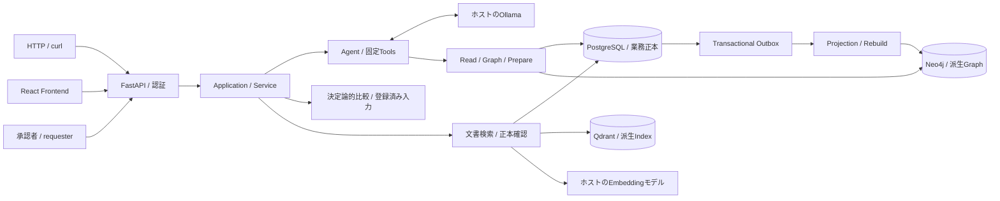

# LineScope

[](https://github.com/philippos2/line-scope/actions/workflows/ci.yml)

**設備・工程の依存関係と根拠をつなぎ、製造現場の意思決定を支援する単一工場のデモ。**

「M-204で異常が起きた。どこまで影響する？ 修理・交換・代替ではどう違う？」という問いに、業務Object、依存Graph、文書、決定論的計算を組み合わせて判断材料を提示します。最終判断・承認・実行はエンドユーザーが行います。

> 実PostgreSQL・Neo4j・Embedding／Qdrant・ローカルLLMに接続したデモです。正式な経済・能力・安全・対応計画／履歴の登録、承認・確定、比較、Graph・Evidenceを画面から操作できます。未登録値は不明として扱い、固定値で補完しません。一般的な自然言語調査には遅延・形式不正・Tool選択ミスが残ります。完成範囲はデモ・習作であり、実業務の性能や任意質問への成功を保証しません。

## 主な機能と検証対象

| 領域 | 現在できること |
|---|---|
| 業務Object | 設備・状態・保全・工程・生産作業・製品・インフラ・依存関係を認可付きで参照 |
| Graph調査 | 下流影響・上流依存・共通依存・一段代替・SPOF候補を探索。経路、完全性、未評価項目を提示 |
| 判断材料の比較 | 影響候補・現在状態と選択した正式な費用・能力・安全・対応計画／履歴をDecision Packageへ統合 |
| 文書検索 | 実Embedding/Qdrantで検索し、PostgreSQLのactive versionと管理本文を検証して引用。版更新・再構築に対応 |
| 承認付き更新 | 設備状態・保全・生産作業・依存関係の明示的Prepare。同一カテゴリの複数Target、要求置換、Approval / Execute |
| 監査・同期 | version検証、監査・履歴・Outboxの原子性、常駐Graph Projection、Rebuild / Restore、構造化運用ログ |

Graph上の到達や一段代替の構造成立は、実際の停止・十分な能力・安全性を保証しません。不明と0、影響なしと探索不完全を区別します。

## システム構成とデータの正本



Python / FastAPI / Uvicorn、SQLAlchemy Core / Psycopg 3、PostgreSQL、Neo4j、Qdrant、Ollama、Docker Composeを使用します。pgvectorは使用しません。FrontendはReact / TypeScript / Viteです。

PostgreSQLが業務データ・更新要求・承認・監査・履歴・Outboxの正本です。Neo4jとQdrantは派生データです。GraphはCURRENTの場合だけ正常利用します。LLMに任意SQL / CypherやApproval / Executeを公開しません。[アーキテクチャ](docs/design/architecture.md)

## DBスキーマ・ER図

**[業務データのER図](docs/design/data-model.md#13-適用済み業務スキーマのer図)**

設備と現在状態、保全予定・実績、工程・生産作業・複数設備割当、製品、インフラ、型付きDependencyRelationを管理します。図はSQLのFKを示し、更新要求・承認・監査などの管理テーブルは別です。多態的参照と関係の意味は[ドメインモデル](docs/requirements/domain-model.md)を参照してください。

## APIを直接呼ぶ

[起動・APIデモガイド](docs/getting-started.md)で環境とBearer tokenを準備してから実行します。

```sh
curl -sS http://127.0.0.1:8000/agent \
  -H "Authorization: Bearer $LINESCOPE_TOKEN" \
  -H 'Content-Type: application/json' \
  -d '{"message":"M-204の異常について影響・修理・交換・代替を比較して"}'
```

比較は登録済み入力を使い、LLM未設定でも動作します。入力が未選択なら候補と不明を返します。一般的な日本語調査にはOllama設定が必要です。

共通応答は`answer`、`data`、`evidence`、`warnings`、`errors`、`request_id`、`context_id`、`status`を持ちます。比較の`data.decision_package`には実Graphの影響候補、登録済み入力の比較、根拠・unknownsを返します。

```text
調査・Evidence確認
  → 明示的Prepare（before / afterを固定、業務値は未変更）
  → 承認者のApproval（Snapshot hashを確認）
  → requesterのExecute（version再検証、更新・監査・Outboxを確定）
```

承認は成立後30分で期限切れになります。複数Targetは全体を一つのTransactionで扱います。確定after Snapshotと、その後の現在値は別です。承認・実行のcurl例は[ガイド](docs/getting-started.md#apiを直接呼ぶ)、再送・状態遷移・error codeは[API / Tool契約](docs/implementation-design/api-tools.md)を参照してください。

## デモシナリオ

| シナリオ | 確認する振る舞い |
|---|---|
| 最小業務経路 | 影響・比較候補→Prepare→承認前拒否→Approval→Execute→再送→更新後確認 |
| 複数設備の変更 | 同一要求に複数Targetを含め、要求置換・承認・一括更新を確認 |
| 文書と根拠 | 実Embedding/Qdrant検索、active version、引用、版更新、alias再構築 |
| 日本語の比較要約 | 実LLMが正式比較Toolを参照し、サーバ側で数値・制約・不明事項を説明 |

```sh
python3 scripts/verify_minimal_flow.py
```

専用Compose環境で最小シナリオを実行し、終了時にその環境を削除します。通常の`.env`・volumeは共有しません。実モデルを含む4経路の一括検証と受入JSONの保存は[ガイド](docs/getting-started.md#実モデルを含む一括デモ受入)を参照してください。

最重要の業務目標は、影響・リスク・経済影響・対応策・制約・Evidence・Unknownsを比較可能に示すことです。固定デモのPASSと、[全Business Scenario](docs/implementation-design/business-scenarios.md)・Goldenの正式受入は区別します。

## セットアップ・データ準備・起動

[起動・APIデモガイド](docs/getting-started.md)に、clone、資格情報生成、migration、データ投入、Graph構築、Ollama設定、比較デモ、curl操作、停止手順をまとめています。

通常起動は`compose.yaml`、実Vector経路の追加構成は`compose.rag.yaml`です。API / migration / Projectionはコンテナで実行し、LLM / EmbeddingはホストのOllamaへ接続します。モデルは自動取得しません。

## テスト

独立した使い捨てPostgreSQL / Neo4jを使用し、通常環境の資格情報・volumeを共有しません。

```sh
docker compose -f compose.test.yaml build tests
docker compose -f compose.test.yaml run --rm --no-deps tests ruff check backend scripts
docker compose -f compose.test.yaml run --rm --no-deps tests ruff format --check backend scripts
docker compose -f compose.test.yaml run --rm tests
docker compose -f compose.test.yaml down --volumes --remove-orphans
```

CIはDockerビルド、Ruff、実DBテストを2 shardで並列実行し、runtime起動とmigrationも確認します。Fake LLMによる制御テストと実モデルの品質評価は別です。実LLM / Embedding試験はopt-inで、通常CIへ必須化していません。[テスト計画](docs/implementation-design/test-plan.md)

## 制限とスコープ外

- 費用・能力・安全・対応計画は正式入力を使います。未登録・期限外・条件不一致は不明を保持し、実設備の安全や運転許可を認定しません。
- Read Agentの実行上限は既定120秒です。一般質問にはモデル応答の形式不正・Tool選択ミス・時間切れが残ります。明示的な比較や画面のGraph操作と区別してください。
- 一般LLM／検索品質の数値閾値、任意質問の成功、商用SLA・高負荷運用は保証しません。
- 過去時点分析は現在登録情報の期間評価であり、当時の状態を完全復元しません。
- 画面・実モデル・固定fixtureの確認範囲と既知の失敗は、[作業履歴](docs/history/2026-10-16-read-quality-checkpoint.md)で区別します。
- AIの自律的な最終判断・Approval / Execute、実設備制御、本番MES / ERP接続、複数工場・マルチテナントは対象外です。
- 材料・在庫・調達を含むSupply Chain Operational Intelligence、在庫・受注・BOMの完全管理はv1の対象外です。与えられた設備・工程の停止状態からの影響分析とは区別します。

範囲の正本は[要件定義](docs/requirements/requirements.md)、到達点と残作業は[ロードマップ](docs/roadmap.md)です。

## リポジトリ構成

```text
line-scope/
├── backend/
│   ├── src/linescope/  # interfaces / application / domain / persistence / graph / agent / integrations
│   └── tests/         # 対応する責務単位のテスト
├── frontend/          # Reactの分析・比較・Evidence画面
├── docs/              # ガイド・要件・設計・実装設計・履歴
├── scripts/           # 資格情報生成・デモ疎通・受入検証
├── .agents/skills/    # 開発・レビュー・検証手順
├── compose.yaml
├── compose.rag.yaml
└── compose.test.yaml
```

## 設計・検証資料

- [文書入口・各事項の正本](docs/deliverables.md)
- [Use Case](docs/requirements/use-cases.md)・[受入基準](docs/requirements/acceptance-criteria.md)
- [API / Tool契約](docs/implementation-design/api-tools.md)・[Transaction / Outbox / 同期](docs/implementation-design/transaction-design.md)
- [運用・ログ設計](docs/implementation-design/operations.md)・[変更・検証履歴](docs/history/README.md)
- [開発ガイダンス](AGENTS.md)・[開発・PR運用](CONTRIBUTING.md)

開発用SkillはCoding Agentの作業手順であり、LineScope実行時のAgent機能とは別です。
