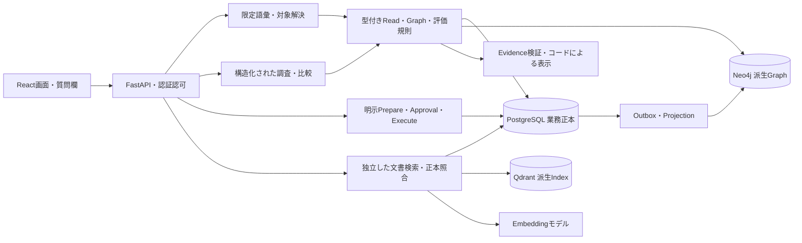

# LineScope

[](https://github.com/philippos2/line-scope/actions/workflows/ci.yml)

**ライトウェイトオントロジーを用い、登録された工場設備・工程・生産の関係から、依存先・影響範囲・代替候補を調べる技術検証デモです。**

設備・工程・生産作業・製品・インフラに型と関係の意味を与え、関係をたどる分析、登録状態による三値評価、Evidenceによる根拠の提示を試しています。実工場での停止影響や代替運転、安全性、経済効果を保証するシステムではありません。

## 最初に読む

| 知りたいこと | 文書 |
|---|---|
| デモでやること・やらないこと、主張しないこと | [要件定義 §9.1・§11.2](docs/requirements/requirements.md#91-今回のデモでやること) |
| 何を検証し、何が分かり、何が未確認か | [本デモアプリで検証したこと](docs/demo/verified-findings.md) |
| 正式デモの接続先・起動・停止 | [正式デモ環境](docs/demo/environments.md)（画面5173／API8002） |
| 別マシンでの新規構築・操作 | [起動・操作ガイド](docs/getting-started.md) |
| 構成・意味定義とデータ | [アーキテクチャ](docs/design/architecture.md)、[業務概念・関係](docs/requirements/domain-model.md)、[データモデル](docs/design/data-model.md) |
| 設計理由と仕様の所在 | [設計FAQ](docs/design-faq.md)、[文書入口・正本の責務](docs/deliverables.md) |

## デモの例

架空のシナリオではM-204を登録上STOPPED、M-208をRUNNINGとし、両方が共通必須電源R-02に依存します。M-204の「主軸異常」は物語上の前提であり、システムが故障原因を診断した結果ではありません。

- 関係図で、下流の工程・生産作業・製品と、上流の電源依存を確認します。
- M-208を構造上の代替候補として調べ、登録状態と登録供給状態による利用可能性を区別します。R-02がUNKNOWNまたはUNAVAILABLEなら利用可能と断定しません。
- 登録された経済・能力等の入力で、損害額や対応案の条件・不足情報を確認します。P-100の能力評価をP-200へ一般化しません。
- 変更する場合は、変更準備、保存内容の確認、カテゴリの権限規則に従う承認、元の依頼者による実行、再取得を分けます。

投入データと再現条件は[シナリオ1](docs/demo/scenario1.md)、観測結果と限定は[検証結果](docs/demo/verified-findings.md)を参照してください。

## 質問欄で試す

システムへの質問はテキストボックスから送ります。現在は固定9観点の語彙・例文に一致する質問を、型付きReadとEvidenceに基づくコードの定型文で回答します。**通常質問にLLMの分類・文章生成は使用しません。**

例：`m204の登録状態は？`、`第１加工機停止の影響範囲はどこまでか？`、`M-204の代替候補は？`、`第一加工機の保全記録は？`。

設備の表記揺れは左ペインの検索と同じ検索層で吸収します。対応外・複合質問は別の問いへ読み替えず案内し、保全実績0件は未実施と断定しません。対応観点・表現・限界の定義は[質問欄設計](docs/design/demo-question-chat.md)に集約しています。

正式APIへの読取り例です。tokenは私有設定から取得し、公開しないでください。

```sh
curl -sS http://127.0.0.1:8002/agent \
  -H "Authorization: Bearer $LINESCOPE_TOKEN" \
  -H 'Content-Type: application/json' \
  -d '{"message":"M-204の登録状態は？"}'
```

## 責務と境界



概念・関係の意味は業務モデル、実データと状態はPostgreSQL、探索はNeo4j、評価はサーバ規則、根拠と表示はEvidenceに対応する処理が担います。Graph DBの採用だけをオントロジーの効果とは扱いません。LLMを用いた過去の試行と失敗は[検証知見](docs/demo/verified-findings.md#f-試した方式と採用した割り切り)から参照できます。

## 検証・制約・開発

実装済み、自動試験済み、直接API確認済み、ブラウザ確認済みは同じ意味ではありません。各結論の根拠と未確認範囲は[検証結果](docs/demo/verified-findings.md)を参照してください。旧H6/H7の未達は保存され、現方式の成功で上書きしていません。

- [受入基準](docs/requirements/acceptance-criteria.md)／[業務シナリオ](docs/implementation-design/business-scenarios.md)
- [決定論的テスト計画](docs/implementation-design/test-plan.md)／[モデル評価の適用範囲](docs/implementation-design/evals.md)
- [API・Tool契約](docs/implementation-design/api-tools.md)／[Transaction・承認・同期](docs/implementation-design/transaction-design.md)
- [検証履歴・生データへの入口](docs/history/README.md)／[進捗・ガント](docs/roadmap.md)
- [開発ガイダンス](AGENTS.md)／[PR・CI運用](CONTRIBUTING.md)／[Frontendの起動・検証](frontend/README.md)

既存CIは変更範囲に応じた検証を`Tests and migrations`へ集約します。文書のみではBackend・runtimeを省略し、Frontendのlint・型・整形・build等を実行します。通常CIのFrontendジョブはVitestを実行しません。実モデル品質や実工場での成立をCI成功から推定しません。
