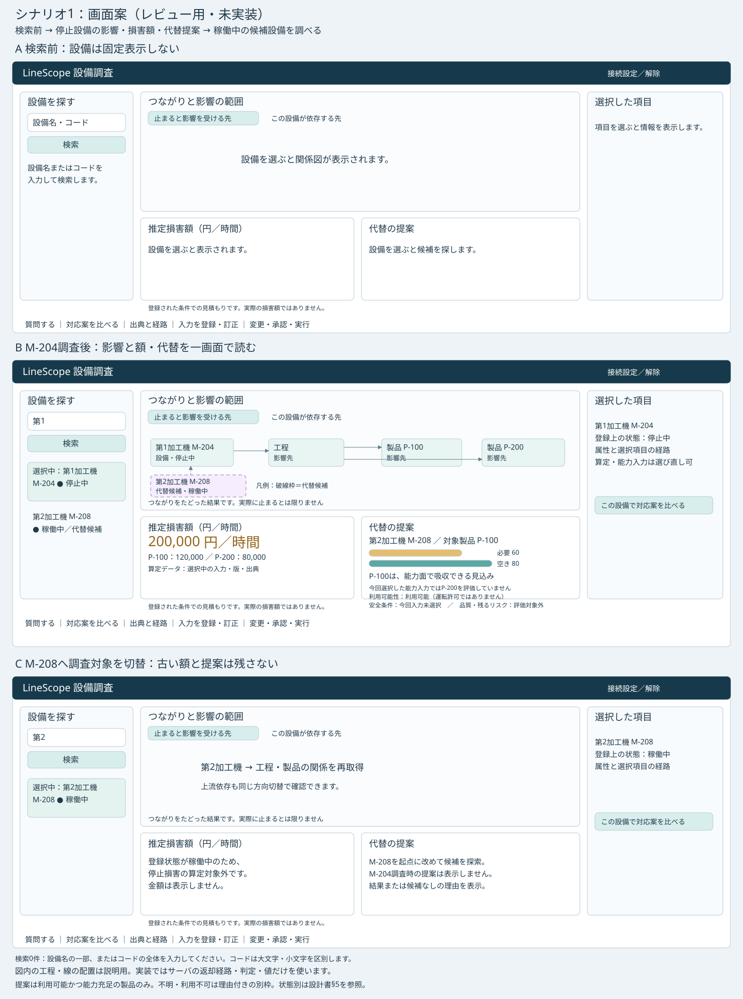

# シナリオ1：設備停止から代替候補を提示するUI設計案

**状態：設計レビュー待ち。実装承認ではない。** 今回はシナリオ1だけを対象にする。[改修計画・残PR](scenario1-implementation-plan.md)、[画面ワイヤーフレーム](scenario1-wireframes.svg)と合わせて評価する。現行画面の説明・業務仕様正本をこの案で変更しない。

## 1. 利用者の目的と決定事項

利用者は設備名の一部から対象を探し、停止した設備の影響先・依存先・推定損害額を知り、LineScopeが見つけた代替候補を根拠とともに確認する。初期画面へM-204・M-208を固定表示しない。検索・読取・判定はLLMの自由生成を通さない。

| 項目 | 今回の決定 |
|---|---|
| D1 | 案A。search_equipmentを既存の「関係分析」直接経路へ追加。新HTTP APIなし |
| D2 | シナリオ1は(a)登録状態に基づく損害額。(b)仮想停止金額の契約は追加しない |
| 対象 | 一台の停止設備を調べ、候補設備を提示する。候補へ調査対象を切り替えられる |
| 能力入力 | 候補の入力を全ページ確認。1件は自動選択、複数件は選択を求め、0件は未登録。選んだ入力・版・期間・出典を見せ、選び直せる |
| データ | JSON一ファイル＋薄いローダー。既存シードは変更しない |

目的・関係意味論・権限・APIの正本は[文書入口](../deliverables.md)に従う。[BS-05等の受入](../implementation-design/business-scenarios.md)にある構造・能力・安全・品質の区別を維持する。

## 2. 画面と導線

広い画面は左に設備検索、中央上に関係図、中央下に損害額と代替提案、右に選択した項目の属性と比較への明示ボタン。最下段に補助機能を置く。

図はレビュー用の静的配置案であり、稼働画面や取得成功の証拠ではない。設備コード・金額・能力はシナリオの説明例で、UIへ固定実装しない。件数・経路は実応答に従う。初期画面・停止設備調査後・稼働設備選択時を図示し、失敗等は§5で定義する。

| 段階 | 操作 | 表示・自動読取 |
|---|---|---|
| 初期 | 設備名（部分一致）／コード（完全一致）を選んで検索。空欄検索も可 | 実検索の候補を表示するまで設備を出さない。続きがある場合だけ絞込みを案内 |
| 起点選択 | 候補からM-204を選ぶ | 下流・上流・損害額入力を独立取得。下流の図と登録上の状態を表示 |
| 損害額 | 原則追加操作なし | 入力1件を明示して自動選択、期間を読取専用表示。停止中・登録条件成立なら200,000円／時間と内訳 |
| 候補提示 | 追加操作なし | 下流の全到達製品を重要対象、選択設備を除外対象にして代替探索。M-208が返れば図と提案へ |
| 能力評価 | 1件なら追加操作なし | M-208・P-100の能力入力を選び、元設備M-204の比較APIで評価。必要60・空き80とサーバ判定を表示 |
| 詳細確認 | 任意でノードを選ぶ／比較ボタン | 属性は選択時取得。比較対象は明示ボタンで決める。調査起点とは別に保持 |
| 候補の調査 | M-208を「この設備を調べる」で起点へ | M-204の古い結果を破棄し、M-208の図・稼働中・停止損害対象外を表示 |

ノードをクリックしただけでは起点を変えない。右欄の「この設備を調べる」で起点を変え、「この設備で対応案を比べる」で下段比較へ進む。自動提案の比較要求は元設備を起点とし、候補の能力入力を使う。候補を起点にした自己代替要求を送らない。

## 3. 配置・表示と操作

- 左：検索種別（設備名／コード）・検索欄・検索ボタン・結果。登録状態を色と文字で示す。状態はサーバ観測があるものだけ表示し、未取得は確認中。状態取得のために非対応Toolを追加公開しない。
- 中央上：方向切替「止まると影響を受ける先」「この設備が依存する先」。起点を強調し、設備・工程・生産作業・製品・インフラを種別名と色で区別する。直接／間接はサーバ分類を使う。
- 代替候補：破線枠と「代替候補」で識別。代替探索の返却ノード・代表経路・代替関係の根拠だけを描く。上流の通常依存と下流影響と代替関係は凡例で区別する。
- 中央下左：推定損害額（円／時間）、登録状態に基づく評価、製品別内訳、選択した算定データ・版・出典・読取専用期間。詳細内も期間編集不可。
- 中央下右：代替の提案。候補名・コード・登録状態、構造の判定、対象製品・数量単位、必要能力／空き能力の棒と数値、能力判定、未確認の条件。棒の長さはサーバ値を描画するだけで判定を計算しない。
- 右：選択ノードの属性と、そのノードを含む経路。設備なら明示的な調査・比較ボタン。名称未取得時は種別を表示し、UUIDで代用しない。
- 下段：質問する／対応案を比べる／出典と経路／入力を登録・訂正／変更・承認・実行。初期は内容を閉じる。図と損害額・提案は開閉で消さない。
- 390／768px：検索→図→損害額→提案→属性→補助機能の縦順。1600pxでは中央下二列。ページ全体の横overflowを出さない。図の移動・拡大と一覧によるノード選択を維持する。

キーボードで検索・候補選択・方向切替・ノード一覧・明示ボタンを操作できる。自動取得完了でfocusを奪わず、結果と失敗を状態通知する。

## 4. 自動処理の契約と責務

1. searchEquipment(query)はEquipmentFilterのname／equipment_codeとpaginationを既存直接経路へ送る。検索の認可・厳密引数検証はサーバへ残す。
2. 起点の下流／上流は既存Graph Toolを直接呼ぶ。損害額の入力選択を図の前提にしない。属性はノード選択時にget_*で取得する。一斉30件取得は廃止。
3. 下流の返却到達製品すべてをfind_alternative_pathsのimportant_targets、起点設備をexcluded_nodesにする。製品0件では実行せず理由を表示。引数・探索上限は[api-tools](../implementation-design/api-tools.md)に従う。探索不完全を候補なしと扱わない。
4. alternatives[].candidates[].candidateの設備IDを使って能力入力をequipment_id完全一致検索する。候補と関係のない能力入力を選ばない。cursor未完了を0件／1件と確定しない。詳細GETで版・期間・出典・製品を確認する。
5. POST /decisions/compareへ元設備ID・選択経済入力ID・候補の能力入力ID・一致する期間を送る。安全・保全は未登録のため空配列。入力の期間不一致なら判定を送らず理由と訂正への導線。期間は勝手に揃えない。
6. 主画面の提案はサーバ比較の該当候補・製品のSUBSTITUTE案を表示する。安全・品質・残余リスクはサーバの不足を保持する。必要60／空き80がP-100の評価であり、P-200を含む全業務の吸収評価ではないと示す。
7. 損害額はPOST /incidents/investigate。選択設備とequipment_id完全一致で取得した経済入力を送り、金額は十進文字列の整形だけとする。算定APIによる下流分析の重複は許容し、新APIは追加しない。
8. 下流・上流・代替・比較・損害額の世代が違えば正常な一つの結論へ合成しない。図を参照する結果の対応を確認し再取得を案内する。別観測時刻を同時Snapshotとは説明しない。

### コンポーネント分割案

| 単位 | 責務 |
|---|---|
| App | 接続、更新世代、補助パネルの明示対象 |
| EquipmentSearchPanel | 入力・設備検索結果・一台選択 |
| useEquipmentInvestigation | 起点・要求世代・独立した取得状態、下流から候補探索へつなぐ |
| GraphWorkspace／SelectedNodePanel | 返却された図・一覧・選択属性と経路 |
| LossEstimatePanel | 経済入力選択、読取専用期間、サーバ金額と理由 |
| AlternativeProposalPanel | 候補、能力入力の選択、サーバ判定、未確認条件 |
| 表示マッピング | 登録状態・判定・理由・エラーの日本語化を一か所に集約 |

既存の比較・入力・承認パネルは再利用する。主画面の1件入力自動選択は今回の決定による明示的な例外として、実装時に既存設計の「すべて利用者が手動選択」を改訂する。選択済み入力を隠さず、利用者が変更できるようにする。

## 5. 状態別表示・保持する制約

| 状態 | 表示・操作 |
|---|---|
| 初期 | 設備名またはコードで検索してください。図・金額・提案は設備を選ぶと表示されます |
| 取得中 | 図を調べています／算定データを確認しています／代替候補を探しています／能力を評価しています。各領域で独立表示 |
| 稼働中 | 登録上の状態：稼働中。登録状態が稼働中のため、停止損害の算定対象外です。金額なし |
| 保全中・不明 | 登録上の状態を表示し、停止損害に当てはまるか確認できない理由。金額なし |
| 算定データなし | 未登録の理由と「算定データを登録する」。図は表示 |
| 算定データあり・損害額未登録 | 選んだ算定データに、損害額（円／時間）が登録されていません。訂正導線。金額なし |
| 計上項目なし | 金額を出さず理由。APIのknown_subtotal_per_hourは計上ゼロならnull。根拠付き明示0と区別 |
| 部分算定 | included_in_subtotal=trueが一件以上でサーバ小計ありの場合だけ「判明分のみ（不明あり）」 |
| 候補なし | 完全探索で候補なしなら「登録された代替候補はありません」 |
| 到達製品なし | 代替を調べる対象製品がないため、候補を探索できません |
| 能力入力なし／複数 | 未登録で評価できない理由／入力の期間・版・出典付き選択肢。構造候補の図は残す |
| 非最新・再構築中 | 原因と再試行。正常図・現在額として残さない |
| 個別失敗 | 失敗領域に原因と再試行。検索・図・代替・能力・金額の他の有効表示は残す |
| 対象切替 | 旧対象の結果・属性・入力選択・下書きを破棄。遅延応答を復元しない |
| 更新試行後 | 更新前と表示し再調査。応答不明を変更済みと断定しない |

設備未登録・検索続き・入力複数件・失敗を成功扱いしない。AbortSignalと要求番号・起点ID・入力ID・更新世代で受理条件を確認する。接続解除・利用者切替では全取得情報を破棄する。認証情報の非保存、明示Prepare→別担当者承認→元requester実行、再送キー、非CURRENT gateは維持する。

## 6. 文言と移行

| 表示箇所 | 確定案 |
|---|---|
| 主見出し | 設備を調べる |
| 検索 | 設備名の一部／設備コード（完全一致）／検索 |
| 図 | つながりと影響の範囲 |
| 状態 | 登録上の状態：停止中／稼働中／保全中／不明 |
| 金額 | 推定損害額（円／時間）／登録状態に基づく見積もり |
| 提案 | 代替の提案／代替候補／能力面では吸収できる見込み |
| 条件 | 対象製品／必要能力／空き能力／構造上の代替／安全：未確認／品質：未確認 |
| 期間 | 評価期間：選択した算定データの適用期間（読取専用） |
| 図の注意 | つながりをたどった結果です。実際に止まるとは限りません |
| 金額の注意 | 登録された条件での見積もりです。実際の損害額ではありません |

通常のUIラベルにGraph・Tool・Envelope・UUID・正本・SPOF・生の列挙値・APIエラーコード・経済入力・被害額・損失根拠を出さない。内部値は日本語へ変換し、未知エラーは一般文と再試行、コードは閉じた「技術情報」へ置く。利用者が入力した名称や出典原文は改変しない。LLM待ち時間の注記は質問・文書検索だけ。

| 削除・移行対象 | 対応 |
|---|---|
| incidentMode・二モード切替 | 一画面に統合 |
| 算定データ検索を入口とするボタン | 設備検索へ置換 |
| 調査直後の全ノード属性取得 | 選択時取得へ |
| カード内の状態変更 | 最下段の変更・承認・実行へ |
| 詳しい分析に隠れた代替提示 | 自動候補・能力を主画面へ。追加分析そのものは保持 |
| 現行の比較・根拠・入力・承認 | 維持。選択対象・文言・自動選択の説明を更新 |
| frontend-console／Frontend README／検証script | 実装承認後、実画面に合わせて更新 |

## 7. シナリオ1の受入計画

| ID | 確認事項 |
|---|---|
| S1-01 | 専用環境でLLM利用不可でも検索→影響・額・候補・能力が成立。検索開始から候補表示、選択から各結果表示の時間を実測 |
| S1-02 | M-204の関係図・登録上停止中・200,000円／時間と内訳。上流依存も確認 |
| S1-03 | M-208が自動で候補に出る。P-100の必要60・空き80、構造と能力を分け、安全・品質・P-200等の未確認範囲を残す |
| S1-04 | M-208へ起点切替後、稼働中・停止損害対象外。旧設備の金額を残さない |
| S1-05 | 能力入力0件・複数件で理由／選択。制御した補助試験を使ってよい |
| S1-06 | 検索・図・代替・能力・損害額の個別失敗、再試行、他領域の保持 |
| S1-07 | 禁止語検査、390／768／1600px、キーボード検索・設備選択・ノード一覧操作 |
| S1-08 | 設備切替・遅延応答・接続切替で旧結果を復元しない |

実バックエンドの証拠は実画面と応答で示し、stub成功を代用にしない。S1-05等の補助試験は実環境での代表受入と区別する。テスト展開件数は実装前に見積もる。試験成功をUIの妥当性の代わりにせず、配置と導線は利用者確認を受ける。

## 8. 今回扱わない後続事項の保存

以下は旧案から移した参照用の設計事項で、今回の残PR・完成条件に含めない。作業を進める根拠にはしない。

- シナリオ2、複数設備の比較、共有する影響先・共有損害、複数起点の直接／間接分類。
- D2(b)：停止と仮定する設備を指定した金額。契約・操作・既定値は未決のまま。
- D3：検索行の算定データ有無バッジ。絞込みなし経済入力検索・page_size 100・cursor追跡でequipment_id集合を照合する旧提案。payloadは含まれず、登録ありは金額登録ありを意味しない。今回実装しない。
- D4：複数起点の分類と世代整合。起点別分類を保持し、合算分類を作らず、図と金額の世代不一致は再取得という旧提案。単一起点にも必要な世代整合は今回維持する。
- UA-03：二台を調査対象として同時選択し、共有先と重複計上防止を示す旧受入。
- UA-12：異なる入力期間の複数設備を選び、不一致一覧と訂正導線を示す旧受入。今回の単一起点・候補能力入力の期間検証は省略しない。
- M1〜M6の登録状態、稼働中対象外、完全一致検索、期間読取専用、金額未登録と0の区別は今回も維持する。旧UA-01〜12の包括受入を今回の合格とはしない。

## 9. 実装へ進む条件

本設計・配置図・JSONローダーを含む変更計画について開発依頼者が承認した後に限り、残実装2 PRへ着手する。現時点で変更するのは文書と静的な設計図のみ。
