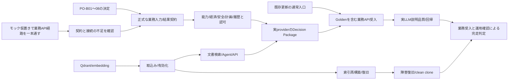

# バックエンド残項目・完走ロードマップ

日付: 2026-10-14。調査基準: main `38d17d0`（#206 merge済み）。本書は実装状況と作業見積もりの履歴であり、業務仕様の正本ではない。

## 1. 結論と見積もりの訂正

バックエンドの業務要件全体が8割・9割完成したという過去の報告は撤回する。内部部品・テスト・PRの消化量を業務要件の完成度と混同し、能力・経済・安全・対応案比較、公開入口、実LLM受入の残作業を十分に算入していなかった。

調査後の業務要件全体の実現度は、**概算30〜50%という低確度の推定**とした。参照・構造Graph・承認付き更新に部分実装/確認がある一方、RAG公開、能力・経済・安全・対応案比較とGolden全体の受入が残ることに基づく粗い判断であり、完了工数/総工数や受入済み重みを実測集計した率ではない。半分を超えたことを保証しない。実測した進捗率は未算定であり、この推定を確定値として投資/納期判断へ使わない。

現在のレビュー粒度で、残る機能実装・検証は概算 **26〜44 PR**。文書PR #207、merge済み#206、任意のrefactoring、Frontend・動画・FAQはこの本数に含めない。これは進捗率でも納期の保証でもない。PO未決定事項の実装を含む暫定見積もりであり、仕様確定や受入で追加が見つかれば上限を超え得る。

| 残作業群 | 概算PR数 | 状態 |
|---|---:|---|
| RAGを文書取込みからAgent/API回答まで接続 | 5〜8 | metadata・本文検証部品はあるが、検索と公開入口は未実装 |
| 既存更新・参照機能の入口を完成 | 4〜7 | 内部Prepare・Approval/Executeの試験成功と、通常Agent入口の完成は別 |
| 能力・経済・安全・計画・履歴・対応案比較 | 13〜21 | 対象内。PO-B01〜08の決定と下位契約・実装が必要 |
| 一連の業務受入・実LLM評価・運用・修正 | 4〜8 | 部分API試験はあるがGolden全体の受入は未完了 |
| **合計** | **26〜44** | 確定済みの基盤を利用し、未決定機能を勝手に対象外にしない |

「6〜10工程」という直前の回答は、未接続部分と受入を粗く括ったものであり、全業務要件の残PR数を表していなかった。全要件の見積もりとして使用しない。

この規模をそのまま投資判断に使わない。まず後述M0で一本の業務フローを通して成立性を確認し、各milestoneで実動作・不足・見積もりを更新する。小さなPRや内部部品の完成を業務システムの進捗基準にしない。

## 2. 調査方法と保証範囲

次を照合した。

- 正本: requirements §14.1〜14.3、use-cases UC-01〜21 / UC-B01〜17、acceptance-criteria、business-scenarios §3・4・7、rag-design、evals、operations、test-plan。
- 通常起動と入口: `bootstrap.py`、`interfaces/api.py`、`application/agent_service.py`、`application/tools.py`、`agent/read_agent.py`、`agent/agent_tools.py`、`agent/update_intent.py`、`settings.py`、`cli.py`、`compose.yaml`。
- DB: migrations 001〜007。能力・損失率・修理交換費・安全基準等の計算用正本がないことを確認。
- 試験: APIのGraph業務シナリオ・Controlled Action、設備状態・保全予定UPDATE・生産予定UPDATEのAgent入口、保全予定CREATE・保全実績CREATE・設備割当・依存関係のApproval/Execute試験、Knowledge metadata/content試験。
- 実LLM: scriptsの検証入口と、2026-10-13の代替/SPOF再評価記録。

全コードの再監査や全業務シナリオの実LLM再実行は今回行っていない。試験実装・過去実行記録・今回のCIの保証範囲を区別する。#206のCIは3606 passed / 1 skipped。skipはlive LLMのopt-in試験であり、実LLM受入成功には含めない。

## 3. 既存実装・試験の存在を確認したもの

| 領域 | 確認できる実装・試験 | 完成と混同してはいけない範囲 |
|---|---|---|
| 起動・認証・DB role | Compose API/PostgreSQL/Neo4j/Projection、migration/provision、Bearer context、query/runtime/projection分離 | Qdrant/embedding/知識ファイルの設定と起動は未接続。readinessはPGのみ |
| 業務参照 | `application/reads.py`、Core reads、ReadAgent、POST /agent | あらゆる日本語の対象解決・説明品質を承認したわけではない |
| 現在設備状態更新 | EquipmentCommandPrepareからSnapshot/Approval/Execute、API試験とBS-14/19の現在状態variant | 将来停止予約・劣化モデル・安全判断を含まない |
| 保全・生産予定UPDATE | MaintenanceCommandPrepare / ProductionCommandPrepare、Agentから承認・実行のAPI試験 | CREATE、実績、割当集合、複数Targetの通常入口とは別 |
| 確定処理 | Snapshot/hash/version/lock、全Target検証、Audit/履歴/Outbox、冪等再送とrollbackの実DB試験 | 新しい能力・費用・安全データの権限・更新カテゴリは未定義 |
| Graph | CURRENT gate、影響/上流/共通依存/代替/SPOF、Neo4j adapter、Outbox worker、Rebuild/Restore controller | 到達・構造成立は停止・生産量・能力・安全・損失の判定ではない |
| 文書根拠 | KnowledgeDocument schema、PG再認可、管理ファイルhash検証、決定的chunk復元、返却前再認可 | retrieve_knowledgeは未登録。検索、ingestion、索引再構築、生成への接続は未実装 |
| ログ・CI | 構造化ログ、相関・秘匿、業務Audit、独立DBの2 shardとruntime job | 運用runbook全体の実地受入・全suiteの重複最適化は完了していない |

実装・試験の存在は、上位の業務仕様に適合し再利用できるという保証ではない。仕様を取り違えた実装は、テストが通っていても誤りである。各部品を再利用する際は、正本の業務目的・UC・受入仕様と実際の入出力を照合し、適合確認済みの範囲を記録する。不一致は実装を修正し、実装へ合わせて仕様やテストを曲げない。基盤の実装量を業務判断支援全体の完成度として報告したのは誤りだった。

## 4. 公開入口の不足を確認した根拠

1. `bootstrap.build_api_services`はReadAgentと設備状態・保全予定UPDATE・生産予定UPDATEのcommandを組み立てる。RAG serviceは組み立てない。
2. `AgentApplication.commands`は上記3種類。`ReadAgent.run`が作るAgentToolSessionには`prepare_authorized=True`を渡さず、ReadAgentもReadResult以外を拒否する。内部ToolDispatcherにPrepare schemaがあっても、この経路から新規のPrepareは実行できない。
3. 保全予定CREATE・保全実績CREATEのAPI試験は、冒頭で「Prepare stays internal」と明記し、内部fixtureで保存済みの要求からApproval/Executeを試す。
4. 設備割当・依存関係のAPI試験も内部prepareで要求を保存してからHTTPの閲覧・承認・実行を確認する。通常のPOST /agentからPrepareする一連の受入とは別。
5. 明示的更新意思の判定には保全登録・依存無効化の一部patternがあるが、patternだけで公開処理が完成したとは判断しない。依存CREATE/UPDATE、設備割当の一般的な入力受付も補完が必要。
6. Graph Tool自体はexplicit_as_ofを受け付けるが、AgentInputのトップレベルexplicit_as_ofはReadAgentで拒否される。過去指定の通常入口・引数伝播・説明を確認する必要がある。当時の完全なpoint-in-time復元を要求へ追加するものではない。
7. 複数Target・要求置換の内部処理はある。単一対象の既存commandで確認済みの置換を未実装扱いにはしない。ただし全カテゴリの公開受付・対象確認からの継続を業務フローとして受入確認する必要がある。

根拠試験: `backend/tests/interfaces/test_maintenance_plan_create_api.py`、`test_maintenance_record_create_api.py`、`test_production_assignment_action_api.py`、`test_dependency_action_api.py`。接続済みの比較対象: `test_equipment_prepare_api.py`、`test_maintenance_prepare_api.py`、`test_production_prepare_api.py`。

## 5. 残項目の実装・検証単位とPR見積もり

関連部品は業務フローとして検証できる単位にまとめる。以下は依存・レビューリスクから見た幅であり、部品ごとに必ず一PRを増やす計画ではない。各行に対応試験を含める。全体受入の行は、個別機能試験の重複ではなく横断的な誤配線・説明・運用の確認。

| ID | 残項目と完了条件 | 主な依存・根拠 | PR目安 |
|---|---|---|---:|
| K1 | Qdrant/embedding接続、設定・timeout・起動・固定version。実モデルで疎通する | rag-design、現Compose/Settingsに未接続 | 1 |
| K2 | 管理ファイル取込み→Parse/Chunk/Embed/upsert→新version有効化。失敗時は旧active維持、同code直列化・単一activeを守る | K1、KnowledgeDocument、rag-design §8 | 1〜2 |
| K3 | query embedding→検索→PG再認可→hash検証済みchunk→生成前再認可→citation。retrieve_knowledgeをAgent/APIへ接続しcurlで根拠を取得する | K1/K2、#205/206、AC-R01〜03 | 1〜2 |
| K4 | active正本から新collection再構築、version変更の再検証、検証後切替、索引欠損の復旧 | K2/K3、rag-design §8 | 1〜2 |
| K5 | relevance/grounding、文書命令、旧version・失効・Qdrant障害のAPI/実モデル受入 | K3/K4、evals §4・6 | 1 |
| W1 | 保全予定CREATE・保全実績CREATEを通常Agent入口からPrepareし、承認・実行・再参照まで通す | UC-06/08、内部Prepareは既存、入口不足 | 1〜2 |
| W2 | ProductionOperation設備集合の期間置換を通常入口で受付。before/after・承認・Execute・USES同期まで確認 | UC-09、内部割当・Outboxは既存 | 1 |
| W3 | 依存CREATE/UPDATE/DISABLEを通常入口で受付。全Target認可、承認、循環/期間再検証、投影まで確認 | UC-21、DependencyPrepare/Executeは既存 | 1〜2 |
| W4 | 全カテゴリの複数Target/確認継続/置換入口と、明示過去時点の受付を接続・受入。既存対応済みvariantは再実装しない | UC-11/13/14/15、AgentApplication/ReadAgent | 1〜2 |
| B1 | PO-B01〜08の決定を要求・domain・data・API・ACへ対応させ、業務入力と結果契約を確定する | requirements §14.3。推測で確定しない | 1〜2 |
| B2 | 製品・単位・評価期間別の能力/必要量/空き能力/不足、代替互換性・buffer/復旧期限を正本と決定論的処理へ実装 | PO-B03/07、UC-B02/03/11、BS-05/06/13 | 2〜3 |
| B3 | 損失率・通貨・calendar・期間・独立加算/二重計上防止・subtotal・修理交換費/停止損失を実装 | PO-B01/02/05/07、UC-B05〜09、BS-02/03/09/10/16 | 2〜3 |
| B4 | 劣化観測、安全基準/適用条件/許容期限、6リスク次元、unknown/実行不能理由を実装。経済比較で安全を上書きしない | PO-B04/07、UC-B04/08/10、BS-04/11/15 | 2〜3 |
| B5 | 修理/交換/継続/代替案、lead timeと作業時間、暫定期間、次回計画、将来停止variantを実装 | PO-B01/05/07、UC-B06〜09/14、BS-03/07 | 2〜3 |
| B6 | 故障・修理・過去停止損失の正本/期間/根拠、履歴比較を実装。状態STOPPEDを故障原因に読み替えない | PO-B06/07、UC-B12、BS-12 | 1〜2 |
| B7 | Graph・数量・経済・安全・案比較・文書根拠をDecision Packageへ統合しAgent/APIで回答する | B2〜B6/K3、UC-B09/13/15、AC-B09〜11 | 1〜2 |
| B8 | 新情報の登録/閲覧権限、更新カテゴリ、全Target、Snapshot/Approval/Execute/Auditと観測versionを接続する | PO-B07と各入力。既存権限を流用して勝手に許可しない | 2〜3 |
| V1 | fixture/Fake Adapterで一本のGolden経路を先に通し、順次実装へ置換。最終的にBS-01〜19/G01の意味論的API受入を確定 | 各機能、business-scenarios。mock合格と製品受入を区別 | 1〜2 |
| V2 | 代表日本語dataset、名前/曖昧対象/不足/複数Tool/非CURRENT/Injectionの実LLM評価、品質baselineと閾値、失敗回帰 | evals。現在は代替/SPOFの単発warm probeなど部分確認 | 1〜2 |
| V3 | clean cloneから取込み・検索・更新・投影・再構築を再現。backup/restore・DEAD対応の管理手順と障害応答、操作例を検証・整理 | operations、CLI、Compose。管理者用DEAD訂正/再送は現在CLIにない | 1 |
| V4 | 横断受入で見つかる不具合修正・回帰。無関係な全面refactoringを完走の前提にしない | V1〜V3の実測 | 1〜3 |

集計: K=5〜8、W=4〜7、B=13〜21、V=4〜8、合計26〜44。例えば同じ業務フローのK2/K3やW1の二CREATEを安全にまとめられれば下限へ近づく。未知の契約・失敗が増えれば上限以上になり得る。PO決定前のB群は低確度であり、作業時間・日付へ換算できる見積もりではない。

## 6. 業務ユースケースの現在地

「部分」は指定範囲の実装/試験があることを示し、当該UC全体の受入PASSではない。

| UC | 現在地 | 完了までに残るもの |
|---|---|---|
| UC-B01 影響範囲 | 部分: Graph直接/間接・経路・完全性、複数Tool API試験 | BS-01の固定fixture/実LLM受入、Infrastructureの意味PO-B08 |
| UC-B02 生産能力 | 未実装/PO待ち | 能力・必要量・単位・期間・低下モデル |
| UC-B03 代替吸収 | 部分: 一段置換の構造成立 | 空き能力・不足量・互換性・残存リスク |
| UC-B04 リスク | 部分: 未評価と構造SPOF/不完全性を区別 | 6次元リスクの入力・適用・根拠と結果契約 |
| UC-B05 損失 | 未実装/PO待ち | 決定論的損失処理、加算/期間/単位/unknown |
| UC-B06 修理 | 未実装/PO待ち | 費用・所要時間・停止損失・修理後リスク |
| UC-B07 交換 | 未実装/PO待ち | 費用・lead time・作業期間・暫定対応 |
| UC-B08 継続 | 未実装/PO待ち | 劣化・次回計画・安全許容・費用比較 |
| UC-B09 対応比較 | 未実装/PO待ち | 同条件比較、実行不能/不明、Decision Package |
| UC-B10 安全除外 | 未実装/PO待ち | 承認済み基準と判定入力、候補除外 |
| UC-B11 納期/計画 | 未実装/PO待ち | buffer/需要/復旧期限、登録と適用規則 |
| UC-B12 履歴比較 | 部分: 設備状態履歴・保全実績Read | 故障原因・修理費・過去損失・将来根拠 |
| UC-B13 不足明示 | 部分: Graph不完全・UNKNOWN、対象確認、Tool失敗 | 能力/経済/安全ごとのpartial/subtotal/unknowns |
| UC-B14 Prepare | 部分: 現在状態・予定UPDATEのcommand/API | W群の通常入口、将来停止variant、分析案との接続 |
| UC-B15 根拠 | 部分: DB/Graph構造化Evidence、文書復元部品 | 文書検索/引用、計算入力・式、全結果の説明品質 |
| UC-B16 曖昧対象 | 部分: context所有/TTL、確認継続のAPI試験 | 代表日本語・名前だけの対象解決、更新全カテゴリの受入 |
| UC-B17 更新後確認 | 部分API受入: BS-19の確定after/current・再送 | 自然言語E2E、実Projectionと再分析までの横断受入 |

## 7. Business Scenarioの未完了部分

| BS | 確認済み部分と残件 |
|---|---|
| BS-01 | Graph経路/直接間接のAPI構造試験あり。指定業務fixtureによる完全受入は未確定 |
| BS-02 | 200000/hour・1600000・1900000は受入仕様の期待値。計算/費用比較は未実装 |
| BS-03 | 480000・150日は固定期待値。calendar・安全・交換条件・比較の実装/PO判断待ち |
| BS-04 | Hard Safety Constraintの具体入力/評価/除外は未実装 |
| BS-05 | 一段構造代替あり。必要60/空き80の能力評価と残存リスクは未実装 |
| BS-06 | 必要90/空き60/不足30の決定論的処理・影響評価は未実装 |
| BS-07 | 14日lead time・暫定案・同条件比較は未実装 |
| BS-08 | Graph連鎖/経路/探索不完全は部分実装。リスク次元の評価は未実装 |
| BS-09 | 損失未知を除外したsubtotal・経済incompleteは未実装 |
| BS-10 | 修理費不足時の比較契約・構造化unknownsは未実装 |
| BS-11 | 劣化・悪化根拠・継続許容・経済結果を組み合わせる受入は未実装 |
| BS-12 | 保全履歴Readあり。故障/停止損失/修理交換の長期比較は未実装 |
| BS-13 | 120/30=4時間のbufferモデル・復旧期限は未実装/PO待ち |
| BS-14 | 現在状態Prepareの2表現はAPI意味論試験PASS。実LLM分析品質と将来停止は未確認/PO待ち |
| BS-15 | 安全未知と継続案の具体的な扱いは未実装/PO待ち |
| BS-16 | 損失二重計上の禁止・加算不能subtotalは未実装/PO待ち |
| BS-17 | context確認継続のAPI試験あり。対象調査を含むBS全体の実LLM受入は未確認 |
| BS-18 | 空/partial/LAGGING/ERROR/REBUILDINGの5条件はAPI意味論試験PASS。実LLMの説明品質は未承認 |
| BS-19 | 承認・実行2回後の確定after/current・再送はAPI意味論試験PASS。実投影後の再分析/自然言語E2Eは未確認 |
| BS-G01 | **未完成**。構造影響部分だけでGolden合格としない。PO-B01〜07、専用fixture、B/K群の統合が必要 |

business-scenarios §7の部分PASSを覆してはいない。ScriptedLLMを使う実DB/API試験と、実LLMの自然言語選択・説明を区別した一覧である。

## 8. 完走ロードマップと成立性の早期確認

### M0: 未完成部品をモックで仮置きし、業務経路を一本通す

モックは未完成部品の仮置きとする。まずAPI/curlから入口→分析→比較→変更→結果確認まで動く業務経路を作り、その同じ経路のモックを実装済みの部品へ順次差し替える。

- 質問→対象特定→Graph影響→能力/損失/安全/案比較の構造化結果→Decision Package→Evidence→明示的なPrepare→別承認者のApproval→requester Execute→確定結果/現在値の確認をAPI経由で一本通し、固定fixtureを使うE2E試験でも同じ経路を検証する。
- 未完成の能力・経済・安全・RAG providerだけを差し替える。既存の認可・Snapshot・Approval/Execute・DB transactionをmockで代替して安全成立としない。
- fixtureの計算式・デモ条件と正式業務ルールを区別する。PO未決事項の仮値を業務正本や通常運用へ昇格させない。mockのみの結果を実装PASS/Business受入PASSにしない。
- 固定fixtureを読み替えず、各providerを実装へ置換して同じ意味論的assertionを通す。各機能を別々に完成させた最後に初めて接続を試す進め方を避ける。
- ここで、入力した業務上の問いと出力が正本のUC/受入意図に合うことを確認する。契約・待ち時間・Evidence連携・更新への導線が成立しない場合も、残りの実装を大量に積む前に設計/見積もりを修正する。

M0のAPI試験/fixtureはV1、正式なDecision Package接続はB7に含めており、26〜44へ別枠のPRを二重加算していない。M0の具体API結果契約は既存UC/受入意図から案を作り、PO未確定業務意味を含む部分を明示する。

### 工程順のガント表

**列は着手順・依存関係の区切りであり、日・週・納期ではない。** 工数未確定の箇所に暦日を割り当てて、納期が確定したように表示しない。■は予定作業、◇はPO判断。並行可能とは論理的な依存を意味し、複数Agentを起動する指示ではない。

| 作業 | 入口/成立性 | 接続 | 業務入力 | 計算/制約 | 統合 | 実受入 | 運用/完走 |
|---|:---:|:---:|:---:|:---:|:---:|:---:|:---:|
| M0 モック仮置きで一本通す（V1） | ■ | ■ | | | | | |
| PO-B01〜08と正式契約（B1） | ◇ | ◇ | ■ | | | | |
| RAG接続（K1〜K3） | ■ | ■ | ■ | | | | |
| RAG再構築/実評価（K4/K5） | | | ■ | ■ | | ■ | |
| 更新の通常入口（W1〜W3） | | ■ | ■ | | | | |
| 複数Target/確認/過去入口（W4） | | | ■ | ■ | | | |
| 数量/能力/経済（B2/B3） | | | ■ | ■ | | | |
| 安全/計画/履歴（B4〜B6） | | | ■ | ■ | | | |
| 新情報の権限・更新（B8） | | | ■ | ■ | ■ | | |
| 実providerへ置換/Decision Package（B7） | | | | ■ | ■ | | |
| BS-01〜19/G01の実受入（V1） | | | | | ■ | ■ | |
| 実LLM dataset/品質評価（V2） | | | | | ■ | ■ | |
| clean clone/障害復旧/手順（V3） | | | | | | ■ | ■ |
| 受入不具合修正/回帰（V4） | | | | | ■ | ■ | ■ |

### 依存関係

M0後は、RAGと既存入口を接続しながらPO判断を進める。PO待ちのため能力等を推測実装しないが、必要な判断を放置して下位部品だけを増やさない。B群の正式実装とprovider置換後、固定数値・制約・不足・Evidenceを含む業務受入を行う。任意の全面refactoringやFrontendはこの完走の前提にしない。

## 9. 完了判定・見積もり更新

- 各引渡しで、進捗率と算定根拠/対象範囲/確度、確認できた業務入出力、残項目と残PR見積もり、ロードマップの現在地を報告する。未測定の率を実測値として扱わず、変動時は増えた残件・変更した前提を示す。
- 各UC/BSを「API受入確認済み範囲」「実LLM確認済み範囲」「未実装」「BLOCKED」「未検証」で追跡する。項目数の単純比率を工数の比率にしない。
- 実装・schema・索引・model・fixture versionと、確認した呼出経路を記録する。内部fixtureがPrepareを代替していないか確認する。
- M0、RAG公開、既存更新入口完成、Decision Package統合、Golden受入の各milestoneで、残件とPR幅を再見積もりする。
- 日数/作業時間の見積もりはPO決定と代表フローの実装/評価から更新する。現在の調査だけで具体的な完成日を保証しない。
- この記録は進行計画の置き場。AGENTS.mdには現在のフェーズ、残PR数、個別の作業順・納期を入れない。
