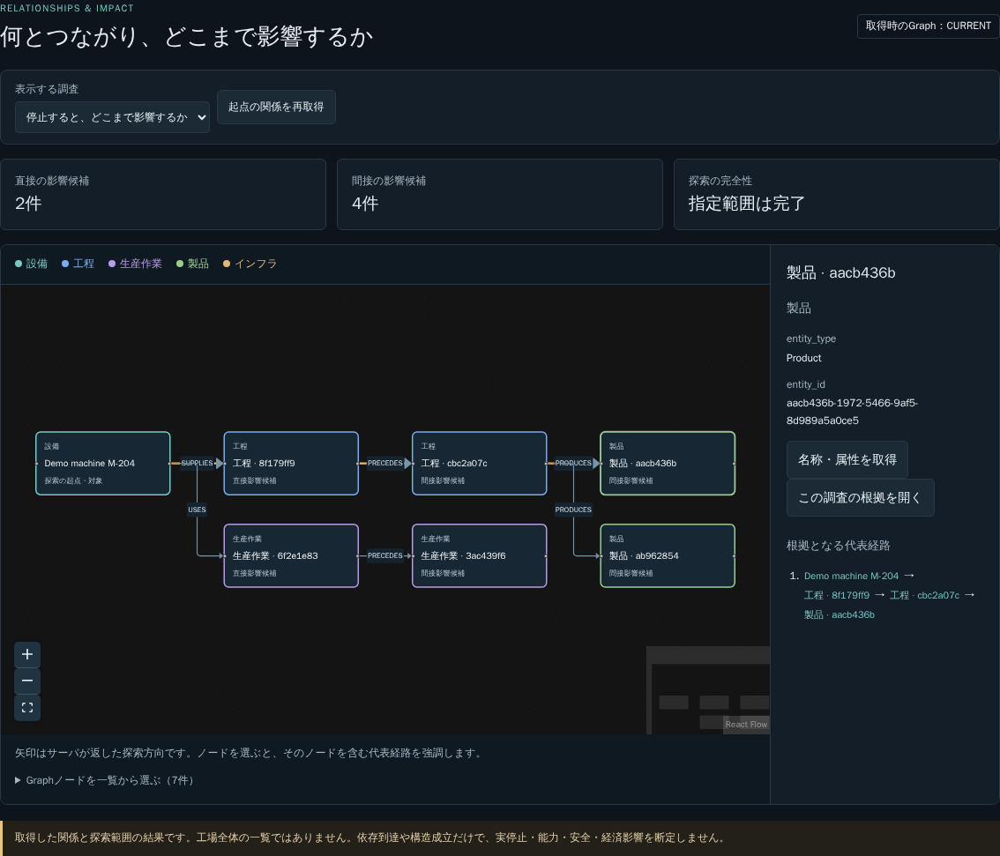

# Graph中心UI 第1段階

## 目的と範囲

ノード間の関係と影響範囲を理解することを主画面へ戻す。開発依頼者の段階的改修の指示に従い、第1段階は開始導線、下流／上流の表示、ノード選択・代表経路・取得属性の確認、既存の比較・根拠・承認操作の保持とする。共通依存・代替・SPOFの対象指定と、判断・変更対象のGraph連動は後続2段階へ残す。

## 参考にした実画面と採用理由

- [Palantir Vertexの関係探索](https://www.palantir.com/docs/foundry/vertex/explore-object-relationships)：中央のGraphと周辺の検索・選択・情報表示を確認。Object Explorerの型間Graphと業務インスタンスのGraphを混同せず、LineScopeでは実業務ノードの関係を主画面にする。
- [Neo4j Bloomの画面構成](https://neo4j.com/docs/bloom-user-guide/current/bloom-visual-tour/bloom-overview/)：Graph sceneと検索・凡例・card listの役割を確認。
- [GraphDBのVisual graph](https://graphdb.ontotext.com/documentation/10.7/visualize-and-explore.html)：型別の色、起点検索、ノード選択と詳細表示を公式スクリーンショットで確認。
- [React Flowの操作部品](https://reactflow.dev/learn/concepts/built-in-components)：Graph操作の拡大縮小・移動・全体表示・ミニマップとノード選択を自作SVGから置換するため採用。`@xyflow/react` 12.12.0でlockし、npm install時auditは0件。分析や成立判定の代行には使わない。

## 実装

- 中央の「登録設備を表示して調査を始める」→実検索候補→設備選択→下流影響／上流依存の取得へつなぐ。左の名称・コード検索も維持。
- Graphを大きな作業面にし、比較・根拠・入力・承認のパネルを開いても保持。隣に選択ノードの取得済み属性と、当該ノードを含む代表経路を表示。
- 型別の色と文字、直接／間接影響候補を表示。上流の直接／間接依存を下流影響候補と呼ばない。ノード選択時は該当する実返却経路のedgeだけを強調。
- 非CURRENTを正常Graphとして表示せず、探索の不完全・描画制限と、実停止・能力・安全等の未評価を維持。node dragやviewport操作でDBの関係を変更しない。edge作成・再接続・削除は不可。
- Graphの取得は既存の決定論的なサーバ比較経路を使用する。自由なLLMへの再調査ではHTTP500 INTERNAL_ERRORを観測したため、今回の初期取得と「起点の関係を再取得」はそれに依存させない。失敗を解決済みとは記録しない。

## 試験と制限

- 追加は表示モデルの4ケース＋代表ブラウザ1シナリオ。既存の接続解除中の遅延応答、未信頼文字列、fresh context、Snapshot確認・失敗時再取得のassertを維持。組合せの直積やBackend試験の追加はしていない。
- Docker内lint／型／format／build成功。Frontend全31件成功（1.60秒）。minify後約514kBのbundle warningが残る。閾値変更で警告を消していない。
- source e7927f0で開始ボタンから11段階の常設UI通し成功。下流6件、上流インフラ、ノード選択と経路強調、拡大・全体表示、Graphを保持した比較・引用、入力準備→別manager承認→元manager実行→再比較、3画面幅を確認。その後、上流ノードの分類文字を依存先へ修正。
- source b73ed89でも全11段階PASS。中央の開始ボタン、実設備選択16.7秒、状態取得5.8秒、下流6件、上流インフラ、経路選択と拡大・全体表示、Graphを保持した比較・実文書引用、別manager承認と元manager実行、再比較で修理300000 JPYを確認。browser runtime errorsは空、390／768／1440pxでoverflowなし。[原測定](2026-10-17-graph-ui-stage1-report.md)。
- スクリーンショットの目視で、経路強調のclassは付いているがReact Flowのpath側CSSにより強調色が薄いことを発見。pathへ直接適用するCSSへ修正し、入口からの実Graph選択を再確認してcomputed strokeも期待色と一致した。機能の通し確認は流用せず、変更範囲に対応する表示検証を追加した。
- 最新headのCI結果はPR本文へ記録する。確認前にDraft／【WIP】を解除しない。

## 未完了

全体完成・全BS・全更新variantの受入ではない。複数ノードの共通依存・代替・SPOFの指定操作、名称・属性取得の使い勝手、比較・根拠・変更対象とGraphの連動、開発依頼者の操作確認はロードマップへ残す。以前の6工程UIの通し成功をGraph中心UIの成功として流用しない。
