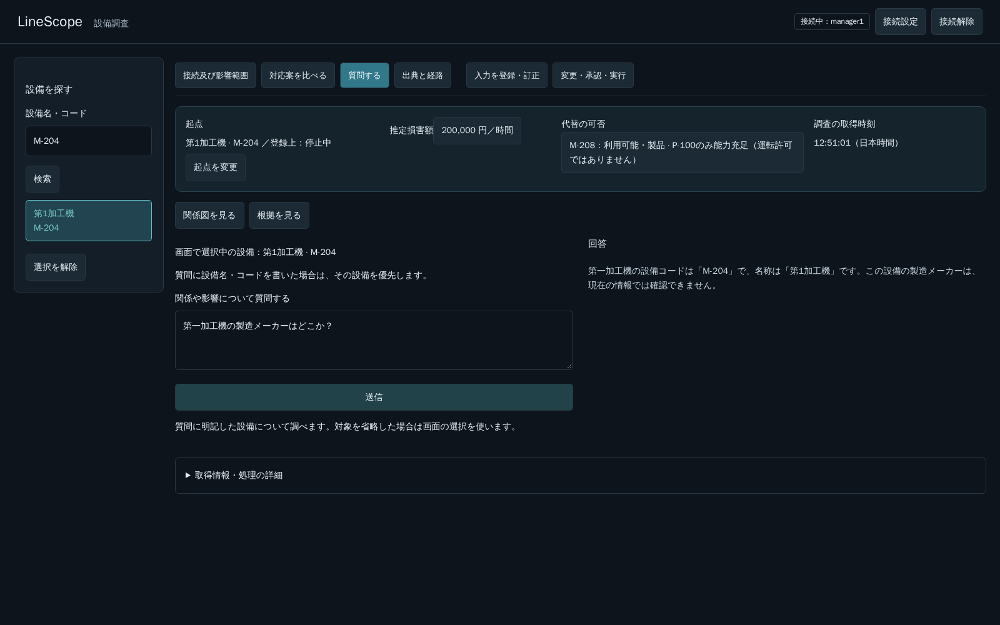
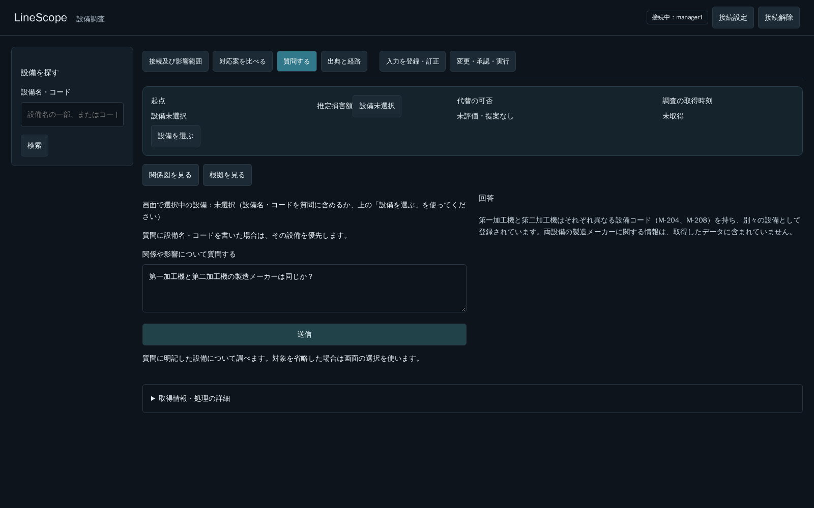

# PR #275：取得済みの設備を不存在と説明する不備

## 再現と原因

開発者から「第一加工機の製造メーカーはどこか？」に対し、表記候補をすべて検索しても設備がないと回答された、という報告を受けた。質問固有の分岐は作らず、検索からモデル入力・生成回答までを照合した。

実際のToolを同じmanager権限で実行した結果：

| 条件 | 実結果 |
|---|---|
| name＝第一加工機 | 0件 |
| name＝第1加工機 | **M-204／第1加工機が1件** |
| name＝第１加工機 | 0件 |
| equipment_code＝第一加工機 | 0件 |

Read Agentの実モデル再現でも、4結果すべてが次のモデル入力へ渡っていた。それでもLLMは全条件0件と回答した（35,514 ms、診断request_id `3f6e4f8f-7f74-497c-8a5b-ddba1283a479`）。取得済みデータと矛盾する回答であり、正常な「メーカー情報が取得できない」という状態と区別すべき不具合である。

表記候補の実検索は成功していた。個別の検索結果を渡すだけで、検索語の群ごとの統合結果を説明用に明示していなかった。誤りは回答生成段階で発生した。モデル内部で1件を無視した理由を断定せず、入力・出力で確認できた事実を根拠にする。

## 共通処理の修正

- 実行した検索条件と実結果から、モデル用のequipment_lookup_summaryを作る。別表記を含む検索群を設備IDでまとめ、候補数と取得完全性を計算する。
- 別の検索語や、明示的なAND条件は混ぜない。複数の実IDを一つへ丸めず、属性の異なるversionの観測も保持する。
- 同じ群に候補があればFOUND（複数ならMULTIPLE_MATCHES）とし、他条件の0件で不存在へ変えない。失敗、未取得ページ、先頭ページ未取得はINCOMPLETEとする。
- 候補数は取得済みID全体で計算する。モデル用の重複表示だけを20件で区切り、元の結果は全件維持し、サンプル打切りを明示する。
- 同じ要約をモデル往復ごとに重複させず、現在の要約1つを保持する。APIのdata・Evidence、Tool契約、認可、回数上限、deadline、データは変更しない。
- 設備の存在と属性の取得可否を区別する共通指示にする。設備コード、質問の題材、メーカー等の単語を判定して専用経路へ入れる処理は追加しない。

自由回答全体の意味論を機械的に検証する仕組みを作ったとはしない。統合した事実の渡し方を修正し、実モデルの回答で再確認する。Q4の運転可否の断定問題を、この修正だけで解消したとも扱わない。

## 検証

既存のBackend試験を減らさず、検索の0件／取得あり、別条件、別表記、複数設備、候補衝突、続き未取得、検索失敗、AND条件、候補表示打切り、元データ保持、モデル入力の要約重複防止を検査した。展開件数の追加はなく、同PRの新規Backend試験24件を維持する。

Docker内の関連回帰は448件成功（16.28秒）。ruff check・format check成功。既存Starlette/httpx警告と終了時のlogging出力の問題は残る。Frontendの製品コードは変更していない。

修正候補のRead Agentを別Pythonプロセスから、同じ実モデル・DB・質問で確認した結果、M-204の存在とメーカー情報を確認できないことを区別した（28,377 ms、`ff21293c-b5b7-4424-baa5-caea65672920`）。一時ソースのimport元は`/tmp/pr275-search-denial/current-src/linescope/__init__.py`。HTTPではなくRead Agent直呼びで、Prepare等へ渡していない。1回ずつの観測であり、性能の一般保証ではない。

5174番へ反映した最初のブラウザ試行では、正しく「M-204が存在するがメーカー情報は取得できない」と回答した。ただし検証側が「取得できない」の表現を許容しておらず停止した。次の試行でも、正しく登録名称で対象を示していたのにコードの本文表示を必須にした検証が停止した。いずれも製品の誤回答とは区別した。検索した実ID・HTTP応答・送信復帰・UUID非表示を機械で検査し、自由文の対象と意味は全文を読んで別に確認する方法で再実施した。テストの通過だけを回答品質の合格にしない。

### 実ブラウザ・実API・実モデルの5問

| 質問 | 結果 | 所要時間 |
|---|---|---:|
| 第一加工機の製造メーカーはどこか？ | 第1加工機・M-204を取得。設備が1件見つかり、メーカーは確認できないと回答 | 16,894 ms |
| 第1加工機の製造メーカーはどこか？ | M-204を取得。設備情報にメーカー属性が含まれず確認できないと回答 | 19,064 ms |
| 第１加工機の製造メーカーはどこか？ | 登録名が第1加工機、コードがM-204と説明し、メーカーは確認できないと回答 | 6,838 ms |
| 第一加工機が最後にメンテナンスされたのはいつか？ | M-204の実IDで記録検索。登録0件と作業未実施は別であると回答 | 21,022 ms |
| 第一加工機と第二加工機の製造メーカーは同じか？ | M-204とM-208を取得。別設備であり、両者のメーカー情報は取得結果に含まれないと回答 | 17,557 ms |

5問ともHTTP 200、回答後の送信ボタン復帰、通常回答へのUUID非表示、JavaScript例外0を確認した。本文の対象と属性不足の意味も読んで確認し、設備がないとは回答していない。これは各1回の確認であり、全質問の品質保証や一般的な応答時間の保証ではない。

### 調査を打ち切った試行と、最終版の再確認

対象優先の追加確認では、M-208選択中に第１加工機の履歴を聞くと、M-204の識別は正しいが、履歴Toolを呼ばず「確認が必要」で終了する試行があった。対象確認だけの機械判定は通ったが、調査としては未完了とした。情報が設備検索にない場合の終了条件が不十分だったため、**対象識別の完全性と質問全体の調査完了を区別し、対応する公開Toolがある情報は参照する**共通指示へ直した。日時や特定の質問に対応する分岐は追加していない。

最終版の実ブラウザ・実API・実モデル確認：

| 画面の選択と質問 | 実参照・回答 | 時間 |
|---|---|---:|
| M-204選択→第２加工機の前回保全日時 | M-208の実IDで保全記録を検索、登録0件と説明 | 37,596 ms |
| M-204選択→この設備の前回保全日時 | M-204の実IDで保全記録を検索、登録0件と説明 | 14,961 ms |
| M-208選択→第１加工機の前回保全日時 | M-204の実IDで保全記録を検索、登録0件と説明 | 21,104 ms |
| M-204選択→第一加工機の製造メーカー | 登録名が第1加工機、コードがM-204と説明し、メーカーは確認できないと回答 | 10,582 ms |

4件ともHTTP 200、送信ボタンの復帰、UUID非表示、JavaScript例外0を確認。履歴の3件は、本文だけでなく実際のsearch_maintenance_records実行も検査した。前節5問と最終版4問の実施段階を分け、途中の未完了を合格へ含めない。

## 範囲と後片付け

5174番の既存APIへ3モジュールを反映して再起動した。5173番、業務データ、seed、DB／volume、モデル設定、API／Tool契約は変更していない。業務書込、新しいDocker imageの作成・取得は行っていない。

今回確認したのは検索結果の統合と、記載した質問での説明・対象優先・必要情報の参照。自由質問すべての正答、性能分布、元の送信不可の発火条件、Q4の運転可否の断定問題は解決済みとしない。最新headのCIは別途確認する。Frontend単体72件は以前のローカル結果であり、今回の試験件数・CIへ付け替えない。

試験用コンテナ・network、非公開の認証env、比較用の一時ソースは削除済み。3モジュールのローカル／5174番APIのSHA-256一致を確認した。stashは保持している。

## 引渡し前の未解決事項とCI

開発者報告の消耗品の保管倉庫に関する回答は、電源R-02の供給関係を保管場所へ読み替えた根拠のない断定だった。scenario1.jsonのR-02はresource_type=power、SUPPLIESの意味は供給であり、消耗品の在庫・倉庫情報はこのデータにない。自由回答全般の修正は#275へ追加せず、Q4の回帰記録としてロードマップ・ガントへ反映した。実モデルでの再実行は行っていない。次工程は根拠付き回答の文書設計とし、merge後3作業日以内にQ2と併せて案と工数を報告する。

実装head a84392eのCI（run 39541226264）は全チェック成功。Backendは1997成功と2049成功・1 skipの計4046成功・1 skip、収集4047件。両shardの収集hashが一致し、選択数1997+2050=4047を確認した。Frontend CIはlint・型・整形・buildであり、Vitestを含まない。本追記後のheadのCIは別途確認し、PR本文へ結果を記録する。
