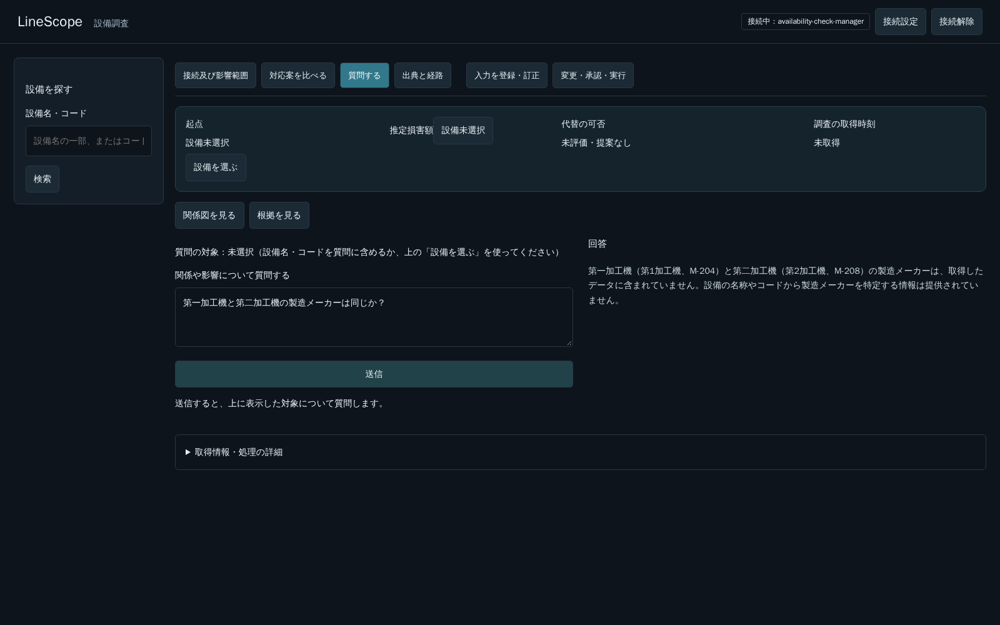

# 複数設備の通常質問での表記照合（PR #275）

## 原因と修正

「第一加工機と第二加工機の製造メーカーは同じか？」で、単純な保全日時質問なら解決できる表記を通常Readが照合せず、設備不存在のように回答した。保全日時専用のmaintenance_dateに候補生成があり、通常Readの0件時補完は名称／コードの条件切替だけだった。

候補生成をequipment_referenceへ移し、両経路で使用する。通常Readでも単一条件・正常・先頭ページの検索に数字表記候補を補い、元の検索がヒットした場合も異なる実IDとの衝突をモデルへ示す。次ページ指定、AND条件、失敗は勝手に展開しない。補助検索からさらにコードの全別表記へ再帰展開しない。複数設備でも既存の12回上限・120秒deadline・認可・Evidenceを維持する。Tool契約・DB・API・更新権限は変更しない。

名称が見つからないことと、メーカー属性を確認できないことを区別するPromptへ補正した。現行のEquipment属性にはメーカー項目がないため、同一メーカーかどうかは推測しない。メーカー情報の新設やデモ値の追加は今回行わない。

## 検証

Docker内の既存回帰444件成功（18.99秒）、Ruff成功。通常調査へ戻る既存試験の期待値を、表記候補3件の実検索へ変更した。試験は最初に旧期待値のまま1件失敗・443件成功だったため、変更仕様に対応する具体的な3要求のassertionへ直して再実施した。Starlette/httpxの既存警告1件、終了時logging output failedを観測した。

追加4ケース（複数設備、候補衝突、取得失敗、回数上限）は、同目的の新規Backend試験が20件から24件になるため了承を依頼中。了承前には追加しない。既存試験を削除・skipして件数を合わせない。

実モデルと実APIを使った5174番のブラウザで、次の2問ともHTTP 200・M-204とM-208の両方の実設備検索・get_equipment・メーカー情報を確認できない旨の回答を確認した。

| 質問 | HTTP応答時間 | 要求ID |
|---|---:|---|
| 第一加工機と第二加工機の製造メーカーは同じか？ | 79,930 ms | 51659c6b-e6fa-4457-a86c-4b83989f3a41 |
| 第１加工機と第２加工機の製造メーカーは同じか？ | 31,759 ms | c5f53228-fba5-4c4f-aa85-3f5cdffa54d7 |

各1回の観測値であり、複合質問の応答速度の保証ではない。1問目は送信ボタンの復帰とスクリーンショットまで確認した。2問目も正しい応答だったが、検証用スクリプトの回答語句判定に「取得できません」がなく失敗扱いとなった。製品の失敗ではなく検証側の過度な表現依存だったため、同じ意味の表現も認めるようにして全角の質問だけ再実行した（要求e637540a-e4a5-467b-9100-c7d4dc01b930、HTTP 200、53,293 ms）。再実行では送信ボタン復帰・JavaScript例外0まで成功した。ただし回答本文が設備コードの代わりにUUIDを再列挙しており、通常表示の規約を満たす確認にはなっていない。これは対象解決の成功と別の、通常Readの自由回答の既知の品質制約として残す。最初のスクリプト全体を成功とは記録しない。JavaScript例外は最初の2問で0件。

## 環境と範囲

確認先は5174番の既存専用Frontendと8003番API。5173番・業務データ・seed・volume・モデル設定を変更しない。Docker imageは作成／取得せず、既存imageと所有する使い捨てtmpfsの試験DBを使用する。F2・F3には着手しない。
