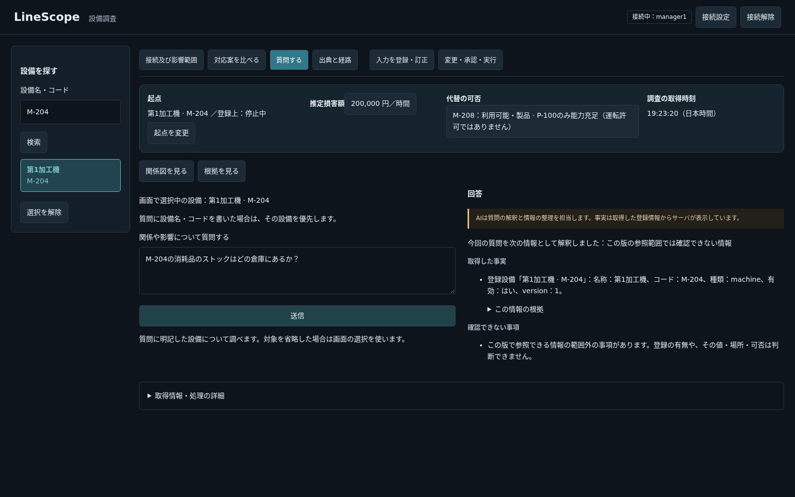
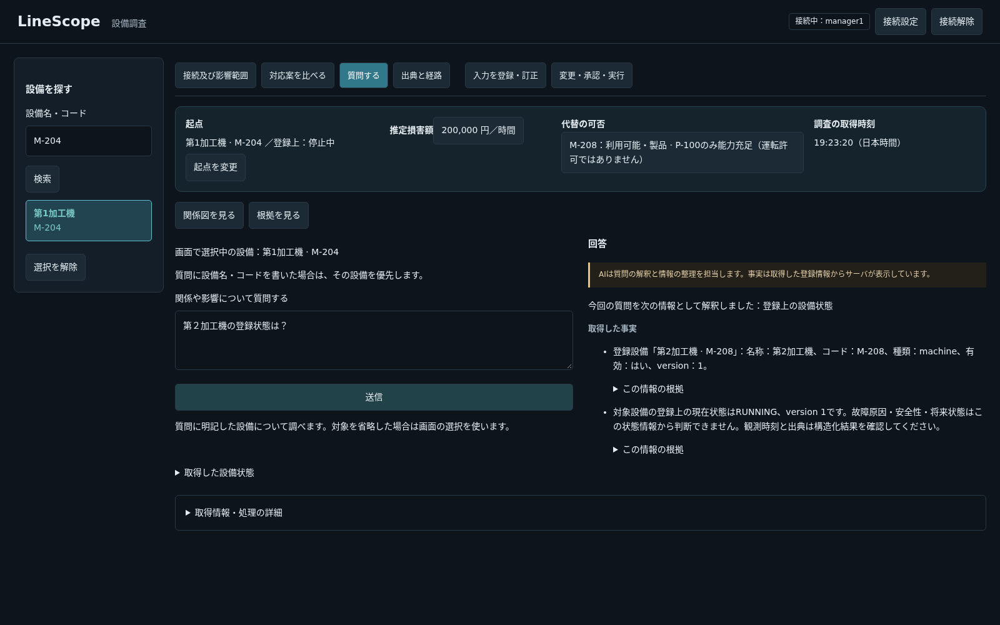
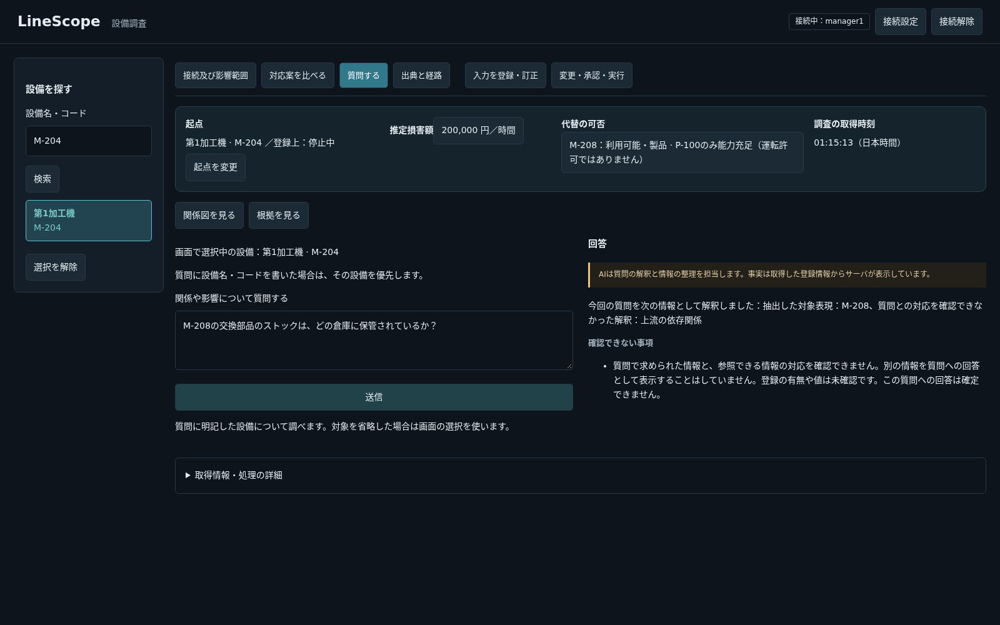
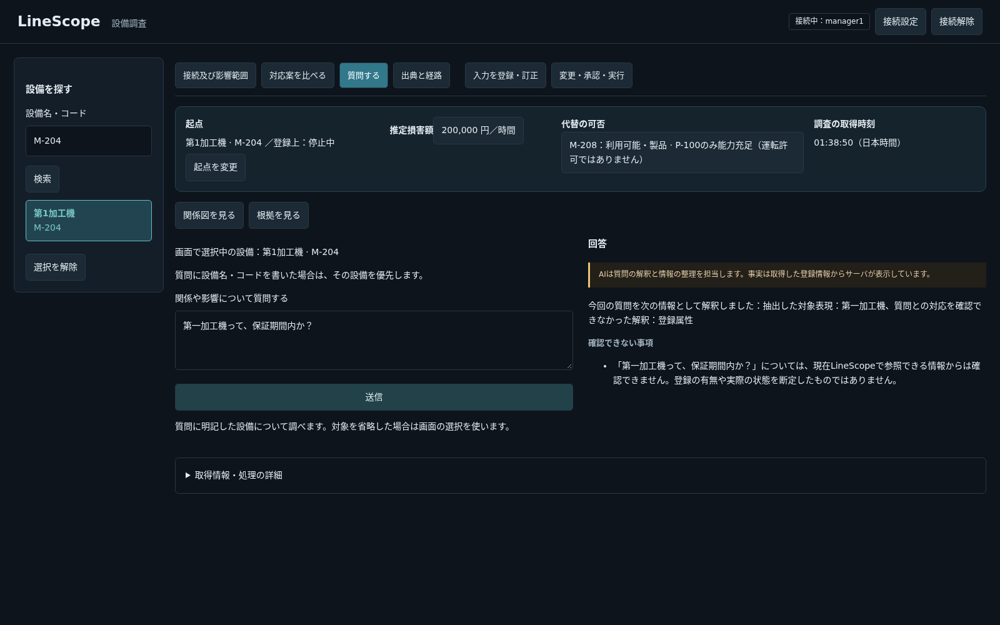

# ハルシネーション対応の実装・限定確認（PR #276）

## 許可と範囲

設計書を作成した後、開発者から同じ#276でハルシネーション対応を実装し、ブラウザで最新版を試せる状態にする指示を受けた。残計画はH→F2→F3の3PRを維持。DB・seed・モデル設定・5173番は変更せず、5174番のFrontendとAPIの変更モジュールだけを反映した。

## 修正の中心

- LLMが構造化した要求fieldを対応一覧へ照合。未知の属性を近い既存情報へ置換しない。主体表現も質問本文／省略時の画面補足と照合する。
- 既存のTool Call schemaを質問解釈に再利用。対象が明示された通常Readは、名称・コード・表記候補の実検索、一意性と完全性、必要なReadの組立てをコードで担当する。質問・設備コードに応じた専用経路は追加していない。
- 登録属性と既存のサーバ計算・要約から事実と表示文を生成。LLM自由文は通常Readの公開文へ流さない。各事実は実tool_call_idを参照。根拠IDだけを添えた任意文の意味を証明する方式ではない。
- 事実、確認不能、未評価、範囲、各事実の根拠を表示。0件、失敗、続き、表示上限を区別し、コピー用answerも同じ生成結果を使う。正式な比較選択、認可・実行予算、時点、Prepareの境界は維持。
- 左ペインにもNFKCと保守的な序数候補を適用。候補を実検索し別IDを丸めない。

## 追加ケースと回帰

自動14ケースと実ブラウザ6項目の計20種類。既存の質問ケースは削除していない。旧試験のLLM任意文章との完全一致は、取得した値・参照・不足を保持し任意文を流さないassertへ変更した。Q2のTool広告を絞る変更に合わせて、上下流Toolを常に両方広告する期待を「必要な方だけ広告し、Dispatcherでは双方の認可済み契約を維持」へ変更した。経路とEvidenceの検査は維持した。

- 関連Backend：277成功・1 skip、4.51秒。この時点の変更に対する結果。既存のStarlette/httpx警告1件と終了時のログ出力失敗は未解決。
- Frontend：全72成功、7.47秒。lint・型・整形・buildも成功。CIのFrontend checkがVitestを実行したという意味ではない。
- 専用サービスを用いた途中の全件は4058成功・1 skip・旧広告前提2失敗（372.80秒）。期待を更新した後、単独の全件を再実行する。全Backendの最終集約と最新head CIは確認後にPR本文へ追記する。下記の環境・旧前提による失敗を、全件成功へ付け替えない。

## 実ブラウザ（実API・実モデル、業務書込なし）

画面でM-204を選んだ状態から、以下を確認した。応答値・事実の参照が実Tool結果に存在することと、文章の意味を別に確認。正常応答、送信ボタンの復帰、内部UUID非表示、JavaScript例外0、禁止した書込HTTPの呼出し0。

| 確認 | 観測 | 時間（各1回） |
|---|---|---:|
| 消耗品の倉庫 | 要求fieldが一覧外となり、場所を作らず参照範囲外を表示 | 2.549秒 |
| 未登録の物を代替にした運転可否 | モデルは下流の質問と解釈。登録到達と未評価を表示し、動く／動かないとは断定しない | 6.047秒 |
| 第２加工機の登録状態 | M-204選択中でも本文のM-208を取得しRUNNINGと表示 | 4.928秒 |
| 第一加工機の前回保全 | 名称を解決し、登録記録0件と「未実施の証明ではない」を表示 | 4.492秒 |
| 加工機という曖昧対象 | 2候補を表示。先頭で状態を取得せず確認待ち | 3.262秒 |
| 左検索の第一加工機 | 実検索でM-204へ到達 | 未計測 |

これらは一般品質・性能分布・全質問への正答の証明ではない。2行目を質問解釈の成功とはしない。モデルの誤解釈が残ることと、コードが根拠を超える結論を作らないことを区別する。

## 途中の失敗と訂正

- 初期は分類の後もLLMにToolを繰返し選ばせ、1試行が120秒で失敗した。初回にはモデルload約26.9秒もあり、単独原因を断定しない。明示対象の取得を共通の構造化計画から実行し、最後の自由文生成を除いた。上表の時間は条件・構成が異なり、純粋な速度向上率として比較しない。
- 粗いtopicだけでは、倉庫の質問を上流と解釈した。要求fieldを独立に照合する方式へ変更。未知のfieldを設備依存のfieldへ吸収するコードはない。
- 初期ブラウザの運転可否の検査はOUT_OF_SCOPEだけを要求して失敗した。登録到達の取得後にNOT_EVALUATEDを表示する結果も区別して扱うよう確認規則を修正した。解釈成功とはせず、運転可否の根拠なき断定がないことを確認した。
- Frontend初回は不完全なホストnode_modulesをmountし@xyflow/reactを解決できなかった。製品のGraphコードは変えず、既存imageの完成済み依存を使って再確認した。
- Backend初回の全件では、専用containerのpytest依存が子processで見えず、Neo4j／Qdrantも未指定だった。依存と専用サービスを整えた。次の専用Neo4jは既定DBがofflineだったため中断し、そのcontainerだけ再作成、tmpfs枠を512MBから2GBへ変更してonlineを確認した。既存デモのDB・volumeは無変更。元のofflineの原因をログで確定したとはしない。
- CIの初回は旧Tool広告前提の2件が失敗した。必要な広告だけを渡す新しい規則へ期待を修正し、取得経路・Evidenceのassertを削っていない。
- 全件検証中に短い比較関連subsetを同じ専用PGで一度並行実行してしまった。subsetは終了し、以降は直列にする。最終集約は単独の全件・CIを根拠にし、並行した途中結果だけで合格にしない。

## 残る限界

質問解釈の誤り、未対応属性、非設備の名称による特定、未対応の公開formatterは残り得る。取得できた別の情報を表示しても、その質問へ正しく回答したとは限らない。未評価の実運転・安全や過去の完全な状態復元、全LLM質問の正答を保証しない。対応範囲・未取得・未登録を混同しない。

最新版は5174番で確認する。PRはDraftを維持し、利用者確認後の指示を待つ。テスト専用container・network・認証env・API内の一時overlayは終了時に削除し、既存環境・stashを保持する。新しいDocker imageのbuild・pullはしていない。

## 追加助言の照合

Claudeの助言のうち、対象と情報種別の解釈表示、有限の主張種類、値のサーバ生成、質問別経路の禁止、両方向の誤り評価、構造不正時の非公開、限界の明示を採用した。情報種別は既に表示していたが、対象の抽出表現を同じ解釈表示に追加した。既存14ケースの1件へその確認を追加し、件数を増やしていない。未検証の推論をAI解釈の別枠で公開する案は採らない。実装は開発者の明示指示に基づくものであり、今回の助言を新たな全面実装の承認とは扱わない。

独立した全Backend実行は4060成功・1 skip、364.83秒。追加14ケース単独も成功。全体の誤断定率・過剰拒否率・構造化出力失敗率を推定する評価は未実施で、限定した質問の成功から一般化しない。

## 最終確認（2026-10-22）

- 実装head `fbb7cba` のCIは全成功。Backend CI run `39587614475` のshard 1は1977成功・1 skip、shard 2は2083成功、合計4060成功・1 skip。収集4061件とcollection hashが一致した。runtime起動・migration・Frontend checkも成功。Frontend CIはVitestを実行していない。
- 対象表現を追加した最新版でも、実API・実モデルの同じブラウザ6項目は全成功。JavaScript例外0、禁止した書込HTTP呼出し0。質問5件の各観測時間は13.582／6.530／3.402／5.668／4.895秒。以前の測定値を置換せず、いずれも単発の再確認として扱う。
- 5174番の変更モジュールをローカルとhash照合。確認に用いた使い捨て4containerとnetwork、私有認証env、API内の一時overlayは削除済み。既存の5173・5174番を維持し、stashは適用・削除していない。
- この追記は実装headの検証結果。後続の文書headのCIと区別する。PRはDraftのまま利用者確認を待ち、F2には進まない。

## H5：交換部品の保管場所に別分野の情報を返した問題（2026-10-22）

開発者は「M-208の交換部品のストックは、どの倉庫に保管されているか？」に、上流到達0件が事実欄へ出る問題を報告した。requested_fieldsが一覧にあることと、質問への意味の対応は別だった。既知の解釈誤りを表示するだけで、この不足が解消したとは言えない。

### 変更と実モデルの照合

`scope_check.py`で元の質問全体と提案されたfieldの意味定義を、取得前に独立照合する。MATCH以外・形式検証不能ならReadを開始せず、factsも空にする。全て範囲外なら設備の識別だけを別の回答として返さない。元の認可・実行予算・deadlineを共有し、モデル設定・DB・seed・5173番は変更しない。追加照合もLLMであり、意味の正しさの証明や全質問への保証ではない。

- 修正前の同文・会話なしの読取probeでは、粗いtopicはUPSTREAMだがfieldはwarehouse_locationとなり、範囲外を表示した。55.420秒で、model load29.094秒を含む。この試行では報告そのものを再現できたとは言えない。
- 修正候補の同文probeでは、fieldがupstream_dependenciesになった。二段目の実モデルがUNSUPPORTEDと判断し、上流を取得せず停止した（7.767秒）。これは実際に起きた誤分類への照合で、注入した判定ではない。
- ブラウザ初回は未対応の3問を停止した後、正常な設備状態の質問が400になった。照合拒否をneeds_inputとして新規会話保存し、後の対象抽出へ無関係な文脈を渡す経路があった。拒否は対象選択待ちではないためneeds_input=falseへ訂正し、新規の対象選択会話を作らないようにした。その400のモデル引数は取得できていないため、文脈だけを唯一の原因と断定しない。既存の対象選択会話を持つ全条件の検証ではない。初回失敗を合格へ付け替えない。

### 修正後の限定確認

同じ順序で実ブラウザを最初から再実行し7項目成功。JavaScript例外0、禁止書込HTTP呼出し0。設備を選択した状態・同じ質問タブで連続して確認した。

| 質問・操作 | 結果 | 応答受信まで（各1回） |
|---|---|---:|
| M-204の消耗品の倉庫 | 範囲外。業務Read0、事実0 | 5.169秒 |
| M-208の交換部品の倉庫 | 上流という誤分類を照合で止める。業務Read0、事実0 | 7.216秒 |
| 未登録の物での代替・運転可否 | 下流という誤分類を照合で止める。業務Read0、事実0 | 9.595秒 |
| 第２加工機の登録状態 | 実M-208のRUNNINGを取得 | 9.171秒 |
| 第一加工機の前回保全 | 実検索の登録0件と限定を表示 | 8.291秒 |
| 加工機という曖昧対象 | 候補を提示し、先頭の状態を取得しない | 7.244秒 |
| 左検索の第一加工機 | M-204へ到達 | 未計測 |

この少数の確認では、未対応3問の根拠のない結論は0、答えられる2問の拒否は0。自然文6問における形式不正によるAPIエラーは0。ただし標本は選定した質問だけで、一般の誤断定率・過剰拒否率・構造化出力失敗率とはしない。二段とも同じ誤解をする可能性は残り、判定を増やして保証したとは言わない。

追加自動6ケース（不一致・非対応・不確実・適合・形式不正・期限超過）と追加ブラウザ1問、既存分と計27種類。開発者へ事前に提示し「ある程度試してみて厳しいようであれば言って欲しい」を受けて限定試行した。既存質問ケースは削除していない。関連Agent・ログ試験は232成功・18 skip（1.07秒）。18 skipはこの使い捨てcontainerでDB等を指定しない試験を含み、全Backend成功という意味ではない。Backend lint・format成功（403ファイル）。Frontendソースは無変更で、単体72件は前回結果。修正後全件はCIで別に確認する。

この修正を同じ#276へ積み、Draftで5174番を開発者確認用に維持する。未評価の一般質問品質を達成済みにせず、難しければ利用者による解釈確認等の代案を先に報告する。

## 保証期間の例とDBを用いた回帰確認（2026-10-22）

開発者が「第一加工機って、保証期間内か？」の分かりにくい回答を報告し、回帰確認を指示した。Equipmentのschema・現行migration・demo JSONに保証期間の項目はない。以前の同じ質問への回答は提示されていないため、過去に正しく期間内外を判定できていたとは断定しない。今回は保証判定を新設せず、確認不能を自然な言葉で伝える共通表示を修正した。

元の質問をコードで引用し、「現在LineScopeで参照できる情報からは確認できません」と示す。質問の要約や不足理由をLLMに創作させず、未登録・期間外等を断定しない。引用内にも内部UUIDは出さない。保証・倉庫・特定設備の分岐はない。

H5のhead aba702cのCIは保全記録のページング試験1件が失敗した。PagedRecordLLMが内部check_question_coverageを通常Readとして処理したため、実行前に止まった。内部照合は既存の試験用応答へ委譲するよう修正し、2ページ・101件の重複なし全取得・最新日時の日本時間表示・Tool呼出しのassertは全て維持した。

- 新しい使い捨てPostgreSQLで、AgentとToolログの関連試験250件すべて成功（3.31秒、skipなし）。以前はDB未指定で18 skipだった範囲も含めた。実デモDBの更新ではない。既存のStarlette/httpx警告1件は残る。
- Backend lintとformatは成功（403ファイル）。Frontendソースは変更せず、前回の72件成功を今回再実行したとはしない。
- 実API・実モデルのブラウザ8項目は全成功。JavaScript例外0、禁止書込HTTP0。保証の1問を追加し、自動20＋ブラウザ8＝計28種類。既存ケースの削除・assertの弱体化はない。
- 未対応4問（倉庫2・保証・未評価の運転可否）はReadもfactsも0。状態・保全の2問は回答、曖昧対象は候補選択待ち、左検索は漢数字で到達した。各HTTP応答までの単発観測は11.756／6.562／6.736／10.649／6.502／6.743／7.484秒、検索は未計測。一般的な誤断定率・過剰拒否率とはしない。
- 保証の回答は「『第一加工機って、保証期間内か？』については、現在LineScopeで参照できる情報からは確認できません。登録の有無や実際の状態を断定したものではありません。」という共通表示。専用の応答文をハードコードしていない。
- 全Backendは次の修正headのCIで別途確認する。旧headのCI失敗や、今回の関連250件を全Backend成功へ付け替えない。

