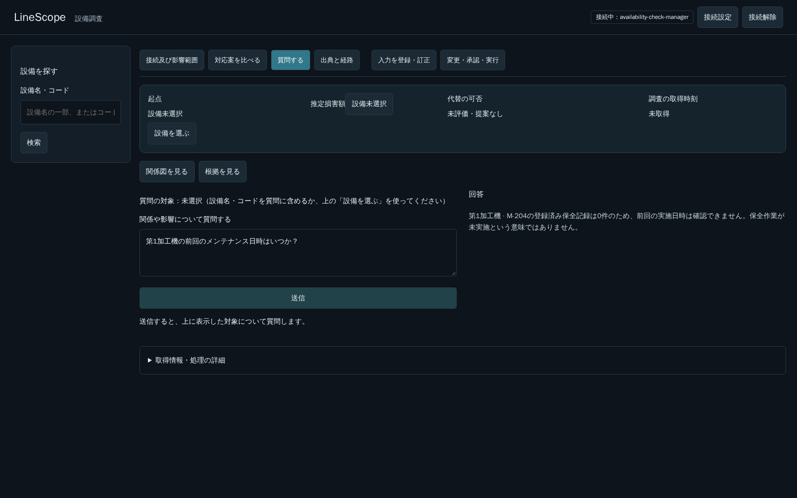

# 保全日時質問のタイムアウトと表記揺れの再確認（PR #275）

## 現象と原因の切り分け

「第1加工機の前回のメンテナンス日時はいつか？」で120秒の上限に達した。該当要求ce5cffbe-0974-4f77-b74b-e60e1b40bdbf、1b433bfe-3ae2-43ed-85ec-639eacccd8b7は最初のLLM応答待ちで終了し、Tool／DB検索に到達していなかった。28のTool定義と約25KBの入力を送り、モデル側では約6,003トークンの処理が発生していた。

短い専用指示にした候補でも、GPU解放前には正常応答82.1秒と120秒の時間切れが混在した。私的な読取試行でnum_batchを128にした比較も時間切れで、改善の根拠にならなかった。製品の設定には採用していない。開発者から「こちらでGPUを使っていた。いま解放した」と連絡を受け、GPU層数の調整案と追加2ケース（計22件）の確認依頼は取り下げた。モデル・GPU層数・daemon設定・deadlineを変更せず再検証した。

解放後は同じ修正候補の名称3表記が約2.9〜3.2秒で応答した。GPU競合の影響が大きかった可能性は高いが、旧コードを解放後に同一条件で比較していないため、元の時間切れをソフトウェアだけの原因とは断定しない。中断後もモデル処理が続くログがあり、直後の要求の待機にも注意が必要である。共有Ollamaの停止・再起動・設定変更は行っていない。

## 採用した修正

- 単一設備の直近保全日時だけの質問では、短い指示と設備検索1 Toolで対象語を抽出する。別の内容も尋ねる場合は通常調査に戻す。
- 名称／コードを別要求で実検索し、「第」に続く半角・全角・漢数字の候補も照合する。実IDで一意性を確認し、複数候補・検索の続き・取得失敗を存在しないことと混同しない。
- 一意な設備の保全記録をページ末尾まで取得し、登録日時の最大値を日本時間で回答する。0件では日時を生成せず、保全未実施とは断定しない。既存の12回・120秒・認可・Evidenceを維持する。
- 時間切れの表示から、質問の絞り込みが常に解決策であるような文言を外した。

検索対象は既存search_maintenance_recordsの範囲。正式MaintenanceInputとの横断検索や、広範な別名辞書を追加する変更ではない。GPUが競合した場合の120秒以内の応答は保証しない。

## 確認した範囲

実モデルqwen3:30b-a3b-instruct-2507-q4_K_M、既存5174番→8003番。最新候補の実API読取6ケースは次のとおり（各1回の観測値）。

| 対象語 | 応答時間 | 判定 |
|---|---:|---|
| M-204 | 11,291 ms | PASS |
| 第1加工機 | 9,083 ms | PASS |
| 第一加工機 | 11,772 ms | PASS |
| 第１加工機 | 1,450 ms | PASS |
| 加工機 | 5,206 ms | PASS |
| 登録されていない検証用設備F1 | 8,010 ms | PASS |

不存在名が検索されない試行を1回検出したため、部分名称・不存在と思われる名称も検索して存在はサーバで確認するよう指示を修正してから上表を再実施した。失敗した試行を成功回数へ含めていない。

実ブラウザでは第1加工機／第一加工機／第１加工機の3問を続けて送信し、HTTP 200・同じM-204の実ID・実保全記録検索・回答後の再送信可能・JavaScript例外0を確認した。検索対象の保全記録は0件で、実在日時がある環境での実モデル確認は未実施。

BackendはDocker内で回帰442件成功（18.49秒）、probe試験2件成功。既存Starlette/httpx警告1件と終了時のlogging output failedを観測した。追加の日時試験7件はすべて実DBを使用して成功し、表記3種・候補衝突・101件のページ取得・取得失敗・複合質問の通常経路を確認した。同目的の新規Backend試験は既存13件＋今回7件の計20件。個々の文言・レイアウト試験は増やしていない。

Ruff check／format、Frontendのlint・型・整形・buildは成功。Frontend buildの既存chunkサイズ警告あり。ここまでの結果はローカル実行で、今回の追加コミットのCI結果とは別である。

## 未確認・環境

GPU競合下での安定性、元の時間切れの単独原因、任意の言い換え全体、正式入力を横断した保全履歴は保証しない。書き込み操作、seed・DB・volume変更、5173番変更、新しいDocker imageの作成／取得は行っていない。F2・F3には着手しない。

