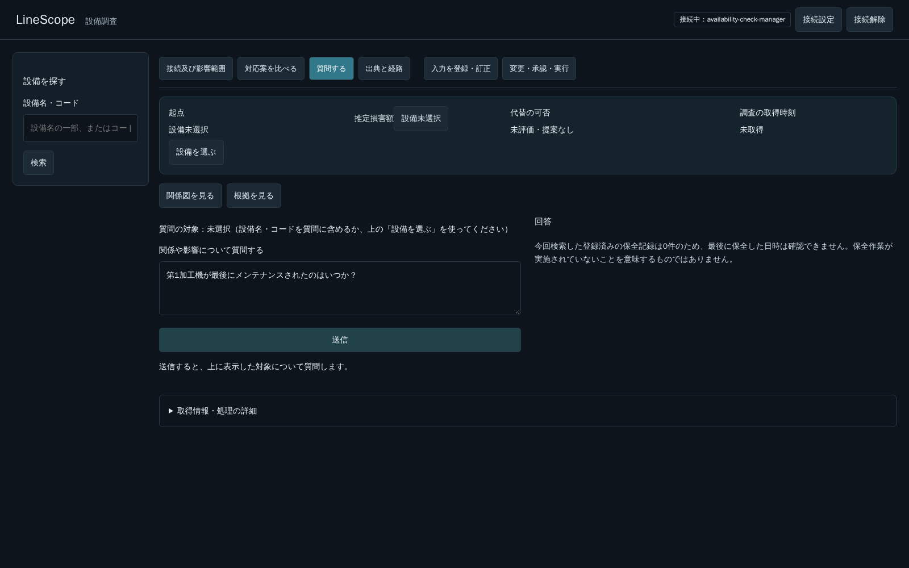

# 名称での質問とM-208の電源依存：後続タスクの調査

開発依頼者の指示により、限定した読取調査と計画の記録だけを行う。#274で製品ソース・プロンプト・Tool・契約・データ・環境は変更しない。今回の後続化は、実装着手の承認ではない。

## F1：名称での質問の対象解決

### 実APIで確認したこと

既存5174番が使うAPI（localhost:8003）へ、context_idを付けない独立した質問を各1回送った。実モデルを使った読取で、書込なし。

| 要求 | 結果 | Toolの経路 | 診断用request_id |
|---|---|---|---|
| M-204が最後にメンテナンスされたのはいつか？ | HTTP 200／ok。「M-204のメンテナンス記録は現在登録されていません。」 | search_equipmentで1件→search_maintenance_recordsで0件。約11.155秒 | 84dc574b-ade6-40f7-a5c4-098400231b3a |
| 第1加工機が最後にメンテナンスされたのはいつか？ | HTTP 200／ok。「設備コード『第1加工機』に該当する設備は見つかりませんでした」旨 | search_equipmentで0件、保全実績の検索へ進まない。約6.141秒 | 645434ed-86a7-4007-a244-218814eb7e72 |
| 直接経路search_equipment、filter.name=第1加工機 | HTTP 200、M-204／第1加工機の1件。約16ms | 名称検索自体は動く | f5560378-ebbd-41da-b32e-33194b303abd |
| 同Tool、filter.equipment_code=第1加工機 | HTTP 200、0件。約35ms | 名称をコード条件へ入れると一致しない | a66fe271-3517-4f96-85ec-dbc0a07ea89d |

設備データや名称検索機能の欠落ではない。自然文の対象解決が、同じ実体の名称とコードで異なる結果になる問題を再現した。公開のtool_traceには実引数がないため、「LLMがequipment_codeへ名称を渡した」とまでは断定しない。今回は利用者の既存会話contextやFrontendの起点コード前置きを含む要求は再送していない。反復による再現率・別モデル・別名称は未調査。

### コード上の根拠と対応案

- `agent/read_agent.py` のSYSTEM_PROMPTの対象指示は「設備コードはsearch_equipmentで検索」となっている。名称とコードの使い分け、0件時の別条件での再検索は明示されていない。これが影響している可能性はあるが、原因の単独特定ではない。
- `application/reads.py` のEquipmentFilterはnameとequipment_codeを別々に受ける。`persistence/core_reads.py`はnameを文字列の部分一致、コードを完全一致で検索し、両方を同じ要求へ渡すとANDになる。OR検索として誤用しない。
- 後続ではTool説明／プロンプトと実Tool呼出しを照合し、名称・コードから対象の実IDへ解決する規則を整える。必要なら0件時の別条件での読取を検討する。新APIや類似名称の無条件な選択を前提にしない。
- 1件なら当該実IDで質問を続け、複数なら候補を示して確認する。対象不存在、対象は存在するが記録0件、参照失敗・探索未完了を区別する。「記録なし」を「保全していない」に読み替えない。
- 「最後の保全」の参照範囲も確認する。今回使われたsearch_maintenance_recordsと、追加のMaintenanceInputの計画／履歴は別の登録経路であり、どちらまで参照した回答かを曖昧にしない。

受入の中心は、同じ設備をコードと名称で質問すると同じ対象へ到達すること、名称が曖昧なら選択を求めること、失敗を記録なしと説明しないこと。範囲・検証数・日数は着手前に確定する。想定は1 PR、#274に実装を追加しない。

## F2：M-208にも必須の電源依存を持たせる

### 現状と理由

- `docs/demo/data/scenario1.json`はR-02（共通電源）とR-02→M-204の必須SUPPLIESだけを持ち、M-208への電源依存はない。M-208の上流に電源が出ないのは、現行データの構成による。図の表示だけを直して存在しない辺を描かない。
- 過去にM-208の利用可能性が不明になることを避けるため、M-208への必須供給を外した。これは機械に必須電源がないという業務上の不自然さを残している。今回、開発依頼者が改めて後続対応を要求したため、単なる保留候補ではなく後続タスクとして扱う。
- `domain/graph_requirement_rules.py`ではインフラの運用上の利用可能性はv1で不明のまま。`docs/design/data-model.md`のinfrastructure_resourceにも稼働状態の列がない。activeは稼働中・供給中という意味ではない。
- 必須の供給だけをJSONへ戻すと、M-208の依存条件の利用可能性は不明へ戻る。電源を任意依存にする、不明を利用可能へ表示変換する、稼働中というM-208自身の状態だけで電源の健全性まで推定する、という回避は行わない。

### 後続の範囲と受入

目的はM-208の上流にも、実態に沿った必須電源とその根拠が図示され、依存先の状態に従って利用可能性が判定されること。R-02を両設備へ供給する構成を第一候補とし、電源状態の取得元・状態モデル・変更統制・判定への適用を設計時に確定する。共通電源が停止した別シナリオを今回無断で復帰するものではない。

着手前にDB／migration、読取・状態変更、Graph観測・代替／弱点／共通依存、JSONローダー、API契約、UI、既存テストへの影響と工数を調査する。インフラ状態の拡張が必要と見込まれるが、具体的な状態値・承認規則・契約を今回決め打ちしない。

受入は、M-208に必須電源依存が見えること、電源が利用可能なら他の条件も踏まえて候補を評価できること、停止なら利用不可・不明なら確認が必要と説明すること。能力・安全・品質・運転許可は別判定のままにする。

想定はこの業務機能で1 PRを暫定計上し、影響調査後に日数・検証数・分割の要否を報告する。単なるJSON修正とは見積もらず、規模が大きければ分割計画を先に提示する。#274での実装・環境再投入は行わない。

## ガントの工程反映漏れの訂正

前回は図の末尾の注記へF1・F2を追記しただけで、工程行・状態・順序には反映していなかった。残タスク全体と進行順を把握する目的を満たさない更新だった。#274のmerge後、F1・F2を独立した工程行へ描き、#274までmerge済み、F1調査中、F2未着手、F1のmerge後にF2という順序へ訂正した。未見積もりのバーを日数に比例する表示とはせず、確定する工程を示す。CONTRIBUTINGへ新規タスク・進捗・merge・順序／分割変更時の文書とガントの同時更新を継続ルールとして追加した。

## F3：範囲一覧の保留stashをF1・F2完了後に更新する

開発依頼者から、F1・F2の改修とmergeを終えてから、保留中の「やること／やらないこと」一覧を更新してPRを作成する指示を受けた。`docs/demo-product-scope`のstash `c48d3e3345d1ea1600cc2e98a0a309a379e336c8`（確認時stash@{0}）がrequirements.mdの範囲整理案であることを読取確認。apply・pop・dropは行っていない。ロードマップとガントへF3の独立行を追加し、現在の残計画はF1→F2→F3の暫定3 PRへ更新した。F2の分割が必要ならその前に再計画する。

## F1の実装候補と検証途中の記録

設備検索のAPI条件・SQL・認可は維持し、Read Agentの指示とTool schemaの説明へ名称／コードの使い分け、0件時の別条件検索、複数候補・続きがある場合の選択確認を追加した。正式な検索条件をORへ変えたり、設備コードに応じた専用処理を追加したりしていない。

検証用に`scripts/verify_equipment_identity.py`を追加。直接検索で一意・複数・不存在の前提を確認してから、実モデルの質問に対する実Tool結果を照合する。設備を特定しないまま保全記録を読むことや、質問と異なる設備の取得を成功扱いしない。製品の書き込み、seed、環境作成は行わない。

- Docker内の関連Backend試験は293件成功（14.12秒）。追加は検証プログラムの判定境界を守る2件。既存のStarlette/httpx非推奨警告1件がある。終了後の`LineScope logging output failed`の出力も観測したが、この時点では原因を特定していない。
- 実APIの初期2試行では、コード質問の設備IDが期待値に一致せず、検証を失敗とした。当初の検証プログラムは失敗応答を保存しなかったため、両応答の詳細は残っていない。後から成功例だけを使って合格としないため、失敗時にも応答と判定理由を保存するよう検証プログラムを修正した。
- 実Dispatcherを包んだ別の読取専用プロセスでは、コードを`name`で検索して0件→`equipment_code`で検索して1件→その設備の保全記録0件、名称を`name`で検索して1件→同じ設備の保全記録0件、を確認した。これは実APIの全試行が成功する証明ではない。
- 実APIの要求`ab008d95-0438-4eab-8df1-7bdd3902ede5`と`24b51696-fbec-42ea-801e-3f5d21c9fd42`では、コード指定から設備M-204・第1加工機の実IDへ到達し、保全記録0件を取得した。
- 続く名称指定の要求`04151419-4648-448e-a073-4135bbbb6b77`は、最初のLLM生成が120秒の期限へ到達し、HTTP 503／AGENT_LIMIT_REACHED。Toolは呼ばれておらず、名称検索0件や記録未登録という結果ではない。

モデルは既存設定の`qwen3:30b-a3b-instruct-2507-q4_K_M`、context 16384を使用。共有LLMの設定変更・停止は行っていない。現時点は検証途中であり、対象解決の安定性・曖昧名称の確認・ブラウザの受入を合格扱いしていない。5174番のAPIだけへ実装候補の2モジュールを配置し再起動した。5173番、DB・seed・volumeは変更していない。

再確認の要求`17e5c48b-c715-454f-9791-a46b5a7f5d87`も120秒でHTTP 503／AGENT_LIMIT_REACHEDとなった。今回はコード質問の途中であり、設備検索の後の生成段階も期限へ達し得る。Ollama側のログでも期限に伴うキャンセルを確認した。名称の取り違えと生成遅延を同じ原因とは断定しない。負荷・モデルの一般品質を確定する調査はしていない。

プロンプトのみの変更を解決済みとして渡さない。実装候補はブランチに保持し、5174番APIの2モジュールは配置前のバックアップへ戻して再起動した。候補のブラウザ受入と、曖昧名称／不存在の実モデル確認は未完了。次は0件時の別条件検索をAgentの制御として確実に行う方式を検討する。新しいAPI・Toolや検索filterの意味変更を前提にせず、呼出し上限・期限・実観測の記録を維持する設計と追加検証数を先に整理する。

### Agentによる別条件検索への変更

引き続き、自然文のRead Agent内で、単一条件・先頭ページ・正常完了の0件に限り、同じ検索語でもう一方の条件を一度検索するよう変更した。元の0件を置き換えず、追加呼出しにも通常のAgentToolSessionを使い、認可・最大12回・deadline・実観測・traceを維持する。モデルが既に指定した条件は重ねて自動実行せず、ページの続き・AND指定・失敗を別条件検索へ変換しない。明示の関係分析経路も変更していない。責務はagent-design §11、指示はprompt-design末尾へ記載した。

- 追加の制御試験は8ケース。関連回帰は301件成功、1警告、15.03秒。両方向、再検索しない条件、両方0件、失敗、12回の上限を検査した。
- 実APIのコード質問`dfde2e64-8d1b-43fd-8983-2c791da11313`、名称質問`37a89aa6-eccc-4f4f-89b1-718bc157b5ea`は同じ設備の検索と保全記録0件まで到達した。
- 曖昧な「加工機」の質問`40e1badd-6e48-445d-959c-89de83ae9564`は、Toolを呼ばず、サーバの「対象を特定できる設備コード・IDなどを指定してください」という確認へ戻った。先頭設備を選んだり、保全記録を読んだりしていない。ただし実候補を検索して一覧提示したわけではない。候補の実取得を必須とする検証プログラムはNO_VERIFIED_READで停止した。この失敗を隠したり、候補取得の合格へ読み替えたりしていない。
- ブラウザからもコード・名称の2質問を実APIへ送信し、同じ設備と保全記録の取得、回答後の再送可、JavaScript例外0件を確認した。ただし、この時点のモデル文面にUUIDが残った。

このため、今回検索した保全記録が全て正常完了の0件の場合だけ、サーバの既存分野別要約へ「日時は確認できない。未実施の証明ではない」という説明を追加した。UUID・推測日時・作業未実施の断定をモデル文面から引き継がない。記録が存在する場合、次ページがある場合、検索失敗の場合はこの0件要約を使わない。3ケースを追加し、今回の追加Backend単体は検証プログラム2件＋Agent制御8件＋0件要約3件＝13件。実モデル4種類・ブラウザ2質問を別枠で数えても19種類であり、20件を超えて追加していない。

実装候補のAPI再配置は5174番に対応する既存APIの3モジュールだけ。既存イメージを再利用し、新しいDockerイメージのbuild・pull、DB・seed・volumeの変更、5173番への変更は行っていない。最終版の確認結果は以下へ追記する。

### 最終版の確認結果

- Docker内の関連Backend試験は304件成功、1警告、13.47秒。ruff check／formatも成功。最初の再実行は専用PGのtmpfsが満杯になり、299件成功・6エラーだった。デモDBではなく使い捨てテストPGだけを再作成し、tmpfsの上限とWAL設定を調整して再実行した結果である。終了時のログ出力失敗の1行は引き続き原因未特定として残す。
- Agent試験群全件も別実行で198件成功、0.86秒。上記304件との重複があるため、足し合わせて件数を報告しない。
- 実API：コード`037e1df2-dbc0-4db2-85ef-82a3a74a5cb4`、名称`c4cd96c1-bd36-427b-82eb-d5357eba270f`、不存在`baf9eaa4-c58e-409f-9f65-92ede4914946`の3ケース成功。コードと名称は同じ設備を取得し、保全記録0件について同じサーバ要約を返す。不存在は両条件の実検索0件で、保全記録の読取は行っていない。
- 実ブラウザ：5174番からコード・名称の2質問を送信し、HTTP 200、同じ設備と保全記録の取得、回答後の再送可、JavaScript例外0件を確認。最終版の要求IDは`432359cd-7917-45b0-a106-0d25e096766c`と`56416200-4d59-4b79-815f-62b0166f15f2`。両方ともUUIDなしの0件要約を表示した。
- モデルmanifest digest：`19e422b0231392335cfc49cfd172de7034bb1aeabb08aa307cce745c60b272fe`。この固定デモでの限定的な確認であり、全名称・全質問・繰り返しの成功率、記録がある設備での最新日時の選択、一般LLM品質の合格ではない。

再現する場合は既存の専用環境とその読取認証を使う。0600の私有envで`LINESCOPE_VERIFY_TOKEN`を渡し、既存API imageへ現在の`scripts/verify_equipment_identity.py`をmountして実行する。例：`python /workspace/probe.py --url http://127.0.0.1:8003 --equipment-code M-204 --equipment-name 第1加工機 --missing-name 登録されていない検証用設備F1 --output /out/results.json`。曖昧名称を実検索する厳密な確認には`--ambiguous-name 加工機`を追加するが、前述の確認要求だけで終わる応答ではFAILになる。検証プログラムを緩めて合格扱いしていない。

ブラウザでの再現は、5174番へ接続し、設備を未選択の状態で「質問する」を開き、上記のコード質問・名称質問をそれぞれ送信する。Networkの実Tool結果で同じ設備と保全記録の取得を照合し、通常回答にUUIDがないこと、送信ボタンが再び押せることを確認する。書き込み、LLM設定変更、別環境の操作は不要。
