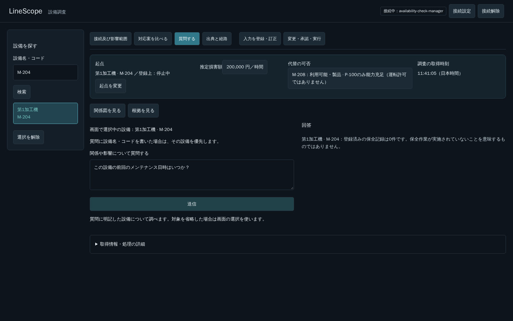
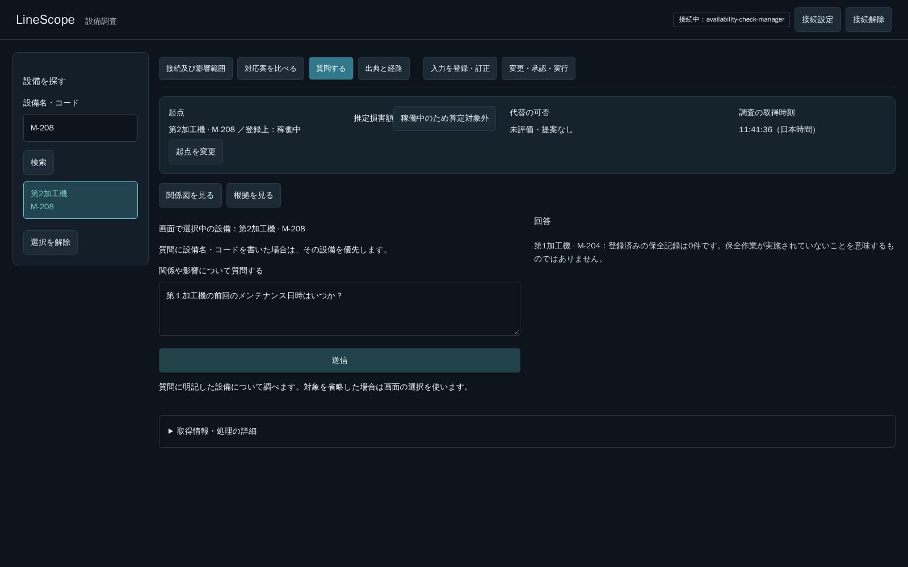
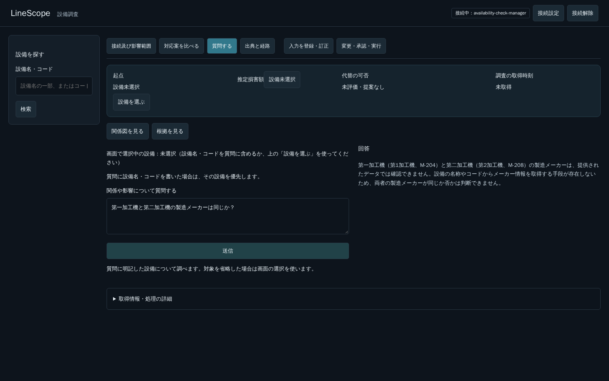
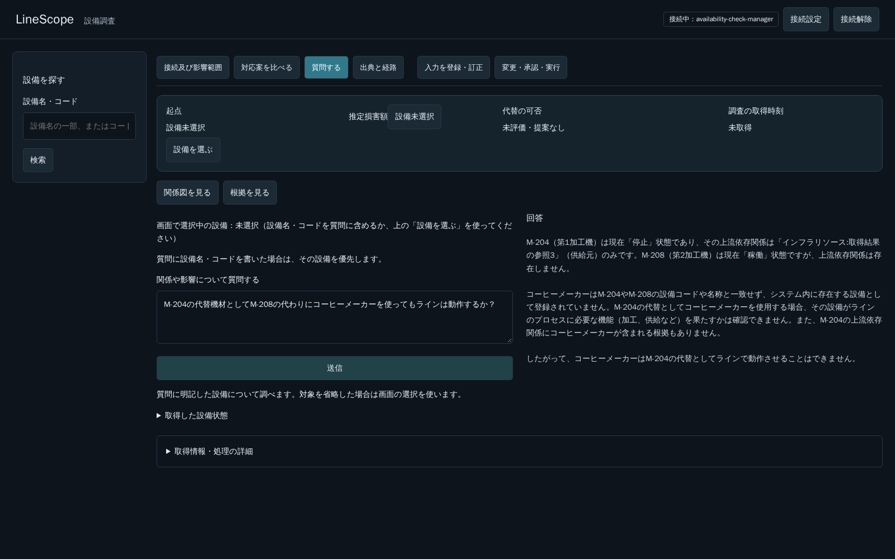

# PR #275：例示専用経路の撤去と通常Readの再確認

## 判断と範囲

開発者の「例は例であり、その質問だけに特化しない」「このPRで作った誤った実装はこのPRで撤去する」という指示に従う。保全日時専用化は、通常経路との比較前に例示を実装要件へ取り違えた設計判断の誤りだった。速度差があることを、質問ごとの専用経路を増やす根拠にしない。

`maintenance_date.py`とRead Agent内の題材検出・専用Prompt／schema・専用の対象選択・自動記録ページ取得・専用日時集計を撤去した。保全、状態、属性比較等の自然文は同じ通常Readループへ渡す。質問文の例別分岐の撤去を、後続PRへ残さない。実行時の認可、12 Tool上限、120秒deadline、Tool・HTTP・DB契約は変更しない。

残すのは、題材によらない設備名／コードの照合、数字の表記候補の実検索、画面選択と質問本文の分離である。候補衝突・未取得ページ・失敗を0件へ変換しない。未取得のメーカーや安全性等を推測しない。

## 撤去後に実際に見つけた不備と修正

最初の通常Readの実ブラウザ確認では、選択M-204から「第２加工機の前回のメンテナンス日時はいつか？」と聞くと、M-204しか検索せず、質問の対象を確認するよう要求する誤答が返った（HTTP 200、29,636 ms、診断request_id `6f7c0b1c-ed77-4919-b040-dbb370d7e360`）。専用経路で通った過去の確認を、撤去後の合格として流用しなかった。

原因は、本文から分けた後も、競合する画面選択のコードをすべての質問へ補足として渡していたこと。Promptの優先指示だけでは、この実試行で守れなかった。画面選択の補足は、本文が「この設備」「選択中の機械」等で選択対象を参照した場合だけ渡す共通処理にした。本文が設備名・コードを明示する通常の質問へ、無関係な選択コードを無条件に併記しない。対象も画面選択への参照もない場合は、黙って選択を採用せず対象の確認を求める。補足はuser情報のままで、認可の根拠やsystem命令へ昇格させない。

別の試行は、API再起動直後の接続で検索欄を待つ段階で停止した。質問の試験へ到達していないため成功へ含めない。API起動完了後、ログイン応答200を確認する検証手順で再実施した。

## 通常回答の表示

- 実取得したTool結果でUUIDと名称・コードが対応した場合だけ、回答本文の内部IDをその表示名へ変換する。取得結果にIDだけがある参照は、一意な「取得結果の参照N」で区別する。取得結果にもないUUIDが残る自由回答は出さず、説明できなかった旨と取得結果の参照を案内する。IDを単純に消して、異なる対象を一つへ丸めない。元の構造化結果・Evidenceは変えない。
- 実取得したtimezone付き日時がそのまま本文へ引用された場合は、日本時間を明記して表示する。未取得の日時を生成せず、サーバが質問の種類に応じて最新日時を自動集計するものではない。
- 保全記録の正常な取得結果がすべて0件で続きもない場合だけ、登録0件と作業未実施の違いを示す。対象表示は、実行した記録検索のequipment_idと実取得した設備名を照合する。検索候補の先頭や画面選択から推測しない。範囲を照合できなければ、特定設備の名前を付けない。

## 回帰試験

保全日時の専用経路用だった11ケースを、通常Readで対象・表記・衝突・ページ取得・失敗・文脈優先を確認する試験へ移し、`test_equipment_reference.py`へ改称した。件数合わせで試験を削除しない。ページ取得はモデルの通常Tool計画で2ページ・101記録を取得し、続きのcursorと、実データの日時表示を検査する。対象取り違えの試験では、取得した記録のequipment_idと回答のコードの両方を検査する。

既存ケース内で、取得済みUUIDの表示名変換と、取得していないUUIDを含む回答の抑止も検査した。今回新しい展開ケースは増やさず、同PRの新規Backend試験は24件のまま。

Docker内の関連回帰：**448件成功、16.00秒**。対象は`backend/tests/agent`、applicationのagent_service／search_reads／reads、integrationsのllm、scriptsのequipment_identity_probe。ruff check成功、ruff format check成功。既存Starlette/httpx警告1件と終了時の`LineScope logging output failed`は残る。これらを今回の修正で解消したとはしない。

Frontendの製品コードは今回変更していない。Frontend単体72件は前回の結果であり、今回の実行結果やCIへ付け替えない。最新headのBackend全件はCIで別途確認する。

## 実ブラウザ・実モデルでの確認

環境は既存5174番、実API・実PostgreSQL・同じOllamaモデルを使用。応答の差し替えは行わず、業務書込は行わない。GPU専用運用。次の各1回の観測値を、一般性能保証としない。

| 画面の選択 | 質問 | 対象と回答 | 所要時間 |
|---|---|---|---:|
| M-204 | 第２加工機の前回のメンテナンス日時はいつか？ | M-208の実IDで記録検索、M-208の登録0件と回答 | 18,947 ms |
| M-204 | この設備の前回のメンテナンス日時はいつか？ | M-204の実IDで記録検索、M-204の登録0件と回答 | 11,350 ms |
| M-208 | 第１加工機の前回のメンテナンス日時はいつか？ | M-204の実IDで記録検索、M-204の登録0件と回答 | 27,529 ms |

3件ともHTTP 200、内部UUIDを回答本文へ出さず、送信ボタンがenabledへ戻り、JavaScript例外0。これで元の送信不可の発火原因を特定したとはしない。

「第一加工機と第二加工機の製造メーカーは同じか？」「第１加工機と第２加工機の製造メーカーは同じか？」も、両設備の実データへ到達し、メーカー情報が取得できず同一性を判断できないと回答した。2件ともHTTP 200、回答のUUIDなし、送信復帰、JavaScript例外0。診断request_idは`7473971a-891c-42fa-8930-05167fc941d3`、`5d810638-8e9a-4756-861a-430ce1845941`。

### 追加の自由質問：合格にしていない回答

コーヒーメーカーを未登録の代替機材として尋ねる例も、専用分岐なしで通常Readへ渡した。最初は名称未取得のインフラIDにより自由回答を抑止した。実取得済みだが名称がないIDは参照番号で区別する共通表示へ修正した後、回答に「上流関係にないためラインを維持できない」という根拠超過の断定が現れた（`4b024e6a-e9bc-4de4-813c-ad8de932d2e7`）。

未登録・依存関係なしから運転の可否を肯定も否定も断定しないという共通指示を補った再確認でも、本文では機能を確認できないとしながら、最後に「代替としてラインで動作させることはできません」と断定した（HTTP 200、113,210 ms、`199eddd0-a2f2-44fa-8aa7-29db235d8cb6`）。**対象解決・UUID非表示と、自由回答の業務上の正しさは別であり、この回答は合格ではない。** スクリプトの「判断できない旨を含む」という機械判定だけでは最後の矛盾を検出できず、本文を読んで不合格とした。語句の追加や判定の弱体化で合格へ変えない。

同じ質問をmain `9132d2d`のRead Agentへ、同じSettings・実モデル・DBで1回渡したところ、**mainでも同じ根拠超過の断定が再現した**。98,336 ms、診断request_id `a163c96f-d7b4-4e11-a524-21996d5d46bb`。mainも上流参照だけから「構造的条件を満たさずラインは動作しない」と答え、内部UUIDも列挙した。#275の専用経路撤去で新しく生じた問題とは扱わず、mainにもある複合Graph自由説明の意味論的な問題としてQ4に記録する。だから許容するという意味ではなく、未解決のまま明示する。

比較は`git archive main backend/src`のソースを既存APIコンテナ内の別Pythonプロセスへ読み込ませた**Read Agent直呼び**。HTTP本体をmainへ切り替えず、Prepare等の書込経路へ渡していない。計測前の短いモデル準備を処理時間から除いた。現在版は実ブラウザ／HTTP経由のためHTTP分の差を含み、1回ずつの比較を一般性能評価にしない。ソースのimport元は`/tmp/pr275-withdrawal-control/backend/src/linescope/__init__.py`。質問固有の経路は追加せず、Q2と併せた一般的なgroundingの検討対象にする。

## 環境と未確認

5174番の既存APIへ変更したPythonモジュールを反映し、そのAPIだけを再起動する。5173番、DB、Qdrant、volume、seed、モデル設定は変更しない。新しいDockerイメージは作成／取得していない。変更4モジュールのローカル／5174番APIのSHA-256一致と、撤去モジュールがimportで見つからないことも確認した。試験用PostgreSQLはtmpfsを使う独立コンテナで、既存の業務DBへ単体試験を投入しない。

質問全般の正答、全表記、全会話、全件ページ取得、性能分布、GPU競合の単独原因は未確認。通常Readの28 Toolの入力負荷（Q2）と、原文検索の左ペインとの表記照合不一致（Q3）、複合Graph自由説明の断定（Q4）はmainにも存在する別課題で、例示専用化を残す理由にはしない。F2・F3へ進む条件とstash保持は変更しない。

検証用のPostgreSQL・testコンテナと専用network、比較用の一時mainソース、非公開のブラウザ認証envは削除済み。既存のAPI・Frontend・DBは維持し、stashも変更していない。
