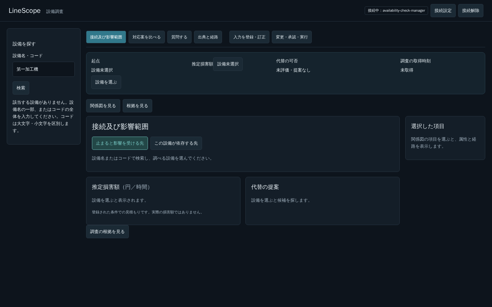

# PR #275レビュー：通常経路の比較・検索の不一致・過去4点の対応表

> 本書は`0977365`時点の調査記録。以後、開発者の指示に従い専用経路を#275内で撤去した。現在の実装・再確認は[撤去と共通経路の記録](2026-10-21-pr275-common-read-withdrawal.md)を参照。本書中の「未実施」「未修正」は調査時点の状態である。

## 結論と今回の範囲

開発者の「GPUは専用とする」「例示した質問に特化して実装しない」という方針に従う。設備の台数・質問の題材によらない対象解決、本文と画面選択の優先順位、表記照合、取得できない情報の説明を共通規則とする。

**時間切れ対策に保全日時専用経路が必須という根拠は、今回の比較では得られなかった。専用経路の撤去・通常Readへの整理案を推奨する。** 専用化による速度差は観測したが、例示だけを通す分岐を残す仕様上の根拠とはしない。今回は調査・文書のみであり、まだ削除していない。#275は整理方針の確認待ちのDraftのまま。新機能・新API・契約変更・実装PRの追加は行わない。

## 1. GPU専用条件での比較

対象質問は「第1加工機の前回のメンテナンス日時はいつか？」、画面の選択前置き・過去会話なし。

| 比較対象 | 1回の処理時間 | モデル往復 | 初回Tool定義数／入力サイズ | 結果 |
|---|---:|---:|---|---|
| main `9132d2d` の通常経路 | 35,653 ms | 2 | 28／23,577 bytes（5,665 prompt tokens） | 時間切れなし。ただし設備名をコードとして検索して0件となり、設備を見つけられない誤答 |
| #275 `73baca8` の通常経路（専用分岐だけ無効） | 32,403 ms | 4 | 28／25,792 bytes（6,162 prompt tokens） | M-204を特定して保全記録を検索し、記録なしと回答。回答に内部UUIDを列挙する問題は残る |
| #275 `73baca8` の保全日時専用経路 | 1,956 ms | 1 | 1／1,499 bytes（424 prompt tokens） | M-204の記録0件、実施日時は確認できないと回答 |

### 方法と比較の限界

- mainの`backend/src`を`git archive main backend/src`で取り出し、既存専用APIコンテナの**別Pythonプロセス**でPYTHONPATHをそのソースへ向けた。mainのimport元は`/tmp/pr275-review/main-backend/src/linescope/__init__.py`、#275側は既存のインストール先。稼働中APIのソース・接続先は切り替えていない。
- 各ソースの`build_api_services`で組み立てたRead Agentへ、同じSettings・認証済み設定に存在するmanager・同じ質問を渡した。**HTTPではなくRead Agent直呼び**であり、実Ollama・実PostgreSQL・既存のTool認可を使用する。Prepare等の書込経路へは渡していない。
- 中間比較では別プロセス内だけで`maintenance_date.matches`を常に偽とし、#275の通常対象解決を残して専用分岐だけを除いた。製品ファイル・稼働中workerの状態は変更していない。
- すべて同じ`qwen3:30b-a3b-instruct-2507-q4_K_M`、context 16,384、temperature 0、num_predict 700、deadline 120秒。モデル・GPU設定の変更なし。実行順はmain→修正通常→修正専用、並列のLLM試行はしていない。
- 各計測の直前に同じ短い確認文でモデルを準備し、その時間は表から除いた。初回の準備は29,365 ms（モデルload 26,203 ms）、以後458 ms／424 ms。計測中のモデルloadは各往復0〜2 ms。
- GPU専用運用の申告後に実施。開始前のRTX 3060は使用率10%、使用メモリ1,334／12,288 MiBだった。キャッシュや実行順の差を完全には除けていない。各1回の観測値であり、性能分布・一般的な全質問の速度・元の時間切れの単独原因は確定しない。
- 診断用request_idは順に`1c4047e4-67c3-4734-9bfe-730d9137cda8`、`f9d70f72-c169-4e09-98c8-164dd3181eab`、`88e06f41-4686-42d5-b2c1-821d02daf61f`。稼働中HTTP workerのアクセスログではなく、比較用プロセスのイベントへ対応する。

mainでも時間切れは再現しなかった。一方mainの対象解決の不備は残るため、mainへそのまま戻すことは修正にならない。専用化しない#275の共通対象解決でも今回の設備と保全記録を取得できたため、**対象解決の修正と専用経路の採否を分ける**。

## 2. 専用経路の整理案（未実施）

- 質問文の語句を見て保全日時だけへ入る分岐・専用Prompt／schemaを撤去し、通常Readに戻す案を推奨する。対象解決の共通helper、本文優先、表記候補の照合、認可・deadline・回数上限・Evidenceは残す。
- 記録0件を未実施と断定しない、ページ未取得で「最後の日時」を確定しない、別設備の記録を混ぜない等の正しさは維持する。既存の日時・ページ取得試験を削除・弱体化して通常経路を成功扱いにしない。共通経路で満たせない点は、契約を勝手に足さず報告する。
- 回答の整形や事実の集計は、取得したTool結果に基づく共通の説明処理として検討する。「保全日時」という例にだけ応答性能や正しさを与える仕組みを横展開しない。
- 専用経路の約2秒から通常経路の約32秒へ戻る可能性は、今回の観測で分かったトレードオフである。一般的なTool集合の選択・入力削減はQ2で扱い、別の質問が出るたびに専用経路を追加しない。
- この整理は**提案であり未実装**。今回の指示範囲ではコード削除・試験変更を行わない。merge前に開発者と整理方針を確認する。

## 3. 左ペインの検索と質問の不一致

5174番の実ブラウザで、設備未選択のまま各検索語を入力した。LLMを使わない「関係分析」のsearch_equipmentへ、名称とコードの2要求が送信されることをNetwork応答で確認した。全要求HTTP 200、JavaScript例外0。

| 検索語 | 名称の部分一致 | コードの完全一致 | UIでM-204へ到達するか |
|---|---|---|---|
| 第1加工機 | M-204が1件 | 0件 | 到達する |
| 第１加工機 | 0件 | 0件 | 到達しない |
| 第一加工機 | 0件 | 0件 | 到達しない |

原因は[readModel.ts](../../frontend/src/features/investigation/readModel.ts#L91)のsearchEquipmentが原文の2条件だけを送ること。質問のAgentが行う数字表記候補の照合は、直接経路の検索引数へは適用されない。直接Toolの部分一致／完全一致の契約を、このPRで黙って変えていない。

これは「仕様上は原文一致で動くが、質問と同じ設備を探せない」という操作上の不一致であり、解消済みにはしない。Q3として追跡する。統一するときも、別表記にある別の設備ID・検索の続き・片方の取得失敗を捨てないことを受入条件にする。今回は検索機能を変更していない。

## 4. 先の4点の対応表

現在コードとmerge済み履歴を照合した。下表の実動結果は過去の該当PRでの確認記録であり、今回4項目全体を再試験したという意味ではない。

| 指摘 | 分類・現在の状態 | 対応PR／根拠 | 残る範囲 |
|---|---|---|---|
| 比較タブの「候補は未取得です」 | 文言は修正済み。未検索と検索済み0件を区別する現仕様 | **#273** `979c56d`。[RegisteredComparison](../../frontend/src/features/decision/RegisteredComparison.tsx#L602)は手動取得操作と、比較に使える入力が登録されていない場合がある旨を表示 | 到着時の自動取得は未実装・判断待ち。取得できる入力がないこと自体は不具合ではない |
| 全案の「費用の総額は算定できません。…確認してください」 | 一律の確認依頼は修正済み。総額が出ない理由の一部は仕様／データ不足 | **#273** `979c56d`。[DecisionComparison](../../frontend/src/features/decision/DecisionComparison.tsx#L100)はサーバの入力・不足情報から金額／時間の未設定、独立計上未確認、項目未完備等を説明 | デモの修理・交換・継続費用はamount=null／complete=false、暫定費用と対応計画は未登録。代替総額は現Backendで対象外。データ拡充・業務機能は別判断 |
| 質問中のカーソルと、回答後も送信不可 | **カーソルは修正済み。回答後の送信不可の元の発火条件は未特定・未解決** | **#273**でaria-busyと共通待機カーソルを接続。#273の実LLM2問、**#275**の名称・対象切替等では回答後のenabled復帰を確認 | 再現できなかったことを修正済みとしない。再発時のNetwork・時刻・request_idを採取し、元の通信中断と同じ原因とも断定しない |
| サジェスチョンが出ない欄 | 棚卸し済みだが全欄の不具合解消は未対応。仕様・データ不足・規約の穴が混在 | **#273**の[欄別棚卸し](2026-10-20-comparison-question-feedback.md#サジェスチョン棚卸し静的確認修正なし)。#269等の候補部品の存在と、実際に候補データがあることを区別 | 登録0件・製品／期間／単位等の条件不一致は候補なし。通常inputで候補を持たない欄は対象範囲の判断待ち。利用者が指した具体欄が未確定な不具合は未確認。全欄を実ブラウザ合格としない |

「比較に使える入力がない」と「候補を取得していない」、登録費用がないこととUI文言の不備、未再現と修正済みを分ける。

## 5. 期限付きの追跡項目

期限は**#275 mergeを起点とした、調査・修正案を開発者へ報告する期限**とする。実装の承認・完了日や、既定F1→F2→F3の順序を勝手に変更するものではない。担当はCodex、採否・実装着手・優先順の判断は開発者。期限内に範囲を確定できなければ、未確定点と影響を期限前に報告する。

| ID | 状態と問題 | 報告期限 | 報告内容・完了条件 |
|---|---|---|---|
| Q1 | **規約違反・未修正**：通常の自由回答に内部UUIDを列挙。今回の修正通常経路でも再現 | #275 merge後 **1作業日以内** | 構造化結果の正当な実IDと名称・コードを対応付け、本文の意味を落とさず技術情報と分離する修正案・工数を提示。文字列を一律に消すだけの対応や、Promptだけで解決済みにしない |
| Q2 | **設計課題・未対応**：通常質問に28 Tool／約25KBの初回入力を送る | #275 merge後 **3作業日以内** | 意図と必要な参照に応じたTool集合・Promptの共通選択案、複合質問・未知意図のfallback、認可との分離、速度と回答品質の評価案・工数を提示。例示ごとの専用経路を増やさない |
| Q3 | **操作不一致・未修正**：左ペインは第１／第一を見つけられず、質問だけが解決 | #275 merge後 **2作業日以内** | 共通の表記照合規則、直接経路の契約・ページ取得・失敗・衝突の扱い、質問と検索の同等性の受入案・工数を提示 |

調査案の提出で不具合を「解決済み」にはしない。実装期限は承認時に定め、受入まで未修正の状態を維持する。Q1〜Q3はロードマップとガントに独立した工程行を追加する。既定3 PRに黙って含めず、追加PR数は範囲・採用・統合単位の判断待ちとする。

## 6. 確認した範囲／していない範囲

確認：3経路各1回の実LLM・実DB比較、左ペイン3検索語の実ブラウザ／HTTP応答、過去4点の現在コード・merge履歴照合、レビュー時点の差分が8コミット・28ファイル・+1,305/-59行であること。8コミットのうち専用経路とその試験は整理判断を分ける。push済み履歴は書き換えない。

未確認：旧コードでの全表記・全質問、性能分布、GPU競合の単独原因、元の送信不可現象の再現、サジェスチョン全欄の実動、Q1〜Q3の修正後受入。今回、製品コード・試験コード・API・DBスキーマ・業務データ・seed・volume・モデル設定・5173／5174の接続先を変更していない。モデルが常駐していることは確認操作の実行状態であり、設定変更ではない。

一時的なmainソースと比較スクリプトは稼働中APIの別プロセス用ディレクトリだけに置き、終了後に削除する。ブラウザ認証値は非公開の一時envだけに渡し、ログ・文書へ記録せず、終了後に削除する。新しいDocker imageは作成／取得していない。文書・SVG・画像だけの変更のため、この確認でBackend単体の再実行はしていない。前回の4,046成功・1 skipを今回の文書commitのCI結果と混同しない。
