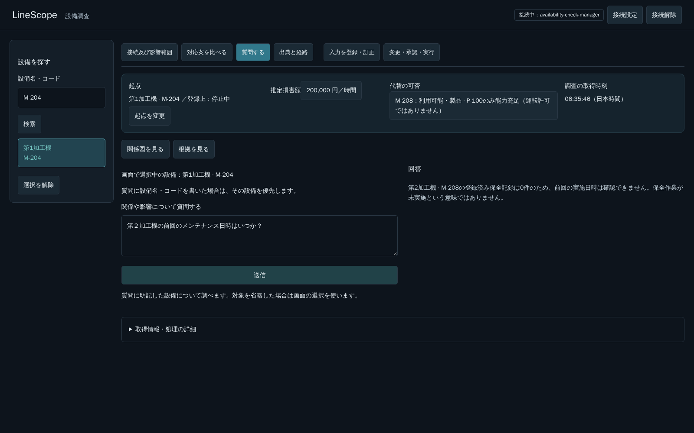

# 画面の選択が質問本文の対象を上書きする問題（PR #275）

## 再現と原因

「第２加工機の前回のメンテナンス日時はいつか？」にM-204の回答が返るとの報告を受けた。UIはM-204を選択中の場合、実際には「調査対象の設備コードはM-204です。\n第２加工機の前回のメンテナンス日時はいつか？」を送信する。この同じ本文を実APIへ送り、LLMがM-204を検索し、M-204の保全記録0件を回答することを再現した。名前の表記候補照合ではなく、本文より選択前置きを優先する対象抽出の不具合だった。

## 修正

Read Agentは既存UI前置きをユーザー由来の補足メッセージと質問本文に分け、本文を最後の独立したuserメッセージとする。通常・日時専用の両Promptで、現在の本文に明示した設備を画面選択・過去会話より優先する。「この設備」の対象省略の場合だけ選択を使う。補足をsystemや認可の根拠へ昇格しない。元のAgentInput、API、再送同一性、認可・Tool回数・deadlineは変更しない。

UIには「画面で選択中の設備」と本文の明示対象を優先する案内を表示する。質問で別設備を指定しても、左ペインの起点は勝手に変更しない。

## 実ブラウザ・実モデルの結果

5174番→8003番の同じ既存専用環境で確認。3ケースすべてHTTP 200、検索された設備の実コードが期待対象のみであること、保全記録検索、送信ボタンの復帰、JavaScript例外0を確認した。

| 画面の選択 | 質問 | 実際の回答対象 | 応答時間 |
|---|---|---|---:|
| M-204 | 第２加工機の前回のメンテナンス日時はいつか？ | 第2加工機 · M-208 | 14,983 ms |
| M-204 | この設備の前回のメンテナンス日時はいつか？ | 第1加工機 · M-204 | 4,978 ms |
| M-208 | 第１加工機の前回のメンテナンス日時はいつか？ | 第1加工機 · M-204 | 3,603 ms |

表の時間は各1回の観測値。画面下の旧案内にも選択対象を常に優先するような文言が残っていたため、本文優先の説明へそろえ、修正後の画面で1行目のケースをもう一度確認した。いずれも登録保全記録0件のため、日時は確認できないと回答した。任意の言い換え・長い過去会話・記録ありの実モデル確認まで保証する結果ではない。

## 自動検証・範囲

Docker内のBackend関連444件成功（18.45秒）、Frontend既存単体72件成功（5.33秒）、Frontend checkとRuff成功。既存BackendのStarlette/httpx警告1件と終了時logging output failed、Frontend buildのchunkサイズ警告あり。追加テストは作らず、既存の表記3ケースを、異なる画面選択の補足があっても本文が独立して渡るassertionで強化した。新規Backendケース総数は20件のまま。最初の試験では既存テスト補助関数が改行をJSON escapeしないため3件のsetupが失敗し、入力fixtureの組立を修正して再実施した。製品のJSON validationは緩めていない。

今回のCI結果はローカル結果と別に確認する。Draftを維持。5173番、業務データ、seed、volume、モデル設定、Docker imageに変更なし。F2・F3には着手しない。

