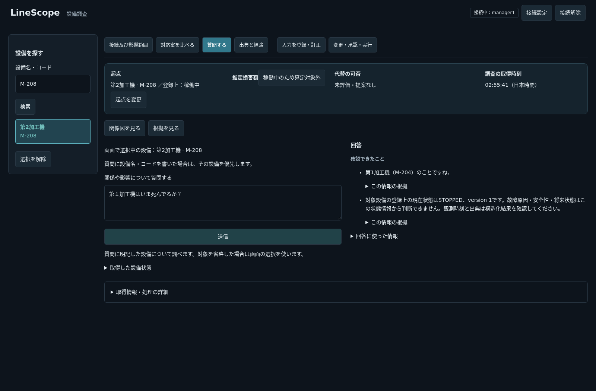
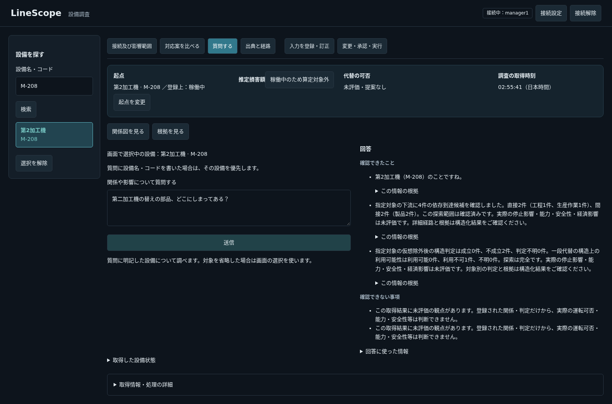

# 口語の状態照会と非対応情報の回帰確認（#276・未完了）

## 目的と範囲

口語・比喩・省略でも利用者が何を知りたいかを解釈し、登録情報から答える。状態照会をDBレコードの有効フラグへ読み替えない。口語を許容することを理由に、保証・保管場所等へ別の登録事実を代入しない。ユーザーの一例に対応する単語・設備別の分岐を作らない。

## 調査で確認したこと

1053c04の読取probeでは、「第１加工機はいま死んでるか？」の大分類はSTATE、要求fieldはactiveになり、二段目はMATCHと返した。表示モデルが有効フラグを回答に使わなかったため、設備識別と確認不能だけが出た。単に未知語の問題ではなく、稼働状態と登録レコードの有効性の意味の取り違えである。

## 試した方法と採否

1. 最初の分類へfield名だけでなく照合側と同じ意味定義を渡し、口語の意図と登録状態／DB有効フラグの区別を明示した。同時に二段目にも口語解釈を明示した。報告された状態照会はregistered_stateとなり、M-204のSTOPPEDを取得した。ただし追加の組合せで、部品の保管先を代替・下流関係として回答した。採用しない。
2. 二段目へ全カタログを渡し、元の質問を最後に置く候補も、保管先の質問をMATCHとした。採用しない。
3. 最初の提案を見せず、同じモデルへ質問の情報種別を独立に取り出させる読取実験でも、部品の保管先をalternative_candidatesとした。これだけで改善するとの根拠は得られなかった。製品へ実装しない。
4. 二段目を1053c04のまま保ち、最初の解釈の指示だけに絞った候補も、下表の6組中4成功・2失敗。保証の有効性を設備のSTOPPEDで答える誤りが残った。採用しない。製品ソースと5174のAPIは1053c04へ戻し、同条件の比較を行う。

後付けの語句deny-list、質問別ルート、照合の強制MATCH、テストの削除・期待値の弱体化で成功扱いにしていない。モデル・GPU・DB・seedの設定変更は行わない。

## 組合せを抑える選定

表現形態3（平叙／口語／比喩）×対象指定2（名称／コード）×情報範囲2（登録状態／非対応）の全直積は12組。二因子の全16対を被覆する6組を選び、script内で各対の被覆を確認する。既存の30種類は削らず、追加6種類で計36種類（自動22＋ブラウザ14）。CIのpytestに6件を追加したという意味ではない。実モデルがなければ、この6件の解釈の品質は確認できない。

| 表現 | 対象 | 求める情報 | 代表入力 | 最小候補 |
|---|---|---|---|---|
| 平叙 | 名称 | 状態 | 第1加工機は現在停止していますか？ | 成功 |
| 平叙 | コード | 非対応 | M-208の保証期限はいつですか？ | 成功 |
| 口語 | 名称 | 非対応 | 第二加工機の替えの部品、どこにしまってある？ | **失敗：下流・代替** |
| 口語 | コード | 状態 | M-208っていま動いてる？ | 成功 |
| 比喩 | 名称 | 状態 | 第１加工機はいま死んでるか？ | 成功 |
| 比喩 | コード | 非対応 | M-204って、まだ保証が生きてる？ | **失敗：稼働状態** |

一意／曖昧／空結果／取得不完全の同値クラスは既存試験を保持する。数値境界は、登録記録のpage_size=100を越える101件、検索継続の上限12回、公開事実の80件上限に対する81件など、実在する閾値を既存試験で確認する。日本語表現に数値の境界があるようには扱わない。ペアワイズは三因子以上の相互作用や全自然文の被覆を保証しない。

## 再現と検証の扱い

常設の`frontend/scripts/verify-scenario1-browser.mjs`へ、任意の実モデル評価モード`LINESCOPE_BROWSER_QUESTION_SCOPE=1`を追加する。通常モードは実LLMを呼ばない。6件すべての応答・判定と画像を私有outputへ保存し、1件の失敗で残りを省略せず、最後に全体を失敗とする。業務書込は遮断し、API・モデルの応答をstubで置き換えない。

使用した既存browser imageには@playwright/testの薄いwrapperがなかったため、最初の実行は起動前に失敗した。既存playwright/test本体へimportを合わせ、既存native Chromiumを選べる任意設定を追加した。imageのbuild・pullや新規package導入はしない。この環境エラーを製品の質問失敗や成功へ数えない。

Backend関連252件、Frontend checkとVitest72件、Ruffは候補について成功したが、これらは実モデルの意味解釈を保証しない。ブラウザの6件で失敗した以上、単体成功から「修正済み」とは報告しない。旧版の同じ実ブラウザ6組も実行し、3成功・3失敗だった。状態3問はすべて失敗、非対応3問はすべて成功。候補は状態3問が成功する反面、非対応3問のうち2問が失敗する。よって「新しい例には答えられた」だけで採用すれば、既存の安全境界を劣化させる。

| 質問のクラス | 旧版1053c04 | 最小候補 | 判定 |
|---|---|---|---|
| 状態3問 | 0/3成功 | 3/3成功 | 改善は観測したが単独では採用条件を満たさない |
| 非対応3問 | 3/3成功 | 1/3成功 | 退行。候補は撤去 |

すべて同じモデル`qwen3:30b-a3b-instruct-2507-q4_K_M`・同じプレビューの登録データで、各版各問1回の観測。確率的な解釈品質の分布や恒常的な成功率は測定していない。合計4/6のような平均だけで、非対応情報を通す退行を正当化しない。双方ともJavaScript例外0・禁止書込HTTP0。通常シナリオの検索・図・損害額・代替・比較用入力の案内も、追加質問前の共通手順として実APIで通った。

## 現在の状態と相談すべきこと

製品コードの候補は全撤去した。backendの差分は0、5174のAPIも1053c04のソースへ復帰した。5173、DB・seed・モデル設定・GPU設定は変更していない。追加の6問・因子対の被覆検査・失敗の保存は、既存の常設ブラウザscriptの任意モードとして残す。現在の製品でこの任意モードは失敗する。CIが緑でも「口語修正済み」「質問の品質が合格」とは扱わない。PRはDraftで、口語対応は同じ#276の未完了・merge阻害として保持する。

この試行で分かった難所は、field候補や「口語を解釈する」という指示から、質問の本来の属性・関係ではなく近い参照能力へ寄せてしまうこと。最初の提案を隠した単独の実験でも保管先をalternative_candidatesとしたため、二段目を独立にするだけで直るとの根拠もない。追加の照合モデル呼出し、質問別の例外、非対応語のdeny-list、タイムアウト増加には進んでいない。

次に相談する案は、質問が何についてどの情報を求めているかを、field候補を提示する前に分解し、要求された属性・関係と参照能力を対応付ける順序への見直し。例えば「保証の有効性」と「設備の運用状態」、「部品の保管先」と「構造上の代替候補」を区別する必要がある。ただし、その分解自体もモデルが誤る可能性があるため、今回の失敗を通せることだけで採用してはならない。コードで何を検証できるか、確認不能時の扱い、正当な質問を拒否する率、追加の内部契約と既存ケースへの影響を、実装前に具体化する。まだ採用・実装していない案である。

