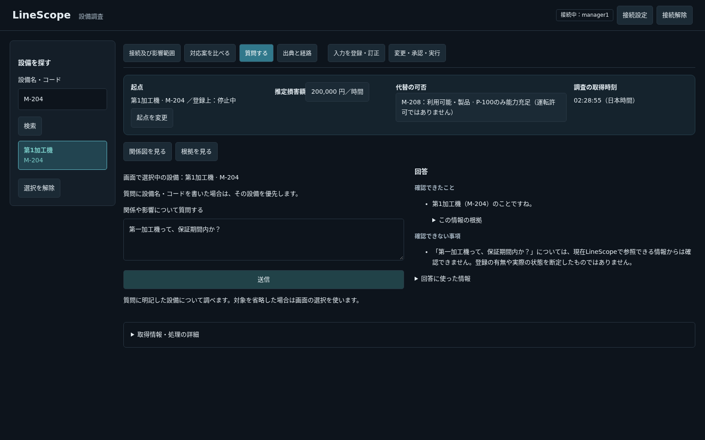

# 質問欄を事例にした目的のすり替えと是正

## 目的・制約・完了判定を分ける

| 区分 | この案件で保持する内容 |
|---|---|
| プロダクトの目的 | 設備トラブルの影響・損害・代替を調べ、対応判断を支援する。質問欄はその補助として、利用者が設備について知りたいことへ根拠を持って分かりやすく答える |
| 制約・留意事項 | 根拠のない事実を作らない。本文の対象を取り違えない。表記候補は実検索する。専門家である利用者へITの内部事情を押し付けない。質問・設備別の専用処理で埋めない |
| 完了判定 | 対象が正しく整理され、問いに対応した情報を答える。答えられなければ不足・非対応を伝える。別の登録情報を並べて回答としない。別表現・正常系・失敗系でもこの関係を維持する |

これらを一つの「気を付けること」の一覧にせず、目的と条件を別に固定する。安全性・認可・データ整合性の条件を緩めて目的達成としない。

## 私の失敗の因果関係

1. 「誤情報を出すな」という条件を「拒否できればよい」という目的に置き換えた。
2. 分かりにくい拒否を指摘されると、拒否文だけを完成条件にした。
3. 呼び名の整理を指摘されると、正規名称の表示だけを完成条件にした。
4. その都度、同じ問いへ答えているかを問い直さず、選定した例と機械的な試験の成功から「直った」と広く報告した。
5. 実装も「取得できた事実」を質問への回答として並べるため、型・値が正しい属性一覧が、保証についての回答の代わりになった。

これは単なるテスト不足や、開発者の説明不足ではない。完了判定を私が縮め、部分成功を全体の受入へ一般化した失敗である。AGENTSには継続手順だけを追加し、この個別の経緯は本書へ置く。

## 質問欄でのケーススタディ

| 利用者の問い・状況 | 期待する結果 | 回答として不適切な結果 |
|---|---|---|
| 「第一加工機って、保証期間内か？」 | 実検索で第1加工機（M-204）へ一意に照合したことを自然に示し、保証を判断する情報は確認できないと伝える | 拒否だけを出して対象の整理も省く |
| 「第一加工機はまだ保証期間内か？」 | 同じ意図として、上記と同じ境界を守る | 種類・有効フラグ・versionを並べて終わる |
| 設備の登録状態・前回の保全日時 | 実対象の登録状態・登録記録を取得し、限定を含めて答える | 過剰拒否、別設備への取り違え、記録0件を未実施と断定 |
| 倉庫・交換部品の保管場所 | 識別した設備は示すが、確認できない保管場所は作らない | 上流依存や電源を倉庫の回答として使う |
| 呼び名が複数設備に該当 | 候補を示し設備コード等で特定してもらう | 先頭を選び、実設備と断定 |

保証のDB項目は現在ない。保証内外を判定する新機能は今回作らない。問いが保証なのに登録情報を出したという開発者の報告は失敗として扱う。会話なしの読取probeでは同文がactiveと誤分類されたが、二段目がUNCERTAINとして止まった。この単発では報告と同じ最終出力を再現していない。モデルの結果が揺れるため、同じ文の一度の成功で解消としない。

## このPRで適用する進め方

- 修正前に、どの受入条件を満たすかを上の表へ対応付ける。目的を「拒否・名称表示・fieldの検証」へ置き換えない。
- 対象の識別、質問への回答、補足情報を分ける。識別結果や技術的な登録フラグが取れただけでは、問いへの回答を得たことにしない。
- 通常の自然文回答で、設備検索で得た全属性を機械的に出力する経路をやめる。要求に対応する内容と識別情報を示し、不足は明示する。
- 検証は、モデルが誤った分類・照合結果を返す条件も制御して確認する。実モデルの一例だけで判定しない。既存の正常系を失わせず、以前の試験の削除・弱体化で通さない。
- 報告は、問いへの応答として確認できた範囲と、内部処理の正常動作、未確認の一般質問品質を分ける。全体の受入を満たさないうちは「一連の問題が直った」と言わない。

## 採用方式と確認結果

- 自然文の全経路で、元の質問と要求fieldを表示モデルへ渡す。設備レコードの全属性公開をやめ、対象識別と要求された属性を分離した。設備の技術的な属性は、要求fieldと質問本文の登録属性語彙が対応するときだけ出す。質問・設備別の業務処理、三段目のモデル照合は追加していない。
- 識別だけ得られ、回答に必要な情報がない場合は`QUESTION_NOT_ANSWERED`を出す。保証等の未対応を、未登録と断定しない。直接ReadのTool結果・Evidenceと既存の認可は維持した。
- 追加の自動試験2件：二段のモデルが誤って通過した後に相当する表示モデル入力（無関係な質問＋active）でも、識別を残し属性の代用を止めること。対となる正常系で、明示した設備種別の実値と根拠を出せること。既存ケースは削除していない。既存3件は公開predicateを識別へ変更し、値・参照・呼出し条件の検査を維持した。
- Docker内の実PGを使ったAgent／Tool logging関連試験：**252件成功、2.92秒**。初回は247成功・5失敗。うち1件で検索未取得の説明を失う退行を検出して実装修正、3件は識別predicateへの契約変更、1件は自由文ではなくOUT_OF_SCOPEコードと確認不能文の対応へ更新した。失敗を成功に数えない。
- Ruff：check成功、403ファイルのformat確認成功。
- Frontend：check（lint・型・整形・build）成功、Vitest全**72件成功、5.38秒**。CIがVitestを実行したという意味ではない。
- 実API・実モデルのブラウザ：倉庫2表現、保証、評価不能な置換判断、別設備の登録状態、保全記録、曖昧な対象、左検索の**8項目成功**。業務書込HTTPは0、JavaScript例外0。質問7件のHTTP観測は約6.6〜23.0秒（各1回）。単発の速度やモデル正答を一般化しない。
- 利用者が報告した別表現「第一加工機はまだ保証期間内か？」も、同じ保証ケースの追加の読取観測を行った。4.275秒で「第1加工機（M-204）のことですね」と確認不能が並び、技術的な属性一覧は出なかった。モデルはwarranty_statusという非対応fieldを返し、範囲外になった。**この実モデル観測は、新しい属性表示ガードが発動した証拠ではない**。誤分類通過後のガードは追加の制御試験が確認する。
- 今回の承認対象の種類は、自動22＋ブラウザ8＝30。上記の保証の別表現は同じ失敗種類の追加観測であり、実行回数は種類数と区別する。
- ガントSVG：85テキスト、描画枠のはみ出し0。時間軸を維持し、期間未確定の追加是正に架空の工期を置いていない。

## 確認していない範囲と限界

任意の自然文と登録情報の意味の完全な一致は保証しない。二段のモデルが状態・関係等の別fieldへ共に誤分類する問題は、この属性表示条件では証明できない。属性語彙にない正当な言い換えを回答できない可能性もある。実モデルの全質問への正答、性能の分布、他データでの全般的な回答品質、実書込は未検証。検索や拒否が動いたことを、自由質問全体の解決と報告しない。

5174の既存APIに変更したソース4ファイルのみ反映して再起動し、既存Frontendで実確認した。5173、モデル設定、GPU設定、DB・シード・volumeへ変更を行っていない。検証は既存イメージと使い捨てPGを使い、build／pullしない。PRはDraftを維持し、利用者のブラウザ確認を待つ。

