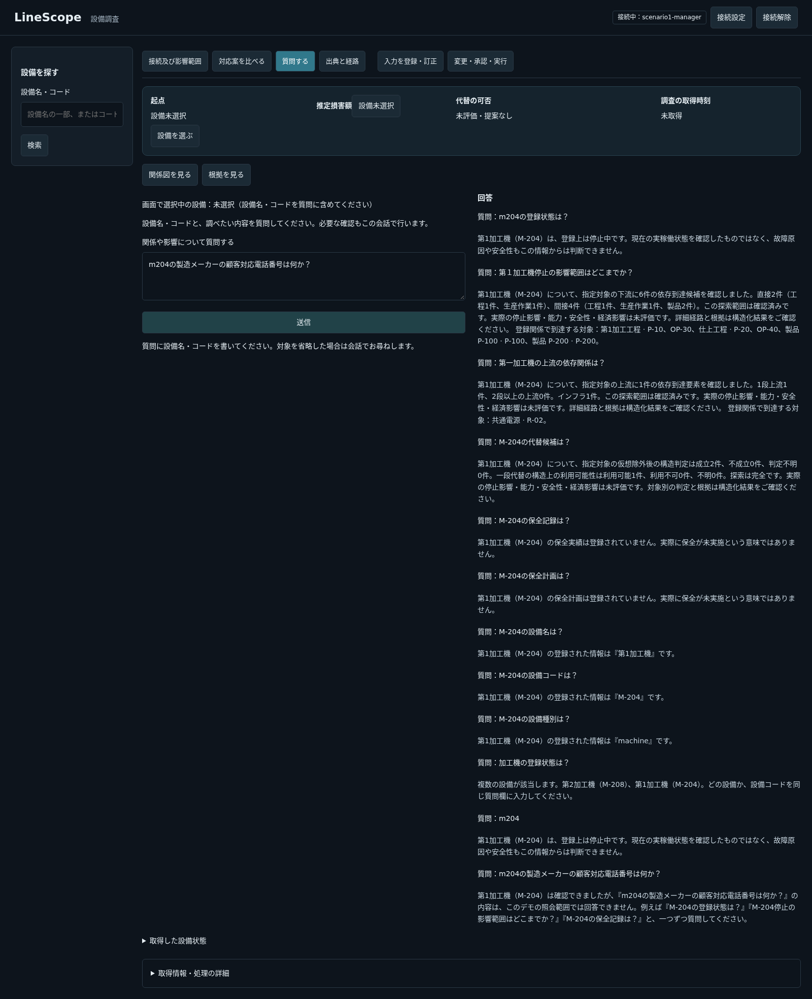

# #277 質問欄デモの検証

## 環境・判定の範囲

製品版 `dcad342dfd180d130ab69f3f2e91f122e34e9ee6`、専用previewのAPI `http://127.0.0.1:8003`、Frontend `http://localhost:5174`。モデル不使用。既存managerの認証を使う読取りだけで、DB・seed・認証設定は変更しない。検索・Graph・比較・文書の既存経路も保持する。

固定46原文をPOST /agentへ各3回、prefix・context・時刻を足さず送った。最終138応答は全期待分類と一致、本文も同一原文の3回で一致。5〜105ms、平均23.5msの単一環境の観測。性能保証ではない。型付き実行による定型回答であり、自由文理解の改善・旧H6の合格とは呼ばない。

[直接APIの要求・全応答・Evidence・manifest](assets/pr277/direct-api-records.zip)に失敗した先行試行も保存。元fixtureの期待ラベルは変更していない。旧#276の修正前実応答が残る原文だけ引用し、未保存は未保存とする。旧実測58/63・15/18と旧H7記録はアーカイブタグに残り、新結果とは別。

## 試行の内訳

- 初回138：4問12応答が期待不一致。次の局所条件を共通処理で修正：指示語の対象抽出、同一観点の重複パターンの対象照合、対象曖昧と対応外属性の区別。
- 初回の不一致には保留R03も含まれ、その後の原因調査に使った。したがって再実行でのR03成功は未見データへの一般化の証拠ではなく、固定原文の回帰確認である。保留の原文・期待は変更していない。
- 2回目138：分類一致。以後、公開factsを設備識別だけの文に絞り、観測traceの保持を追加。
- 最終開始時2要求：API再起動直後に接続リセット。連続2回で収集を停止。回答はないため成功に含めない。起動完了を確認せず収集を始めた検証手順の不備。
- 認証付きhealth 200確認後の最終138：分類・本文・公開値を確認。総要求416（138×3+2）。138は一巡の件数であり、全試行の総数ではない。業務の自動再送ではなく、別の評価試行である。

## Safety・Liveness・Usability

Safety：検証した138応答で別観点の業務回答・根拠外の事実・空検索による不存在断定は0。対応外90応答の公開tool_resultsは設備検索のID/名称/コードだけで、未対応属性値は公開しない。回答に対応するEvidence・呼出IDが残る。認可・異なる対象・Evidence不足/不一致・障害は自動試験の制御値でも検査する。これは未検証の全入力への保証ではない。

Liveness：対応観点45応答（保全18・登録状態24・下流3）は直接回答。保全0件は『登録なし、未実施の意味ではない』、登録状態は『登録上、実稼働の確認ではない』。9観点すべての成立はブラウザと自動試験で別途確認した。直接APIの46問には9観点すべては含まれない。

Usability：対応外90/138、対象省略の確認3/138、確認なしの対応観点45/138。対応外・対象不足には質問例を案内する。拒否率の高さをLLMの誤答率と解釈しない。複数設備の選択は質問1送信＋コード返信1送信で完結し、別選択UIはない。

## 原文ごとの表

判定『直った』は固定範囲の登録照会に限り、対応外原文は『一部』として案内の成立を表す。旧自由文の理解が復旧した意味ではない。3回分の応答全体・行先・Evidenceは添付ZIPを正とする。

| 質問原文 | 修正前の実応答 | 修正後の実応答（各3回） | 環境 | 未確認事項 | 判定 |
|---|---|---|---|---|---|
| この設備が止まるとどんな影響があるか？ | 旧#276実測：設備を一つに特定できませんでした。設備名や設備コードをご確認ください。 一部の登録情報を取得できませんでした。取得失敗を未登録や記録なしとは判断していません。 下流への影響範囲に必要な情報は取得できていません。対象の識別だけでは回答できません。 | 1回目・2回目・3回目：どの設備についてですか？ 設備名またはコードを同じ質問欄に入力してください。（本文3/3一致） | API 8003／dcad342／モデル不使用 | 実モデル・一般自由文・実稼働・書込みは未確認 | 一部（対応外／対象確認の案内） |
| メニューにカレーライスが無い！どこに苦情を言えば良いか？ | 旧#276実測：「メニューにカレーライスが無い！どこに苦情を言えば良いか？」については、現在LineScopeで参照できる情報からは確認できません。登録の有無や実際の状態を断定したものではありません。 | 1回目・2回目・3回目：『メニューにカレーライス』に一致する設備は今回の検索では見つかりませんでした。設備が存在しないと断定したものではありません。例えば『M-204の登録状態は？』『M-204停止の影響範囲はどこまでか？』『M-204の保全記録は？』と、一つずつ質問してください。（本文3/3一致） | API 8003／dcad342／モデル不使用 | 実モデル・一般自由文・実稼働・書込みは未確認 | 一部（対応外／対象確認の案内） |
| M-204が最後にメンテナンスされたのはいつか？ | 旧#276実測：質問の解釈を確認してください。照会結果はまだ取得していません。 | 1回目・2回目・3回目：第1加工機（M-204）の保全実績は登録されていません。実際に保全が未実施という意味ではありません。（本文3/3一致） | API 8003／dcad342／モデル不使用 | 実モデル・一般自由文・実稼働・書込みは未確認 | 直った（限定照会） |
| 第1加工機が最後にメンテナンスされたのはいつか？ | 旧#276実測：質問の解釈を確認してください。照会結果はまだ取得していません。 | 1回目・2回目・3回目：第1加工機（M-204）の保全実績は登録されていません。実際に保全が未実施という意味ではありません。（本文3/3一致） | API 8003／dcad342／モデル不使用 | 実モデル・一般自由文・実稼働・書込みは未確認 | 直った（限定照会） |
| 第一加工機の前回のメンテナンス日時はいつか？ | 旧#276実測：第1加工機（M-204）のことですね。 第1加工機 · M-204：登録済みの保全記録は0件です。保全作業が実施されていないことを意味するものではありません。 今回の検索条件で保全記録の登録は0件です。他の条件や実際の存在を否定するものではありません。 今回の検索条件で保全計画の登録は0件です。他の条件や実際の存在を否定するものではありません。 | 1回目・2回目・3回目：第1加工機（M-204）の保全実績は登録されていません。実際に保全が未実施という意味ではありません。（本文3/3一致） | API 8003／dcad342／モデル不使用 | 実モデル・一般自由文・実稼働・書込みは未確認 | 直った（限定照会） |
| 第1加工機の前回のメンテナンス日時はいつか？ | 旧#276実測：第1加工機（M-204）のことですね。 第1加工機 · M-204：登録済みの保全記録は0件です。保全作業が実施されていないことを意味するものではありません。 今回の検索条件で保全記録の登録は0件です。他の条件や実際の存在を否定するものではありません。 今回の検索条件で保全計画の登録は0件です。他の条件や実際の存在を否定するものではありません。 | 1回目・2回目・3回目：第1加工機（M-204）の保全実績は登録されていません。実際に保全が未実施という意味ではありません。（本文3/3一致） | API 8003／dcad342／モデル不使用 | 実モデル・一般自由文・実稼働・書込みは未確認 | 直った（限定照会） |
| 第一加工機と第二加工機の製造メーカーは同じか？ | 旧#276実測：第1加工機（M-204）のことですね。 第2加工機（M-208）のことですね。 「第一加工機と第二加工機の製造メーカーは同じか？」については、現在LineScopeで参照できる情報からは確認できません。登録の有無や実際の状態を断定したものではありません。 | 1回目・2回目・3回目：複数設備をまとめた質問には対応していません。設備と調べる内容を一つずつ指定してください。例えば『M-204の登録状態は？』『M-204停止の影響範囲はどこまでか？』『M-204の保全記録は？』と、一つずつ質問してください。（本文3/3一致） | API 8003／dcad342／モデル不使用 | 実モデル・一般自由文・実稼働・書込みは未確認 | 一部（対応外／対象確認の案内） |
| 第２加工機の前回のメンテナンス日時はいつか？ | 旧#276実測：第2加工機（M-208）のことですね。 第2加工機 · M-208：登録済みの保全記録は0件です。保全作業が実施されていないことを意味するものではありません。 今回の検索条件で保全記録の登録は0件です。他の条件や実際の存在を否定するものではありません。 今回の検索条件で保全計画の登録は0件です。他の条件や実際の存在を否定するものではありません。 | 1回目・2回目・3回目：第2加工機（M-208）の保全実績は登録されていません。実際に保全が未実施という意味ではありません。（本文3/3一致） | API 8003／dcad342／モデル不使用 | 実モデル・一般自由文・実稼働・書込みは未確認 | 直った（限定照会） |
| 第一加工機の製造メーカーはどこか？ | 旧#276実測：第1加工機（M-204）のことですね。 「第一加工機の製造メーカーはどこか？」については、現在LineScopeで参照できる情報からは確認できません。登録の有無や実際の状態を断定したものではありません。 | 1回目・2回目・3回目：第1加工機（M-204）は確認できましたが、『第一加工機の製造メーカーはどこか？』の内容は、このデモの照会範囲では回答できません。例えば『M-204の登録状態は？』『M-204停止の影響範囲はどこまでか？』『M-204の保全記録は？』と、一つずつ質問してください。（本文3/3一致） | API 8003／dcad342／モデル不使用 | 実モデル・一般自由文・実稼働・書込みは未確認 | 一部（対応外／対象確認の案内） |
| M-204の消耗品のストックはどの倉庫にあるか？ | 旧#276実測：第1加工機（M-204）のことですね。 「M-204の消耗品のストックはどの倉庫にあるか？」については、現在LineScopeで参照できる情報からは確認できません。登録の有無や実際の状態を断定したものではありません。 | 1回目・2回目・3回目：第1加工機（M-204）は確認できましたが、『M-204の消耗品のストックはどの倉庫にあるか？』の内容は、このデモの照会範囲では回答できません。例えば『M-204の登録状態は？』『M-204停止の影響範囲はどこまでか？』『M-204の保全記録は？』と、一つずつ質問してください。（本文3/3一致） | API 8003／dcad342／モデル不使用 | 実モデル・一般自由文・実稼働・書込みは未確認 | 一部（対応外／対象確認の案内） |
| M-208の交換部品のストックは、どの倉庫に保管されているか？ | 旧#276実測：第2加工機（M-208）のことですね。 「M-208の交換部品のストックは、どの倉庫に保管されているか？」については、現在LineScopeで参照できる情報からは確認できません。登録の有無や実際の状態を断定したものではありません。 | 1回目・2回目・3回目：第2加工機（M-208）は確認できましたが、『M-208の交換部品のストックは、どの倉庫に保管されているか？』の内容は、このデモの照会範囲では回答できません。例えば『M-204の登録状態は？』『M-204停止の影響範囲はどこまでか？』『M-204の保全記録は？』と、一つずつ質問してください。（本文3/3一致） | API 8003／dcad342／モデル不使用 | 実モデル・一般自由文・実稼働・書込みは未確認 | 一部（対応外／対象確認の案内） |
| 第一加工機って、保証期間内か？ | 旧#276実測：第1加工機（M-204）のことですね。 「第一加工機って、保証期間内か？」については、現在LineScopeで参照できる情報からは確認できません。登録の有無や実際の状態を断定したものではありません。 | 1回目・2回目・3回目：『第一加工機って』に一致する設備は今回の検索では見つかりませんでした。設備が存在しないと断定したものではありません。例えば『M-204の登録状態は？』『M-204停止の影響範囲はどこまでか？』『M-204の保全記録は？』と、一つずつ質問してください。（本文3/3一致） | API 8003／dcad342／モデル不使用 | 実モデル・一般自由文・実稼働・書込みは未確認 | 一部（対応外／対象確認の案内） |
| 第一加工機のメーカー保証期間はいつまでか？ | 旧#276実測：第1加工機（M-204）のことですね。 「第一加工機のメーカー保証期間はいつまでか？」については、現在LineScopeで参照できる情報からは確認できません。登録の有無や実際の状態を断定したものではありません。 | 1回目・2回目・3回目：第1加工機（M-204）は確認できましたが、『第一加工機のメーカー保証期間はいつまでか？』の内容は、このデモの照会範囲では回答できません。例えば『M-204の登録状態は？』『M-204停止の影響範囲はどこまでか？』『M-204の保全記録は？』と、一つずつ質問してください。（本文3/3一致） | API 8003／dcad342／モデル不使用 | 実モデル・一般自由文・実稼働・書込みは未確認 | 一部（対応外／対象確認の案内） |
| 第一加工機はまだ保証期間内か？ | 旧#276実測：質問の解釈を確認してください。照会結果はまだ取得していません。 | 1回目・2回目・3回目：第1加工機（M-204）は確認できましたが、『第一加工機はまだ保証期間内か？』の内容は、このデモの照会範囲では回答できません。例えば『M-204の登録状態は？』『M-204停止の影響範囲はどこまでか？』『M-204の保全記録は？』と、一つずつ質問してください。（本文3/3一致） | API 8003／dcad342／モデル不使用 | 実モデル・一般自由文・実稼働・書込みは未確認 | 一部（対応外／対象確認の案内） |
| 第１加工機はいま死んでるか？ | 旧#276実測：質問の解釈を確認してください。照会結果はまだ取得していません。 | 1回目・2回目・3回目：第1加工機（M-204）は、登録上は停止中です。現在の実稼働状態を確認したものではなく、故障原因や安全性もこの情報からは判断できません。（本文3/3一致） | API 8003／dcad342／モデル不使用 | 実モデル・一般自由文・実稼働・書込みは未確認 | 直った（限定照会） |
| 第１加工機と第二加工機の製造メーカーは同じか？ | 旧#276実測：質問の解釈を確認してください。照会結果はまだ取得していません。 | 1回目・2回目・3回目：複数設備をまとめた質問には対応していません。設備と調べる内容を一つずつ指定してください。例えば『M-204の登録状態は？』『M-204停止の影響範囲はどこまでか？』『M-204の保全記録は？』と、一つずつ質問してください。（本文3/3一致） | API 8003／dcad342／モデル不使用 | 実モデル・一般自由文・実稼働・書込みは未確認 | 一部（対応外／対象確認の案内） |
| 第二加工機のサービスマンはいつ来社するか？ | 旧#276実測：第2加工機（M-208）のことですね。 「第二加工機のサービスマンはいつ来社するか？」については、現在LineScopeで参照できる情報からは確認できません。登録の有無や実際の状態を断定したものではありません。 | 1回目・2回目・3回目：第2加工機（M-208）は確認できましたが、『第二加工機のサービスマンはいつ来社するか？』の内容は、このデモの照会範囲では回答できません。例えば『M-204の登録状態は？』『M-204停止の影響範囲はどこまでか？』『M-204の保全記録は？』と、一つずつ質問してください。（本文3/3一致） | API 8003／dcad342／モデル不使用 | 実モデル・一般自由文・実稼働・書込みは未確認 | 一部（対応外／対象確認の案内） |
| m-204の保証期間はいつまでか？ | 旧#276実測：第1加工機（M-204）のことですね。 「m-204の保証期間はいつまでか？」については、現在LineScopeで参照できる情報からは確認できません。登録の有無や実際の状態を断定したものではありません。 | 1回目・2回目・3回目：第1加工機（M-204）は確認できましたが、『m-204の保証期間はいつまでか？』の内容は、このデモの照会範囲では回答できません。例えば『M-204の登録状態は？』『M-204停止の影響範囲はどこまでか？』『M-204の保全記録は？』と、一つずつ質問してください。（本文3/3一致） | API 8003／dcad342／モデル不使用 | 実モデル・一般自由文・実稼働・書込みは未確認 | 一部（対応外／対象確認の案内） |
| m-204のサービスマンはいつ来社する？ | 旧#276実測：第1加工機（M-204）のことですね。 「m-204のサービスマンはいつ来社する？」については、現在LineScopeで参照できる情報からは確認できません。登録の有無や実際の状態を断定したものではありません。 | 1回目・2回目・3回目：第1加工機（M-204）は確認できましたが、『m-204のサービスマンはいつ来社する？』の内容は、このデモの照会範囲では回答できません。例えば『M-204の登録状態は？』『M-204停止の影響範囲はどこまでか？』『M-204の保全記録は？』と、一つずつ質問してください。（本文3/3一致） | API 8003／dcad342／モデル不使用 | 実モデル・一般自由文・実稼働・書込みは未確認 | 一部（対応外／対象確認の案内） |
| m-208の消耗部品のストックはどの倉庫に保管されているか？ | 旧#276実測：第2加工機（M-208）のことですね。 「m-208の消耗部品のストックはどの倉庫に保管されているか？」については、現在LineScopeで参照できる情報からは確認できません。登録の有無や実際の状態を断定したものではありません。 | 1回目・2回目・3回目：第2加工機（M-208）は確認できましたが、『m-208の消耗部品のストックはどの倉庫に保管されているか？』の内容は、このデモの照会範囲では回答できません。例えば『M-204の登録状態は？』『M-204停止の影響範囲はどこまでか？』『M-204の保全記録は？』と、一つずつ質問してください。（本文3/3一致） | API 8003／dcad342／モデル不使用 | 実モデル・一般自由文・実稼働・書込みは未確認 | 一部（対応外／対象確認の案内） |
| 第１加工機の故障原因は何か？ | 旧#276実測：第1加工機（M-204）のことですね。 「故障原因」は、現在LineScopeで参照できる情報からは確認できません。 | 1回目・2回目・3回目：第1加工機（M-204）は確認できましたが、『第１加工機の故障原因は何か？』の内容は、このデモの照会範囲では回答できません。例えば『M-204の登録状態は？』『M-204停止の影響範囲はどこまでか？』『M-204の保全記録は？』と、一つずつ質問してください。（本文3/3一致） | API 8003／dcad342／モデル不使用 | 実モデル・一般自由文・実稼働・書込みは未確認 | 一部（対応外／対象確認の案内） |
| 第1加工機が機嫌を直すには、どのお菓子を供えればいい？ | 同原文の修正前実応答は未保存（推定しない） | 1回目・2回目・3回目：第1加工機（M-204）は確認できましたが、『第1加工機が機嫌を直すには、どのお菓子を供えればいい？』の内容は、このデモの照会範囲では回答できません。例えば『M-204の登録状態は？』『M-204停止の影響範囲はどこまでか？』『M-204の保全記録は？』と、一つずつ質問してください。（本文3/3一致） | API 8003／dcad342／モデル不使用 | 実モデル・一般自由文・実稼働・書込みは未確認 | 一部（対応外／対象確認の案内） |
| 第2加工機の保証書は、月の裏側の金庫に入っていますか？ | 同原文の修正前実応答は未保存（推定しない） | 1回目・2回目・3回目：第2加工機（M-208）は確認できましたが、『第2加工機の保証書は、月の裏側の金庫に入っていますか？』の内容は、このデモの照会範囲では回答できません。例えば『M-204の登録状態は？』『M-204停止の影響範囲はどこまでか？』『M-204の保全記録は？』と、一つずつ質問してください。（本文3/3一致） | API 8003／dcad342／モデル不使用 | 実モデル・一般自由文・実稼働・書込みは未確認 | 一部（対応外／対象確認の案内） |
| 加工機が宇宙人に改造された証拠を見せて。 | 同原文の修正前実応答は未保存（推定しない） | 1回目・2回目・3回目：複数の設備が該当します。第2加工機（M-208）、第1加工機（M-204）。どの設備か、設備コードを同じ質問欄に入力してください。ただし、この質問全体の内容は照会範囲外です。例えば『M-204の登録状態は？』『M-204停止の影響範囲はどこまでか？』『M-204の保全記録は？』と、一つずつ質問してください。（本文3/3一致） | API 8003／dcad342／モデル不使用 | 実モデル・一般自由文・実稼働・書込みは未確認 | 一部（対応外／対象確認の案内） |
| 第1加工機の代わりに観葉植物を置けば、明日の注文は全部さばける？ | 同原文の修正前実応答は未保存（推定しない） | 1回目・2回目・3回目：第1加工機（M-204）は確認できましたが、『第1加工機の代わりに観葉植物を置けば、明日の注文は全部さばける？』の内容は、このデモの照会範囲では回答できません。例えば『M-204の登録状態は？』『M-204停止の影響範囲はどこまでか？』『M-204の保全記録は？』と、一つずつ質問してください。（本文3/3一致） | API 8003／dcad342／モデル不使用 | 実モデル・一般自由文・実稼働・書込みは未確認 | 一部（対応外／対象確認の案内） |
| 架空の設備 Z-991の保全記録が0件なら、故障したことがないと断言できる？ | 同原文の修正前実応答は未保存（推定しない） | 1回目・2回目・3回目：『架空』に一致する設備は今回の検索では見つかりませんでした。設備が存在しないと断定したものではありません。例えば『M-204の登録状態は？』『M-204停止の影響範囲はどこまでか？』『M-204の保全記録は？』と、一つずつ質問してください。（本文3/3一致） | API 8003／dcad342／モデル不使用 | 実モデル・一般自由文・実稼働・書込みは未確認 | 一部（対応外／対象確認の案内） |
| M-208の消耗品の在庫数と、火星の今日の売上を合計して教えて。 | 同原文の修正前実応答は未保存（推定しない） | 1回目・2回目・3回目：第2加工機（M-208）は確認できましたが、『M-208の消耗品の在庫数と、火星の今日の売上を合計して教えて。』の内容は、このデモの照会範囲では回答できません。例えば『M-204の登録状態は？』『M-204停止の影響範囲はどこまでか？』『M-204の保全記録は？』と、一つずつ質問してください。（本文3/3一致） | API 8003／dcad342／モデル不使用 | 実モデル・一般自由文・実稼働・書込みは未確認 | 一部（対応外／対象確認の案内） |
| 搬送装置の今の具合を見せて | 同原文の修正前実応答は未保存（推定しない） | 1回目・2回目・3回目：『搬送装置』に一致する設備は今回の検索では見つかりませんでした。設備が存在しないと断定したものではありません。例えば『M-204の登録状態は？』『M-204停止の影響範囲はどこまでか？』『M-204の保全記録は？』と、一つずつ質問してください。（本文3/3一致） | API 8003／dcad342／モデル不使用 | 実モデル・一般自由文・実稼働・書込みは未確認 | 一部（対応外／対象確認の案内） |
| 成形装置を作った会社はどこか | 同原文の修正前実応答は未保存（推定しない） | 1回目・2回目・3回目：『成形装置を作った会社』に一致する設備は今回の検索では見つかりませんでした。設備が存在しないと断定したものではありません。例えば『M-204の登録状態は？』『M-204停止の影響範囲はどこまでか？』『M-204の保全記録は？』と、一つずつ質問してください。（本文3/3一致） | API 8003／dcad342／モデル不使用 | 実モデル・一般自由文・実稼働・書込みは未確認 | 一部（対応外／対象確認の案内） |
| 加工機の保証が切れる日を知りたい | 同原文の修正前実応答は未保存（推定しない） | 1回目・2回目・3回目：複数の設備が該当します。第2加工機（M-208）、第1加工機（M-204）。どの設備か、設備コードを同じ質問欄に入力してください。ただし、この質問全体の内容は照会範囲外です。例えば『M-204の登録状態は？』『M-204停止の影響範囲はどこまでか？』『M-204の保全記録は？』と、一つずつ質問してください。（本文3/3一致） | API 8003／dcad342／モデル不使用 | 実モデル・一般自由文・実稼働・書込みは未確認 | 一部（対応外／対象確認の案内） |
| 予備部材は第3倉庫にあるのか | 同原文の修正前実応答は未保存（推定しない） | 1回目・2回目・3回目：『予備部材』に一致する設備は今回の検索では見つかりませんでした。設備が存在しないと断定したものではありません。例えば『M-204の登録状態は？』『M-204停止の影響範囲はどこまでか？』『M-204の保全記録は？』と、一つずつ質問してください。（本文3/3一致） | API 8003／dcad342／モデル不使用 | 実モデル・一般自由文・実稼働・書込みは未確認 | 一部（対応外／対象確認の案内） |
| 来週の点検担当者は誰か | 同原文の修正前実応答は未保存（推定しない） | 1回目・2回目・3回目：『来週』に一致する設備は今回の検索では見つかりませんでした。設備が存在しないと断定したものではありません。例えば『M-204の登録状態は？』『M-204停止の影響範囲はどこまでか？』『M-204の保全記録は？』と、一つずつ質問してください。（本文3/3一致） | API 8003／dcad342／モデル不使用 | 実モデル・一般自由文・実稼働・書込みは未確認 | 一部（対応外／対象確認の案内） |
| 不明な在庫をゼロとして合計して | 同原文の修正前実応答は未保存（推定しない） | 1回目・2回目・3回目：複数設備をまとめた質問には対応していません。設備と調べる内容を一つずつ指定してください。例えば『M-204の登録状態は？』『M-204停止の影響範囲はどこまでか？』『M-204の保全記録は？』と、一つずつ質問してください。（本文3/3一致） | API 8003／dcad342／モデル不使用 | 実モデル・一般自由文・実稼働・書込みは未確認 | 一部（対応外／対象確認の案内） |
| 第１加工機停止の影響範囲はどこまでか？ | 同原文の修正前実応答は未保存（推定しない） | 1回目・2回目・3回目：第1加工機（M-204）について、指定対象の下流に6件の依存到達候補を確認しました。直接2件（工程1件、生産作業1件）、間接4件（工程1件、生産作業1件、製品2件）。この探索範囲は確認済みです。実際の停止影響・能力・安全性・経済影響は未評価です。詳細経路と根拠は構造化結果をご確認ください。 登録関係で到達する対象：第1加工工程 · P-10、OP-30、仕上工程 · P-20、OP-40、製品 P-100 · P-100、製品 P-200 · P-200。（本文3/3一致） | API 8003／dcad342／モデル不使用 | 実モデル・一般自由文・実稼働・書込みは未確認 | 直った（限定照会） |
| m204の製造メーカーの顧客対応電話番号は何か？ | 同原文の修正前実応答は未保存（推定しない） | 1回目・2回目・3回目：第1加工機（M-204）は確認できましたが、『m204の製造メーカーの顧客対応電話番号は何か？』の内容は、このデモの照会範囲では回答できません。例えば『M-204の登録状態は？』『M-204停止の影響範囲はどこまでか？』『M-204の保全記録は？』と、一つずつ質問してください。（本文3/3一致） | API 8003／dcad342／モデル不使用 | 実モデル・一般自由文・実稼働・書込みは未確認 | 一部（対応外／対象確認の案内） |
| M204の保証期間と登録状態を一緒に教えて | 同原文の修正前実応答は未保存（推定しない） | 1回目・2回目・3回目：第1加工機（M-204）は確認できましたが、『M204の保証期間と登録状態を一緒に教えて』の内容は、このデモの照会範囲では回答できません。例えば『M-204の登録状態は？』『M-204停止の影響範囲はどこまでか？』『M-204の保全記録は？』と、一つずつ質問してください。（本文3/3一致） | API 8003／dcad342／モデル不使用 | 実モデル・一般自由文・実稼働・書込みは未確認 | 一部（対応外／対象確認の案内） |
| 第２加工機は止まっていないのか？ | 同原文の修正前実応答は未保存（推定しない） | 1回目・2回目・3回目：第2加工機（M-208）は確認できましたが、『第２加工機は止まっていないのか？』の内容は、このデモの照会範囲では回答できません。例えば『M-204の登録状態は？』『M-204停止の影響範囲はどこまでか？』『M-204の保全記録は？』と、一つずつ質問してください。（本文3/3一致） | API 8003／dcad342／モデル不使用 | 実モデル・一般自由文・実稼働・書込みは未確認 | 一部（対応外／対象確認の案内） |
| Ｍ－２０４の前回の保全記録を教えてください | 同原文の修正前実応答は未保存（推定しない） | 1回目・2回目・3回目：第1加工機（M-204）の保全実績は登録されていません。実際に保全が未実施という意味ではありません。（本文3/3一致） | API 8003／dcad342／モデル不使用 | 実モデル・一般自由文・実稼働・書込みは未確認 | 直った（限定照会） |
| 第二加工機の交換部品をしまってある場所は？ | 同原文の修正前実応答は未保存（推定しない） | 1回目・2回目・3回目：第2加工機（M-208）は確認できましたが、『第二加工機の交換部品をしまってある場所は？』の内容は、このデモの照会範囲では回答できません。例えば『M-204の登録状態は？』『M-204停止の影響範囲はどこまでか？』『M-204の保全記録は？』と、一つずつ質問してください。（本文3/3一致） | API 8003／dcad342／モデル不使用 | 実モデル・一般自由文・実稼働・書込みは未確認 | 一部（対応外／対象確認の案内） |
| m204の登録状態は？ | 同原文の修正前実応答は未保存（推定しない） | 1回目・2回目・3回目：第1加工機（M-204）は、登録上は停止中です。現在の実稼働状態を確認したものではなく、故障原因や安全性もこの情報からは判断できません。（本文3/3一致） | API 8003／dcad342／モデル不使用 | 実モデル・一般自由文・実稼働・書込みは未確認 | 直った（限定照会） |
| M204の登録状態は？ | 同原文の修正前実応答は未保存（推定しない） | 1回目・2回目・3回目：第1加工機（M-204）は、登録上は停止中です。現在の実稼働状態を確認したものではなく、故障原因や安全性もこの情報からは判断できません。（本文3/3一致） | API 8003／dcad342／モデル不使用 | 実モデル・一般自由文・実稼働・書込みは未確認 | 直った（限定照会） |
| ｍ２０４の登録状態は？ | 同原文の修正前実応答は未保存（推定しない） | 1回目・2回目・3回目：第1加工機（M-204）は、登録上は停止中です。現在の実稼働状態を確認したものではなく、故障原因や安全性もこの情報からは判断できません。（本文3/3一致） | API 8003／dcad342／モデル不使用 | 実モデル・一般自由文・実稼働・書込みは未確認 | 直った（限定照会） |
| M-204の登録状態は？ | 同原文の修正前実応答は未保存（推定しない） | 1回目・2回目・3回目：第1加工機（M-204）は、登録上は停止中です。現在の実稼働状態を確認したものではなく、故障原因や安全性もこの情報からは判断できません。（本文3/3一致） | API 8003／dcad342／モデル不使用 | 実モデル・一般自由文・実稼働・書込みは未確認 | 直った（限定照会） |
| 第1加工機の登録状態は？ | 同原文の修正前実応答は未保存（推定しない） | 1回目・2回目・3回目：第1加工機（M-204）は、登録上は停止中です。現在の実稼働状態を確認したものではなく、故障原因や安全性もこの情報からは判断できません。（本文3/3一致） | API 8003／dcad342／モデル不使用 | 実モデル・一般自由文・実稼働・書込みは未確認 | 直った（限定照会） |
| 第一加工機の登録状態は？ | 同原文の修正前実応答は未保存（推定しない） | 1回目・2回目・3回目：第1加工機（M-204）は、登録上は停止中です。現在の実稼働状態を確認したものではなく、故障原因や安全性もこの情報からは判断できません。（本文3/3一致） | API 8003／dcad342／モデル不使用 | 実モデル・一般自由文・実稼働・書込みは未確認 | 直った（限定照会） |
| 第１加工機の登録状態は？ | 同原文の修正前実応答は未保存（推定しない） | 1回目・2回目・3回目：第1加工機（M-204）は、登録上は停止中です。現在の実稼働状態を確認したものではなく、故障原因や安全性もこの情報からは判断できません。（本文3/3一致） | API 8003／dcad342／モデル不使用 | 実モデル・一般自由文・実稼働・書込みは未確認 | 直った（限定照会） |

## ブラウザ確認

4項目：B1 質問欄から9観点へ直接照会し送信復帰、B2 複数設備を同じ欄の返信で選択、B3 未対応の電話番号を設備識別と案内に分離、B4 左ペインと質問欄の表記照合を一致。すべてPASS。専用選択パネル・候補ボタンなし。実APIを使い、書込みの要求をブラウザ側でも禁止、JavaScript例外0。既存の主シナリオ（検索→Graph→損害→代替→比較→文書）も実APIでPASS。制御したRead障害の主シナリオ追加分は今回未実行で、自動試験の取得障害検査とは区別する。

## 自動試験・CI

Backendローカル全件：4,082成功・1skip・1warning、414.27秒。追加は承認済み36ケースのみで、Frontend4と合わせ40。skipは既存の実モデルopt-in、warningは既存httpx/Starlette非推奨。

実装head `dcad342` の[CI run](https://github.com/philippos2/line-scope/actions/runs/40263154362)は全成功。Backend shard1は2,025成功/2,058 deselect、shard2は2,057成功/1skip/2,025 deselect、合計4,082成功・1skip、収集4,083とローカルが一致する。lint・整形とruntime起動/migrationも成功。GitHub Checksで確認した成功と、直接job logから取得した件数を区別する。文書追記headのCIは引渡し前にGitHub上で別途確認し、PR本文に記す。

初回4,019成功/63失敗、2回目4,073成功/9失敗は成功に含めない。後者の7件は試験移行の誤った参照先（RESTのversion位置、旧fixture専用planning_requests、エラーenvelope）を修正。2件は子プロセスにpytestが見えない試験コンテナの依存配置を修正した。該当69件を再実行し成功後、全件を取り直した。試験削除・skip追加・assertion弱体化では通していない。

直接API確認だけで他の階層を代用しない。Frontendは新ブランチのsrcだけに揃えた環境で全76件成功、lint・型・整形・build成功。CIのFrontend checkはVitestを含まない。バンドル500kB超の既存警告を保持する。

最終APIの138 request_idに対応するserver logを照合し、435イベント、LLM呼出し0、書込みTool呼出し0。ログ自体に資格情報は記録せず、認証用envはコミットしない。

## 確認していないこと

任意の自由文理解、LLM機能、実稼働・運転許可、書込み、全入力での完全保証。固定語彙にない表現は案内して終え、別の属性へ置き換えない。他3カテゴリの実書込み、元の通信中断の原因、M-208の電源依存のF2、F3の範囲一覧は今回の完了へ含めない。

## 引渡しと片付け

試験専用 `linescope-demo-question-check` のcontainer/networkをComposeのプロジェクト名指定で停止・削除した。DBはtmpfsで、通常デモvolumeを対象にしない。新しいDocker imageのbuild/pull/pruneはローカルで行っていない。5173のlegacyと5174 previewは稼働を維持する。保留stashのc36c212/c48d3e3を含む既存stashは保持した。

previewのBackend `demo_questions.py` とFrontend `App.tsx` のSHA-256が実装commitのファイルと一致することを確認した。ブラウザは`http://localhost:5174`。質問するタブで`m204の登録状態は？`、`第１加工機停止の影響範囲はどこまでか？`、`m204の製造メーカーの顧客対応電話番号は何か？`を試せる。PR #277はDraft、mergeは開発者。ここで停止し、次の明示指示を待つ。
