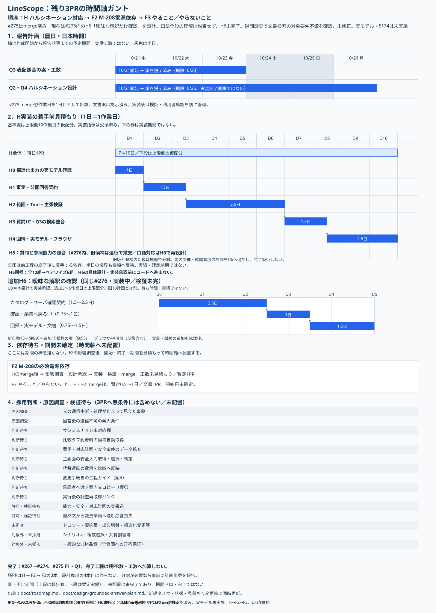

# LineScope 開発ロードマップ

仕様の正本は[文書入口](deliverables.md)で選ぶ。本書は進捗・残タスク・順序・見積もりの正本であり、業務受入の合格宣言ではない。

## 現在地・次の作業・残PR数

**#275は2026-10-21にmerge済み。残りは開発者決定の3PR：H（ハルシネーション対応）→F2（M-208電源依存）→F3（やること／やらないこと）。** 設計専用の4本目は作らず、Hの設計・承認後の実装・検証を同じPRへ積む。Hは実装指示を受けて#276で実装・限定確認済み。全件検証・CI・利用者確認は別に記録し、未確認を完了扱いしない。DB・seed・モデル設定・5173番は変更していない。

| 順序 | 業務単位 | 現在の状態・次の操作 | 依存・規模 |
|---|---|---|---|
| **1 H** | ハルシネーション対応（Q2・Q4） | #276 Draft。口語候補は回帰で退行し撤去。H6の範囲は条件付き承認、試験件数・負荷の承認待ち。口語全般の理解は約束せず、明確な照会は確認なし。「違う」は原文を残して編集へ。追加案は自動13＋評価6、総55種類で未実施 | H→F2→F3の順。H6追加3〜5作業日の暫定値（承認・CI待ち別）。開始日は未確定 |
| **2 F2** | M-208の必須電源依存・インフラ状態判定 | 未着手。Hのmerge後に影響調査・設計・工数提示、その承認後に実装 | Hのmergeが前提。暫定1PR、工数未確定。辺の追加や任意依存への変更で回避しない |
| **3 F3** | デモ・プロダクトの「やること／やらないこと」一覧 | stash保持。HとF2のmerge後に最新到達点へ照合して文書PRを作成 | H・F2のmergeが前提。暫定0.5〜1作業日。今はstashを適用・削除しない |

3PRは今回採用した計画の本数。下の未解決・未検証・判断待ちをすべて解消する保証ではない。大規模化で分割が必要なら、黙って増やさず3PR計画への影響を先に報告する。小さい文言修正ごとのPR分割もしない。

## H：ハルシネーション対応の区切り

**事実はコードが責任を持ち、LLMには解釈と整理だけをさせる。** #276で要求fieldの対応一覧、コードによる取得、事実の生成・表示を実装した。設計時の範囲ゲート、型付き事実・主張の対応検証、サーバ生成の公開文章、事実・解釈・確認不能を分けた表示を採用する。根拠ID・単語の一致、プロンプト・注意書きだけでは対策済みとしない。任意の自由文を「解釈」と名付けて無検証で公開しない。

対象解決が直っても自由回答は事実を生成することがある。消耗品の保管場所を電源R-02から断定した例と、未評価の運転可否を断定した例は、未解決の回帰記録。失敗の種類ごとに対象・言い回しを変えて評価する。質問例ごとの専用経路は作らない。

Hは中規模の見込み。7〜10日には構造化出力の読取検証、内部・公開契約、共通処理、UI・Q3、回帰を含む。レビュー・承認・CI待ちは別。モデルの既存Tool Call JSON schemaを再利用した。質問の誤分類が残るため、構造化できたことを正答保証としない。難しい場合は安全な縮退案と工数を報告し、未検証自由文へ戻さない。

## ガントチャートと時間の定義

上段は暦日の**報告計画**、下段はHの実装承認日T0を起点にした**作業日単位のガント**。縦軸は作業、横軸は時間、棒の幅は開始から終了までの期間に比例する。上段の棒は報告までの予定期間で実働工数ではない。下段は上限側10作業日の仮配分で、暦上の開始日を確定した計画ではない。

| 報告・作業 | 開始・終了／期間 | 状態・依存 |
|---|---|---|
| Q3の方針・工数報告 | 10/21開始、**10/23まで**（merge翌作業日を1日目、土日を除外） | Hへの同梱案を本設計で提示し、実装・限定確認済み |
| Q2・Q4の設計・工数報告 | 10/21開始、**10/26まで**（同じ数え方で3作業日以内） | 文書・実装・限定した実モデル確認済み |
| H0 実モデルの構造化・取得範囲確認 | T0後D1／1日 | 実装指示を受領。着手前の期間配分を残す |
| H1 内部事実・公開回答契約 | D2〜D3前半／1.5日 | H0後 |
| H2 範囲・Tool・事実・主張の共通処理 | D3後半〜D6／3.5日 | H1後 |
| H3 質問UI・根拠・Q3検索整合 | D7〜D8前半／1.5日 | H2後 |
| H4 既存回帰・実モデル・ブラウザ確認 | D8後半〜D10／2.5日 | H3後、merge前に結果・限界を報告 |
| F2 | 開始はH merge後、終了・期間未見積もり | 時間軸へ架空の棒を描かず未配置 |
| F3 | 開始はF2 merge後、暫定0.5〜1日 | F2終了未確定のため未配置 |

レビュー・承認待ちを省略して実日付へ換算しない。F2の調査後に実施日・期間・依存を見積もり、この図と表を同時更新する。未採用の残件も下表と図の未配置欄に保持する。

## 後続タスクの統合一覧

各行はタスクでありPR数ではない。H・F2・F3以外は採用判断・調査・検証の条件を満たすまで未計画で、ガントの期間を捏造しない。

| 区分 | 残タスク | 完了条件・次の判断 | 想定PR |
|---|---|---|---|
| #274 merge済み | R2・残W2：各Panelの読取・接続エラー、無効理由を平易に案内 | 原因と再試行を操作の近くへ表示。接続busy共有・製品検索等も対象を確認 | #274、完了 |
| #274 merge済み | 関連文書検索の取得時点・更新前規則 | 表示結果と検索対象・取得時点を対応付け、更新後を最新扱いしない | #274、完了。重複計上しない |
| 原因調査・未解決 | 元の通信中断／処理が止まって見えた事象 | 再発時のNetwork・時刻・request_idとAPIログを照合。最小限の診断追加は別途範囲を決める | 原因・修正範囲確定後に見積もり |
| 原因調査・未解決 | 質問の回答後も送信不可という現象 | #273の実LLM確認では未再現。再発条件を特定してから修正し、回復を検証 | 未見積もり。元の中断と同一原因とは断定しない |
| 入力補助・判断待ち | サジェスチョンの未対応欄・出ない欄 | 棚卸しから必要欄を決定。登録なし・条件不一致と取得不具合を区別 | 未見積もり |
| 読取の改善候補 | 比較タブ到着時の候補自動取得 | 明示取得の現仕様から変更するか判断。手動選択・取得済み結果を上書きしない | 未見積もり |
| データ拡充・判断待ち | 各対応案の費用・対応計画・安全条件 | 最小デモから増やす項目と比較で見せる結果を決定。JSONだけでは埋まらない未対応機能を分ける | 未見積もり。今回データ追加なし |
| 機能追加・判断待ち | 主画面の安全入力の取得・選択・判定反映 | 適用範囲・期間・選択規則を決め、入力選択を安全充足や運転許可と混同しない | 未見積もり |
| 機能追加・判断待ち | 代替運転の費用を比較へ反映 | 現実装の代替total_cost=nullから変更する業務ルール・契約・根拠を決定 | 未見積もり |
| 導線改善・案B | 変更手続きの工程ガイド | 準備済み／別担当者承認待ち／依頼者実行待ち／実行済みと例外状態を対応付ける | 未見積もり。案Aは#270で実装済み |
| 導線改善・案C | 承認者へ渡す案内文のコピー | 対象・概要・要求ID・次の担当をコピー。正式な承認根拠は保存Snapshot | 未見積もり。要求ID自体のコピーは実装済み |
| 導線改善・判断待ち | 実行後の調査再取得リンク | 要求対象と起点が一致するときだけ明示操作。不一致は案内のみ | 未見積もり |
| 未検証 | 能力・安全・対応計画／故障履歴の実書込 | 専用環境・認証・操作計画を示し、明示許可後に準備→承認→実行を確認 | 確認のみなら追加実装PR不要。不具合が出た場合は別見積もり |
| 未検証 | 自然文の質問が変更準備へ進む場合の結果不明 | 読取質問の成功と区別し、書込経路の応答喪失・復帰を確認。実施計画と許可が必要 | 必要な規約・修正範囲を確認して見積もり |
| 未監査 | ドロワー・要約帯・出典切替・構造化変更・補助操作の状態監査 | 監査対象外をOKと扱わず、必要範囲を選んで監査・確認する | 文書・確認のみなら既存工程へ記録。修正は結果次第 |
| F2・H後に調査 | M-208の必須電源依存の図示と利用可能性判定 | インフラ状態を含む影響調査・設計を先に実施。電源を任意依存にしたり、不明を利用可能へ変えたりしない | 暫定1 PR。影響調査後に分割・工数を確定 |
| 将来シナリオ・対象外 | シナリオ2、複数設備選択・共有損害、検索行の登録状況バッジ | シナリオ1の残是正とは別に要件・採用範囲を決める | 未見積もり。廃止済みデモを今回復帰しない |
| F1・#275 merge済み | 名称・コードと質問対象の解決 | 専用経路撤去、検索結果の共通ビュー、本文優先、限定検証を完了。自由回答全般の正しさとは別 | 残数0 |
| 後続タスクF3・完了待ち | デモ・プロダクトの「やること／やらないこと」一覧更新 | H・F2のmerge後にstashから最新化し文書PRを作る | 文書PR 1本。stash保持中 |
| Q1・#275 merge済み／限定検証 | 通常回答への内部UUID露出 | 取得済み名称・コードとの照合と、未解決IDが残る回答の抑止を共通経路へ追加。同PR内で回帰・実モデルの限定した確認済み。自由回答全般の正しさとは区別する | 残数0。#275へ記録 |
| Q2・Hで構造化・取得の往復を削減／検証中 | 通常質問の28 Tool・約25KBの初回入力 | #275 merge後3作業日以内に意図別の共通Tool選択・fallback・評価案と工数を報告。例別の専用分岐を増やさない | H #276に実装。実行結果と限界は履歴参照 |
| Q3・Hに同梱／限定確認済み | 左ペイン検索は第１／第一でM-204へ到達しない | #275 merge後2作業日以内に質問と検索の表記照合統一・失敗／衝突／続きの扱い・工数を報告 | H #276に実装。実行結果と限界は履歴参照 |
| Q4・Hで事実生成を実装／全体の正答保証なし | 自由回答が未評価の運転可否や未登録の保管場所を断定する | #275 merge後3作業日以内にQ2と併せて根拠付き回答の文書設計・評価案と工数を報告。質問別の専用分岐は作らない | H #276に実装。実行結果と限界は履歴参照 |
| 品質改善・対象外 | 一般的なLLM回答品質 | 対象質問と評価基準を決める。特定の読取質問成功を一般品質合格としない | 未見積もり |

## 完了した工程（残工数・PRへ加算しない）

- #267 A1、#268 A2、#269 B、#270 変更準備後の導線、#271 静的監査、#272 W1・直結W2の復帰、#273 R1・W3、#274 R2・残W2はmerge済み。
- #275 F1・Q1はmerge済み。質問専用の保全日時経路を撤去し、共通の対象優先・表記照合・検索結果ビュー・内部ID表示を限定確認。Backend CI4046成功・1 skip。一般回答の正しさを保証するものではない。
- 過去の0.5〜1日等は旧工程の事前見積もりであり、現在の残工数に流用しない。

## Hの確認状況

関連Backend 277件成功・1 skip、Frontend単体72件とlint・型・整形・build成功。実ブラウザ6項目はHTTP実接続で確認し、JavaScript例外0、書込0。運転可否の質問を下流と解釈したケースは解釈成功とはしないが、取得した登録関係と未評価を表示し運転可否を断定しない。全Backendと最新head CIの成否はPR本文・[実装記録](history/2026-10-21-grounded-answer-implementation.md)へ別記する。

## 判断待ちと保護中の作業

実書込の検証は、専用環境・認証・操作を示した明示許可後のみ。元の通信中断原因は未特定で、推測によるタイムアウトの追加をしない。再発時のNetwork・時刻・request_idとAPIログを照合する。能力・安全・対応計画の実書込は経済入力の通し確認とは別。

F3用stash `c48d3e3345d1ea1600cc2e98a0a309a379e336c8` は保持。その他stashも削除しない。5173・5174番、DB・volume・seed・モデル設定をこの文書工程で変更しない。

## 関連文書

- [ハルシネーション対応の設計・実装計画](design/grounded-answer-plan.md)
- [Agent設計の根拠付き回答方針](design/agent-design.md#根拠付き回答の設計方針)
- [過去4点の対応・比較測定](history/2026-10-21-pr275-review-checks.md)
- [検索結果の共通ビューの修正・検証](history/2026-10-21-equipment-lookup-summary.md)
- [旧UI是正計画](design/post265-ui-correction-plan.md)
- [履歴一覧](history/README.md)

## H5：利用者確認で判明した範囲ゲートの不足

#276の追加修正。交換部品の保管場所に上流到達0件を返す事象を受け、質問とfieldの意味の照合を取得前に追加する。範囲ゲートの実装と、質問への正答を混同していた区切りを訂正する。実装・追加回帰を終え、実ブラウザ8項目成功・実PG関連250件成功。実装head eb6fba4のCI全成功（Backend4066成功・1 skip）。利用者確認待ち。旧headのCI成功を、この修正の検証成功としない。限定試行で成立しない場合は広げず報告する。Hのmerge前に確認し、F2・F3の開始条件と残PR3本は変えない。

H5の回帰確認：保証期間の例を追加し、自動20＋ブラウザ8の計28種類。保証のデータ項目はなく、未確認を自然に伝える共通表示を修正する。CIで判明した試験用LLMの照合対応漏れも同じPRで修正し、既存の保全記録ページングassertを維持して実PGで確認する。新しい後続PRや保証機能は追加しない。

## H5内の追加是正：呼び名の照合と返答を復帰

同じ#276。質問内容を答えられないとき、呼び名の照合まで止めた退行を是正する。名前・コードの識別だけは既存Readで行い、実登録名を自然に返す。通常表示から内部の抽出・解釈の説明を詳細へ移し、確認操作は増やさない。実装・実ブラウザ8項目・実PG関連250件・Frontend72件とcheckを確認。追加のテスト種類は増やさず、既存ケースの境界を「識別以外の情報を取得・公開しない」に更新した。修正後CI・利用者確認待ち。PR数とH→F2→F3の順序は変えない。

## H5内：問いへの回答を目的とする再整合

#276内。設備の識別は問いへの回答とは別であり、検索で得た種類・有効フラグ・版の一覧を、保証等への回答に代用しない。明示した登録属性だけを表示し、識別しか得られなければ確認不能を併記する。既存の正常質問と未取得の限定を保持して回帰確認する。目的を制約へ置き換えない手順とケーススタディを記録する。工期は追加実測中で未確定。PR数はH・F2・F3の3本を維持し、F2・F3へは進まない。

## H5内：口語を登録情報へ対応付ける是正

同じ#276。状態の質問をDBレコード有効フラグへ誤分類した事象を再現した。最初の分類と二段目の照合で参照能力の意味を共有し、口語を字面だけで拒否しない。ただし運転許可・安全保証や非対応情報へ読み替えない。平叙／口語／比喩×名称／コード×登録状態／非対応の全12組を、全因子対を覆う6組へ絞って実モデルで追加評価した。候補は4成功・2失敗のため未採用。検証を緩めず、直前の実装へ復帰。同条件の旧版は状態0/3・非対応3/3成功、候補は状態3/3・非対応1/3成功。退行のため候補を撤去し、同じ#276で方式の再検討が必要。既存の30種類は維持し、合計36種類（自動22＋ブラウザ14）。追加工期は実測中。H→F2→F3とPR数は維持する。

## H6：曖昧な解釈の確認（方針採用・具体設計／実装承認待ち）

同じ#276。確認は解釈が曖昧な場合だけとし、口語の全てには挟まない。口語全般の理解は約束しない。[具体設計§13](design/grounded-answer-plan.md#13-h6曖昧な解釈の確認採用方針実装承認待ち)に、コードが全文と定義を対応付けられない条件等の「曖昧」、確認なしの範囲、「違う」の後に原文を残して編集へ戻る動作、確認頻度の評価を記載する。単語別ルートやembeddingは増やさない。active等は通常分類から外し、直接Read・技術情報は維持する。

現行APIに確認項目がないため、POST /agentへ任意項目・応答を追加する案。新HTTP経路・永続DB・認可変更はなし。確認は明示的に選んだReadとして処理し、元の問い全体への正答や業務承認に変換しない。

追加の暫定見積もりは3〜5作業日：カタログ／サーバ1.5〜2.5、UI0.75〜1、回帰・実モデル・文書0.75〜1.5。実装・検証14〜18ファイル程度（文書別）。旧H全体の7〜10日内という意味ではない。ガントでは別の承認起点U0から、上限5日の棒を配置する。暦日・実績は未確定。H→F2→F3の3PRを維持する。

試験案は既存36種類を残し、新自動13＋ホールドアウト6で総55種類。実モデルの調整6＋評価6を各3回、既存ブラウザ8項目を1回で44項目実行。追加試験の件数・負荷の承認を得るまで、コード・環境・試験実行へ進まない。口語全体の確認率上限は実測後にPOが判断する。

**H総量：H0〜H5の実装・限定検証は実施済み（実働未計測、口語候補は撤去）＋残H6は3〜5作業日＋承認・CI・確認待ち。旧7〜10日との計画合算は10〜15日で実績ではない。F2はH merge後、F3はF2 merge後。F2未見積もりのため暦日開始は未定。**

試験対応・重複・字義構文の擬似コードは[設計§13.8〜13.10](design/grounded-answer-plan.md#138-実装前の試験対応表重複承認対象)。用語定義の正常系不足により、自動12→13件を提案した。未承認の試験追加・実行は行わない。
