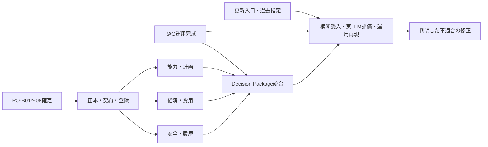

# LineScope バックエンド完走ロードマップ

この文書は現在地・残作業・見積もりを管理する計画であり、業務仕様の正本ではない。仕様の入口は[deliverables](deliverables.md)。過去の見積もりは[調査履歴](history/2026-10-14-backend-remaining-work.md)に残し、今後の計画は本書を更新する。

調査基準はmain `428378c`（#214までmerge済み）。実Vector検索の[PR #214](https://github.com/philippos2/line-scope/pull/214) `f4bb990`についても、実装・CI・curl疎通確認済みの範囲を記録する。

## 現在地

入力から出力までの最小経路は通っている。全機能の完成を待つ段階には戻らず、この経路へ大きな業務機能を加え、内部の仮実装を順に置き換える。

| 業務上の到達点 | 状態・根拠 | まだ保証していないこと |
|---|---|---|
| 設備状態・保全/生産情報を認証済みAPIから読む | 実PGのRead ToolとAgent/APIの試験あり | あらゆる日本語の対象解決・説明品質 |
| 依存Graphを探索し、経路と不完全性を返す | 実Neo4j、CURRENT gate、Graph API試験あり | 到達することが操業停止・能力不足・損失を意味するという判断 |
| 分析→Prepare→別ActorのApproval→requesterのExecute→更新後確認 | `verify_minimal_flow.py`で実curl/PG/Neo4j疎通成功（#212） | 比較部分はmock。BS-G01全体の受入ではない |
| 保全予定/実績CREATE・設備割当・依存関係の変更を入口から確定する | #209〜211のcommand→API→Approval/Execute試験 | 全カテゴリの複数Target・過去指定・確認継続の一括受入 |
| 文書を取り込み、検索し、正本を確認した抜粋と引用を返す | #213でmock検索の経路接続。#214で実Embedding/Qdrantのcurl疎通・版更新・障害時の拒否を確認 | Index再構築/切替、検索品質、実LLMのgrounding受入 |
| 影響・費用・能力・対応案を一画面分のDecision Packageとして返す | #208の固定M-204経路が接続済み | 費用等はstatic mock。能力/経済/安全の正本、計算・比較・許容判定は未実装 |
| 故障時に影響・損失・対応策を比較して判断材料を出す | 経路と仮置き結果がある | Goldenの意味論的API受入と実LLM品質の合格は未完了 |

**工数ベースの進捗率は未算定。** 過去の8〜9割という報告は使用しない。履歴の30〜50%も低確度の当時の推定であり、実測率ではない。新しいPR数やテスト件数から割合を作らず、上表の業務到達点と下表の残件で判断する。

## 完走の二つの到達点

1. **最小完成形の拡充**: Goldenの入力→影響→数量/費用→対応比較→Evidence→明示的Prepare→Approval/Execute→更新後確認を一本のAPI経路で利用できる。仮置き入力・内部mockは表示して区別する。計算自体は決定論的に実装する。mockを実データや正式な安全判断として扱わない。
2. **業務要件のバックエンド受入**: PO判断を反映した正本・権限・契約で仮置きを置換し、BS-01〜19/G01、重大Invariant、実LLM評価、運用再現を確認する。

最初の到達点で利用可能な経路を先に作る。二つ目の残件を隠して「完成」と報告しない。実装が一段落した際は、その到達範囲と残件を添えて「バックエンドの実装が一段落しました（終わったとは言っていない）」と報告する。

## 残り工数とPR見積もり

現方針の大きな業務単位で、**計画15〜24 PR、受入で判明する修正予備3〜6 PR、合計18〜30 PR程度**。このroadmapの文書PR、#214、Frontend、動画、FAQ、任意の全面refactoringは含めない。業務仕様の追加やPO判断の結果によって上限を超え得る。

工数は下表の**標準作業単位24〜42＋修正予備3〜9＝27〜51単位**を暫定値とする。1単位は、確定済み契約に沿う一つの入口→処理→結果を、実装・対応検証・レビューまで通す基本作業の相対量。大きなPRは複数単位を含み得る。人時/人日への換算実測はなく、日数や納期に換算しない。単位・PRの消化数をプロダクト進捗率には使用しない。

| ID | 残る変更と完了条件 | 主な依存・受入 | 概算PR | 相対工数 |
|---|---|---|---:|---:|
| K | active正本からIndex再構築→検証→collection切替。版変更を再確認し、障害/途中失敗/モデル更新/残存物の管理を検証。取込み・検索を運用可能にする | rag-design §8、AC-R01〜03、既存の実Vector経路 | 2〜3 | 3〜5 |
| W | 全カテゴリの複数Target・対象確認継続・要求置換を公開入口から受入。明示過去時点を受付/伝播し、完全point-in-time復元と誤説明しない | UC-11/13〜15、UC-B14/16/17。ReadAgentは現時点でtop-level過去指定を拒否 | 2〜3 | 2〜4 |
| B1 | PO-B01〜08の意味・結果契約を確定し、新入力の正本と登録/閲覧/承認を接続。業務仕様改訂は機能PRと区別し、必要なDB/Core/Snapshot/更新契約を対応 | requirements §14.3、access-control。新しい情報を既存Graph権限で勝手に許可しない | 2〜3 | 3〜5 |
| B2 | 製品別能力・必要量・空き能力・不足・代替互換性・buffer/復旧期限を、入力→決定論的評価→Evidenceまで接続 | PO-B03/07、UC-B02/03/11、BS-05/06/13 | 2〜3 | 4〜6 |
| B3 | 損失率/稼働calendar/期間/通貨/独立加算/二重計上防止、subtotal、修理交換費/停止損失/継続費用の比較を接続 | PO-B01/02/05/07、UC-B05〜09、BS-02/03/07/09/10/16 | 2〜3 | 4〜6 |
| B4 | 安全Hard Constraint・6リスク次元・故障/修理/停止損失履歴を接続し、修理/交換/継続/代替のDecision Packageへ統合。根拠・unknown・除外理由を保持 | PO-B04/05/06/07/08、UC-B04/08〜10/12/13/15、BS-04/08/11/12/15/G01 | 2〜4 | 4〜8 |
| V | Goldenと全Business Scenarioの意味論的API受入、LLM回答の根拠拘束、実LLM/検索datasetの評価と失敗回帰、clean clone・backup/restore/DEAD管理の再現、README/APIガイド整理 | evals/test-plan/business-scenarios/operations。Mock合格を正式受入にしない | 3〜5 | 4〜8 |
| 計画合計 | 上記の実装と各行の対応検証 | 既存の正しい部品・試験を再利用 | **15〜24** | **24〜42** |
| 修正予備 | 横断受入で判明する仕様不適合・誤配線・境界の修正 | 未発見項目への予備。消化を目的にしない | **3〜6** | **3〜9** |
| 総計 | PO意味確定と現在のスコープを前提とする | **低確度の計画値** | **18〜30** | **27〜51** |

各PRは一つの業務経路を入力から出力まで検証できる範囲とする。Adapter・DTO・helperだけを独立した進捗に数えず、内部mockを許容して機能を先に接続する。安全境界の変更が広すぎる場合はレビュー可能な単位へ分割する。

旧履歴の26〜44 PRとの差は、入口接続/RAGの実装が進んだことと、部品単位から大きな業務単位へ計画を組み替えたことによる。**PR数が減ったことを同量の工数削減・要件削減・進捗率上昇とは扱わない。** 相対工数も実績で校正していない初期値であり、次の業務経路の実測結果で更新する。

## 日付を使わないガントチャート

横軸は今後のPR枠。1枠=1 PRの上限寄りの割当で、日数ではない。█は計画、░は修正予備、·は割当なし。各群の下限/上限は上表を正とする。単一の実装経路を順に進める配置例であり、並行可能な確認や既存mockによる先行接続は前倒しできる。PO判断待ちの時間は枠に含めていない。

```text
PR枠   123456789012345678901234567890
K      ███···························  RAG再構築・切替
W      ···███························  更新入口・過去指定
B1     ······███·····················  PO契約・正本・登録
B2     ·········███··················  能力・計画
B3     ············███···············  経済・対応費用
B4     ···············████···········  安全・履歴・比較統合
V      ···················█████······  横断受入・評価・運用
予備   ························░░░░░░  判明した修正のみ
```

依存関係は次のとおり。PO未決定中でも、明示したfixture/mockを使って先行接続できる。正式な正本・権限・安全判断へ昇格させるにはPO確定が必要。



## 次に行うこと

1. #214の実検索を基準に、RAG再構築/切替と旧active文書の再投入を実運用経路として仕上げる。
2. 固定fixtureで数量・費用を決定論的に計算し、実Graph/文書根拠と対応比較を同じDecision Packageへ接続する。静的な結果mockを実計算へ置き換え、入力fixtureは明示する。
3. 能力・安全・履歴の大きな部品を同じ入力→出力へ順次接続する。B1のPO判断が確定した範囲から正本へ置換する。未決定事項は推測しない。
4. 各業務経路がつながった時点で対応Scenarioを実APIで受入し、最終的にGoldenと実LLM評価・運用確認を通す。

K/W/B/Vを必ず全て順番どおり完了させてから統合するという意味ではない。利用可能な最小経路へ必要な部品を加える。

## 未決定・未検証・見積もりリスク

- PO-B01〜08はrequirements §14.3で未決定。費用/calendar、能力/需要、安全、計画/予約、履歴、新データ権限、Infrastructureの意味は実装者が補完しない。本書で決定し直さない。
- 自由な日本語・実chat LLMのTool選択/引数/説明・RAG Injection/groundingの受入は未完了。一般ReadAgentはTool結果の存在確認後に`reply.content`をそのまま返しており、回答本文とEvidenceの事実一致を強制する境界は未実装（`agent/read_agent.py`）。Vの修正・評価に含め、実LLM受入の前に扱う。
- `verify_minimal_flow.py`/`verify_knowledge_flow.py`/`verify_vector_knowledge_flow.py`のPASSは、それぞれの固定経路の合格。Golden全体の合格ではない。
- UI、FAQ、動画、原材料/在庫/調達の拡張はこのバックエンド残工数に含めない。BackendからFrontendへ進む判断と、製品全体の完成を分ける。
- 未決定の契約が大きくなる、モデル品質や障害受入で不適合が出る場合は、予備枠を超えて再見積もりする。数値を維持するために要件や安全試験を削らない。

## 更新方法

業務到達点が変わった区切りで、確認済み入出力・残るmock/未実装/未検証・次の依存・残PR/工数を更新する。十数PRのmerge後を再評価の目安とし、重大な未定義や不適合が判明した場合は待たずに更新する。将来の計画と過去の調査履歴を混同しない。
